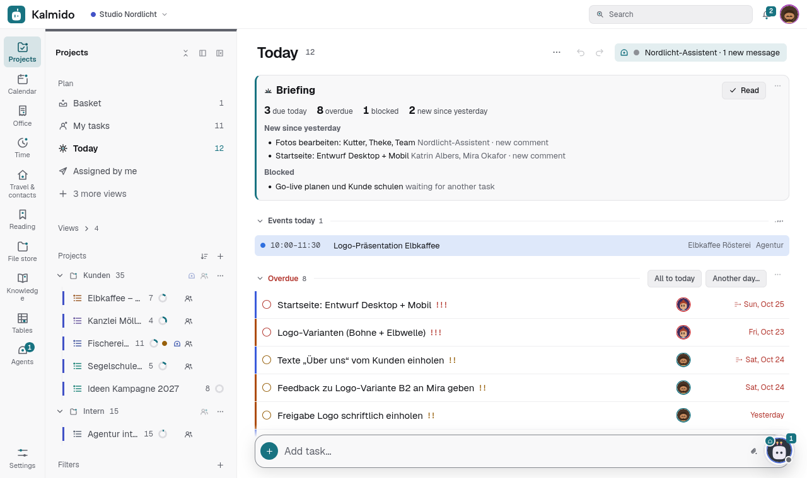
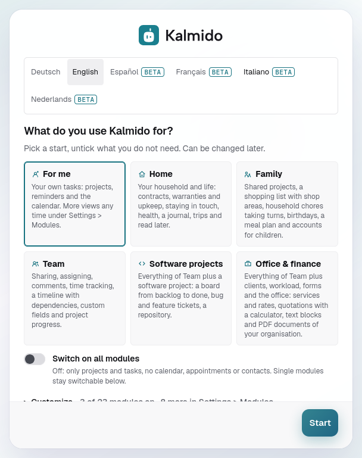
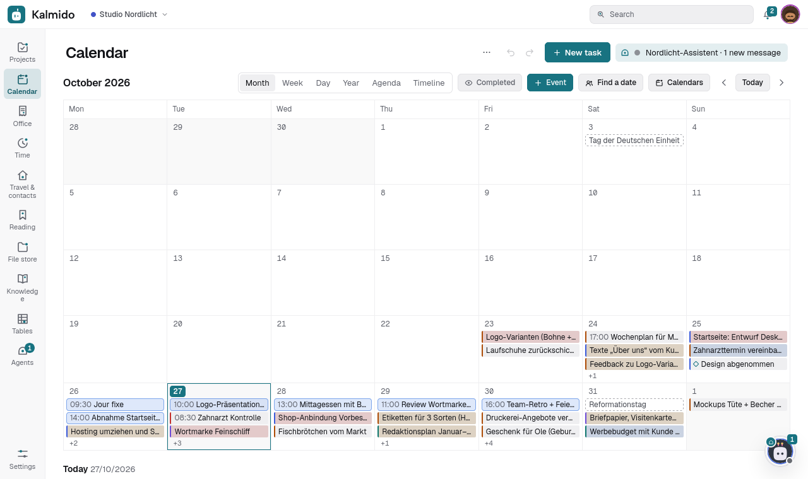
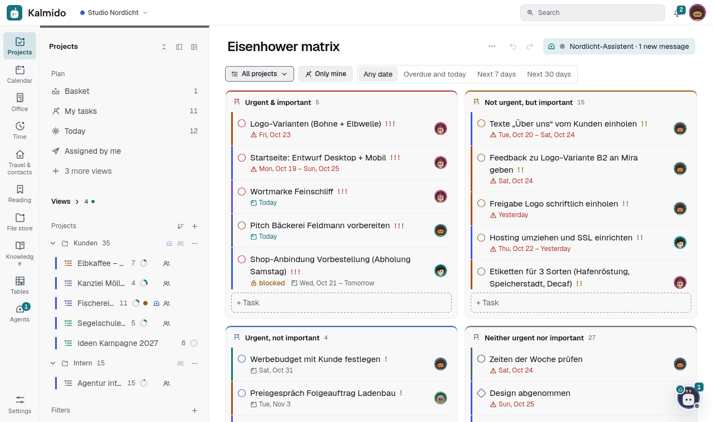
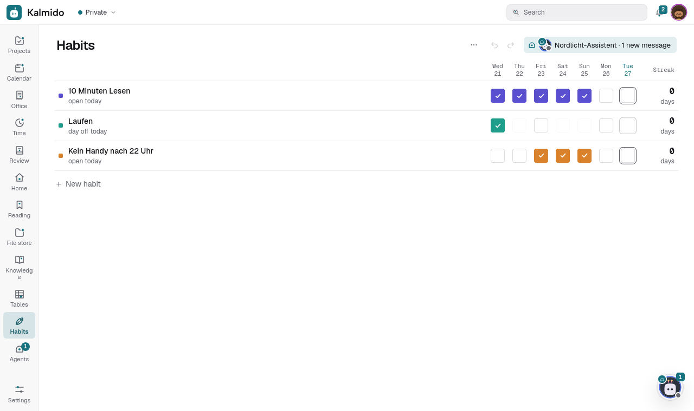
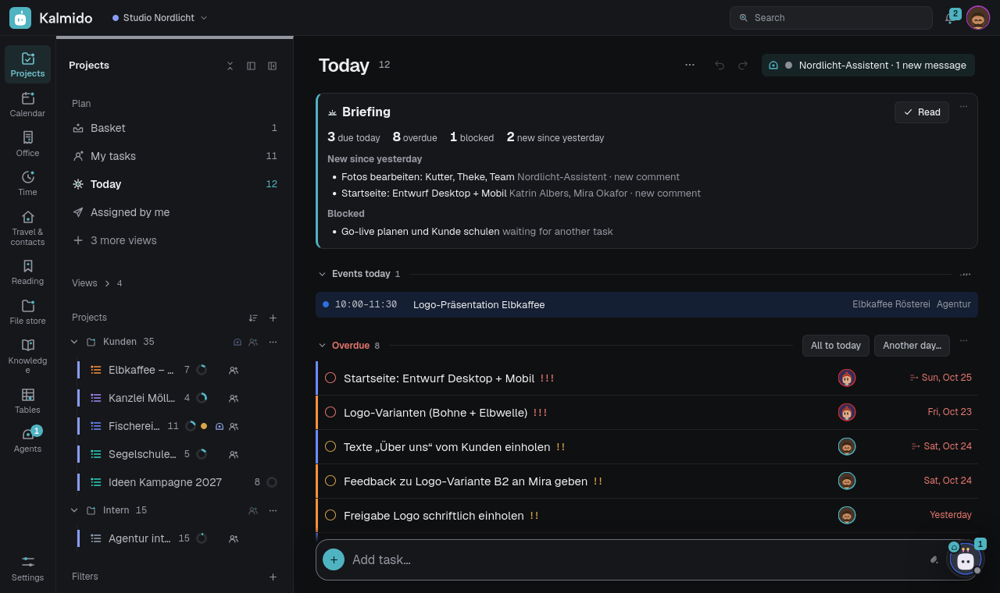
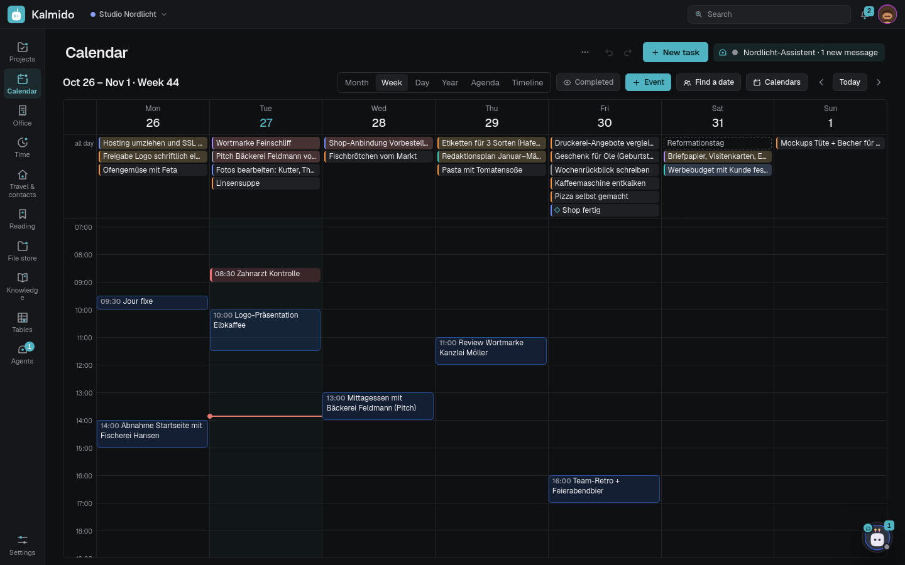
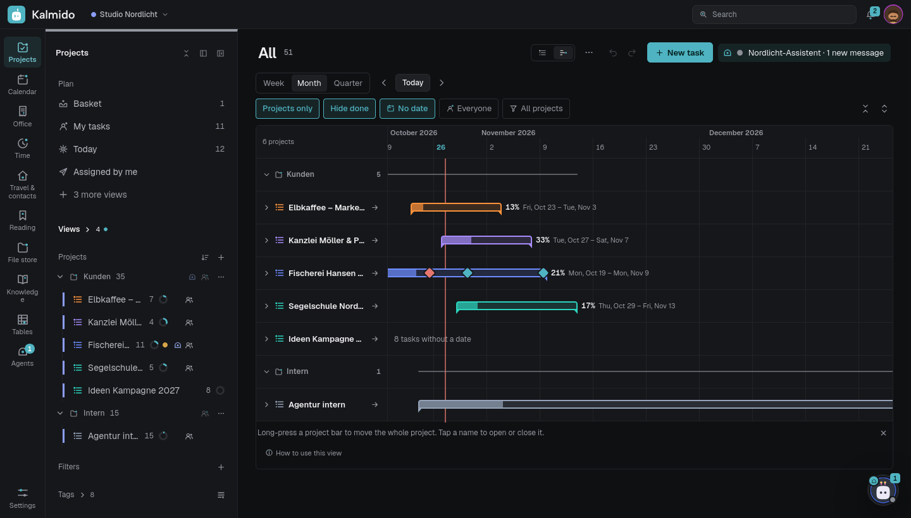
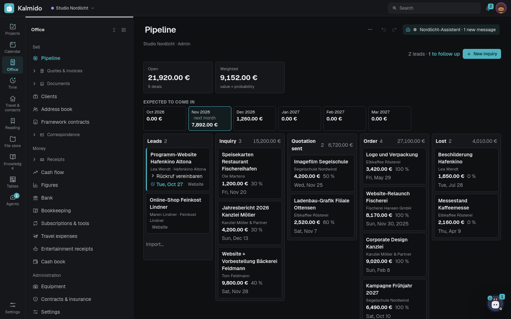
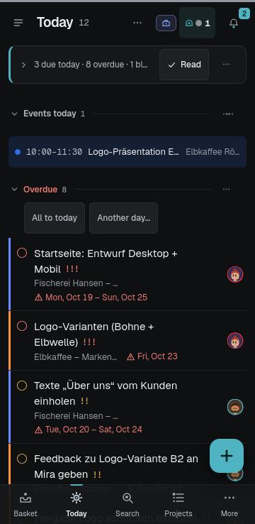

<p align="center"></p>

<h1 align="center">Kalmido</h1>

<p align="center"><b>You plan. Kalmido pitches in.</b><br>Tasks, team and office in one app for freelancers and teams: lists, calendar, projects, time tracking, quotes and e-invoices, receipts and bank, docs and wiki, plus AI agents that only act with your approval. Self-hosted with Docker, free for any number of people. AGPL-3.0.</p>

<p align="center"><a href="https://kalmido.com"><b>kalmido.com</b></a> · <a href="#quick-start">Quick start</a> · <a href="#updating">Updating</a> · <a href="TRANSLATING.md">Translate</a> · <a href="CHANGELOG.md">Changelog</a></p>

<p align="center"><a href="https://github.com/Gegenschuss/kalmido/releases/latest"></a> <a href="https://github.com/Gegenschuss/kalmido/actions/workflows/ci.yml"></a> <a href="LICENSE"></a></p>

<p align="center"></p>

<p align="center"><b><a href="https://kalmido.com/demo/">Try it in your browser</a></b>: no account, no server, your data stays in your browser.</p>

<p align="center"><b>Coming soon: Kalmido hosted.</b> No server of your own, we run it for you, on servers in Germany and GDPR-compliant. Self-hosting stays free.</p>

> **Language:** the interface is **English** by default, with **German** included and **French, Spanish, Italian and Dutch** in beta (machine-translated, corrections welcome); switch under *Settings > General > Language*. More languages are welcome, see [CONTRIBUTING.md](CONTRIBUTING.md#translations) and [TRANSLATING.md](TRANSLATING.md). Kalmido = calm + the Japanese -do (道, “the way”, as in aikido or judo): the calm way of getting things done.
> Kalmido is an independent project and not affiliated with or endorsed by any of the products or companies named here; their names are trademarks of their respective owners and are used only to describe compatibility (import, calendar, export, agents).

## What's new

**2.560.0** (2026-11-05):
- **Agents**: server agents run on the Kalmido server with your own API key (#4670); the data lock also covers Calendar and Contacts.
- **Knowledge**: one editor on CodeMirror 6, Markdown marks only at the cursor (#4052).
- **Wide screens**: tile grids and list and detail side by side (#4552, #4553).
- **For everyone**: a "New for you" dialog after updates (switch in Settings > Help).

Full history: [CHANGELOG.md](CHANGELOG.md).

## Why Kalmido

- **Free for everyone in the house or team.** No per-seat subscription, unlimited users, projects and tasks, and everyone you share a project with works in it for free.
- **One app instead of three.** Tasks, habits, focus timer and real time tracking with rates and timesheets, plus the team essentials: sharing, assignment, comments, activity, a News inbox, dependencies, project status and custom fields.
- **Simple when you want it.** Switch *Collaboration* off and it is a quiet personal project again.
- **Yours.** Runs on your own server, no vendor account, no telemetry (the update check asks GitHub for the latest version every 6 hours and can be switched off; everything else that leaves your server is listed in docs/SELF-HOSTING.md, Outgoing connections), open source under the AGPL-3.0. Fits a self-hosted setup: single sign-on through your proxy, Web Push or ntfy notifications, a calendar feed.
- **Honest trade-offs.** No native apps or widgets (it is an installable web app), no location-based reminders, and no support desk yet.

## Try it without installing

[kalmido.com/demo](https://kalmido.com/demo/) runs the real app in your browser with sample data in your language (a
client website project with sections, tickets, milestones, time entries and dependencies, a personal project, and a
simulated agent that waits for your approval). There is no server behind it: an in-browser stand-in for the API keeps
everything in your browser's storage, the page's Content-Security-Policy forbids every network connection
(`connect-src 'none'`), and there is no analytics. *Reset demo* brings the sample back. Features that need a server
(push notifications, CalDAV, calendar subscriptions, real agents, Git, webhooks, OIDC, more users) show a
short notice with the way to install.

The demo is built from the current sources by `python3 tools/build_demo.py [out_dir]` (static files only; serve the
folder with any web server, e.g. `python3 -m http.server` in it). CI builds it and opens it in jsdom
(`tests/demo_test.js`) so it cannot drift from the app.

## Quick start

Requirements: Docker with Compose on a 64-bit system (linux/amd64 or linux/arm64, also macOS and Windows with Docker
Desktop). Without the virus scanner **1 GB RAM** (about 250 MB idle); with it (the default of the installer and of
`.env.example`, `COMPOSE_PROFILES=localdb,clamav`) about **2.5 GB**, and the first start can take up to 5 minutes. On a
small server remove `clamav` from `COMPOSE_PROFILES` and set `KALMIDO_CLAMD=` empty. Details and disk, CPU and Raspberry
Pi advice: [docs/SELF-HOSTING.md](docs/SELF-HOSTING.md#requirements).

**Installer** (macOS, Linux; Windows: `irm https://kalmido.com/install.ps1 | iex`): downloads the latest release,
uses the prebuilt image (or builds it locally if that is not possible) and starts it on `http://localhost:3040`.
kalmido.com/install.sh (and `.ps1`) forwards to the installer of the latest GitHub release; it pins the prebuilt image
to the release's digest (checked against `SHA256SUMS`) and checks the source archive against `SHA256SUMS` when it downloads it without git; with git the tag is fetched from GitHub over HTTPS. If the checksum list of a release cannot be fetched, it stops.
It never uses sudo, writes an `update.sh` into the install folder (`~/kalmido`) and shows the one-time **setup
code** for the first account at the end. The scripts are in this repository: [install.sh](install.sh),
[install.ps1](install.ps1).

```sh
curl -fsSL https://kalmido.com/install.sh | sh
```

If the port is busy, the installer prints the command to retry with another one, e.g. `KALMIDO_PORT=3050 ./update.sh` (or `curl ... | KALMIDO_PORT=3050 sh`); `PUBLIC_URL` follows while it is still `http://localhost:<port>`.

**Uninstall:** `docker compose --profile '*' down -v`, `docker image rm <image> postgres:17 clamav/clamav:1.4`, then `sudo rm -rf` the folder (the database files belong to the container's user). Copy `data/backups/` and `secret/kalmido.key` first if you want them.

The same without the website:

```sh
curl -fsSL https://github.com/Gegenschuss/kalmido/releases/latest/download/install.sh | sh
```

`KALMIDO_URL=https://... ` in front of `sh` sets `PUBLIC_URL`; on a server over SSH the installer prints the tunnel command
(see docs/SELF-HOSTING.md, "From localhost to your own address").

<details>
<summary><b>Install by hand (git clone, or the prebuilt image)</b></summary>

**By hand:**

```sh
git clone https://github.com/Gegenschuss/kalmido.git
cd kalmido
git checkout "$(curl -fsSI -o /dev/null -w '%{redirect_url}' https://github.com/Gegenschuss/kalmido/releases/latest | sed 's#.*/##')"   # the latest release (same as the installer)
cp .env.example .env        # set TZ, PUBLIC_URL and POSTGRES_PASSWORD at least
mkdir -p data secret        # create them yourself, so the container (user 1000) may write them
docker compose up -d --build
docker compose logs kalmido | grep "Setup code"
```

Instead of building, you can use the prebuilt image (linux/amd64 and linux/arm64): put
`KALMIDO_IMAGE=ghcr.io/gegenschuss/kalmido:X.Y.Z` into `.env` (X.Y.Z = the release you checked out, `git describe
--tags` without the `v`), then `docker compose pull && docker compose up -d`. On Linux with a user other than 1000,
give the folders to the container's user (`sudo chown 1000:1000 data secret`). The image runs as uid 1000 and read-only:
[docs/SELF-HOSTING.md](docs/SELF-HOSTING.md) *User and read-only image*.

</details>

Kalmido now listens on `http://127.0.0.1:3040`. The database runs in the `db` service (PostgreSQL 17, files in
`./pgdata`), attachments and backups live in `./data`, the server key in `./secret` (see below).
`docker compose ps` shows the service as *healthy* once it answers (`/api/health`).

<details>
<summary><b>First start: setup code, presets, sample project</b></summary>

Open it: the first start shows a **setup page** that creates the first account (the admin). It asks for the
**one-time setup code** that only the server's log shows (`docker compose logs kalmido`, a framed block *Kalmido first
setup*), so nobody else who reaches a fresh server first can make themselves its admin. The code works once; a
restart prints a new one; wrong codes are rate limited like logins. For tests and automation only:
`KALMIDO_SETUP_CODE=<fixed code>` or `KALMIDO_SETUP_CODE=off` in `.env`. A second step asks **what you want to use**, with six starting points:

| Card | For | On |
|---|---|---|
| **For me** (preselected) | your own tasks | projects, reminders, the calendar, events and contacts; more views any time under *Settings > Modules* |
| **Home** | your household and life | adds contracts, warranties and upkeep, staying in touch, health, a journal, trips, read later and the review of your day and week |
| **Family** | a family | shared projects, a shopping list with shop areas, household chores taking turns, birthdays, a meal plan and accounts for children |
| **Team** | small teams, for example an agency | sharing, assigning, comments, time tracking, a timeline with dependencies, custom fields, project progress and agents |
| **Software projects** | a software team | everything of Team plus a software project: a board from backlog to done, bug and feature tickets, a repository |
| **Office & finance** | a business | everything of Team plus clients, workload, forms and the office: services and rates, quotations with a calculator, text blocks and PDF documents |

Under *Customize…* below the cards you can switch single modules on or off (the matching card stays highlighted),
and pick the language; *Start* stays in view. The modules become the default for new users; collaboration and time tracking are switches for the whole
server. The welcome tour and the *Getting started* project only mention modules that are on. All of it can be changed
later in *Settings*.

Below that, one question: **Start with**: *Empty*, the *Sample project*, or a project of the type *Agency*,
*Software / AI dev* or *Personal* (sections, fields and settings for that kind of work; picking one switches the
modules it needs on). More projects any time: *Projects > + > New project*.

**Sample project.** *Sample project* under *Start with* and on the first card of every new account's welcome tour
(ticked when the project modules are on) adds a realistic example in the user's
language: *Example: Image film for client Muster* with the phases Concept, Pre-production, Shoot, Edit and Approval,
about fifteen tasks around today (overdue, today, next week, undated) with start dates for the timeline, dependencies
for *Flow* and *Now doable*, all four matrix quadrants, subtasks, a Markdown checklist, tags, a weekly status call, a
comment, custom fields, a time entry and a project status, plus the project *Example: Shoot day packing list* (completed
items at the bottom). It only
uses the modules that are on, stays private and quiet (no reminders, pushes, News or webhooks, not in the daily
digest). *Settings > Data > Sample project* creates it again or removes exactly what it created: sample tasks go even
if you edited them, tasks you added yourself stay, and so does their project.

<p align="center"></p>

</details>

> [!IMPORTANT]
> Use HTTPS (a reverse proxy) for anything beyond your own machine: the login sends your password and
> the session cookie is only marked `Secure` behind HTTPS.

**Server key and backups (2.45.0).** Without `KALMIDO_SECRET_KEY` in `.env` the server creates its key on the first
start in `./secret/kalmido.key` (mode 0600) and keeps using it; a key in `.env` always wins. It encrypts stored tokens
and the organisation data, and it is deliberately **not** in `./data`, so a backup never carries the key next to the
data it protects: keep a copy of the file somewhere safe (a password manager). Without any key, *Settings > Server >
Server* shows a warning. A new server makes an **automatic backup every day** (03:30, 14 daily and 8 weekly kept, in
`./data/backups`; *Settings > Organisation > Data > Backups*); copy that folder to another disk too. The backup page warns when the
disk has room for fewer than three more archives; set a passphrase (see `docs/SELF-HOSTING.md`, "Disk space and passphrase").

The server remembers the fingerprint of its key: a different key than before does not start (`KALMIDO_SECRET_KEY_CHANGED=1` for a wanted change, then rewrap; see docs/SELF-HOSTING.md).

## Features

Kalmido is built from modules: switch on what you need under *Settings > Modules*, the rest stays out of sight. A short
overview per area; every single feature is in the [full feature list](docs/FEATURES.md).

**Your own work**: tasks, planning and time, in one place.
- Projects with folders, sections and Kanban columns, subtasks, priorities, tags, Markdown notes, attachments, drag and drop everywhere (also on touch)
- Quick add in plain language (`Dentist tomorrow 3pm !high #private ~Work`) and quick capture from anywhere
- Recurring tasks, reminders up to a year ahead, deadlines with a countdown, *Plan my day* between your appointments
- Calendar, Gantt timeline, roadmap, Eisenhower matrix, Kanban with WIP limits, sprints and burndown
- Habits, a Pomodoro timer, time tracking with rates and a printable timesheet, templates, undo and redo, a trash with restore

More: [docs/TASKS.md](docs/TASKS.md), [docs/FEATURES.md](docs/FEATURES.md)

**Together**: share work with people, groups and clients.
- Projects and folders shared as admin, member, participant or viewer; tasks assigned to people or groups; public links
- Comments with @mentions and files, reactions, an activity history, a News inbox and bundled push notifications
- A private space for everybody plus organisations with invitations; clients, workload, approvals and forms for small teams
- Team chat: direct messages and a channel per shared project, agents included

More: [docs/TEAM.md](docs/TEAM.md)

**Home and family**: private life next to work, kept apart.
- Family: birthdays, chores that take turns, children, shopping lists, a meal plan and packing lists
- Home & life: contracts and subscriptions, home and devices, health, journal, travel and budget
- Reading: read later, feeds and bookmarks per workspace

More: [docs/HOME.md](docs/HOME.md), [docs/BUDGET.md](docs/BUDGET.md), [docs/FEEDS.md](docs/FEEDS.md), [docs/BOOKMARKS.md](docs/BOOKMARKS.md)

**Office, files and knowledge**: the paperwork of a small business.
- Quotes and invoices with PDFs, e-invoices, receipts, letters on your own letterhead, bank import and DATEV export
- Files and documents for you and each organisation, with versions, a trash and sharing
- Knowledge pages with a mind map (also offline), formulas and Mermaid diagrams, plus tables
- Your own calendars and address books, synced with the phone's apps

More: [docs/OFFICE.md](docs/OFFICE.md), [docs/FILES.md](docs/FILES.md), [docs/WIKI.md](docs/WIKI.md), [docs/SHEETS.md](docs/SHEETS.md), [docs/CALENDAR.md](docs/CALENDAR.md)

**AI agents**: they act only with your approval.
- Claude Code, Codex, n8n, a local model or your own script as a team member of type *Agent* with its own token and an on/off switch
- Control levels, approval cards for one-way steps, permissions per agent, data the agent never sees, usage limits and an activity log
- Signed webhooks or long-polling, a chat panel per agent, an MCP server and a setup guide
- An optional built-in assistant, and git integration (GitHub, GitLab, Gitea / Forgejo, Bitbucket Cloud) with hand-off of a ticket to a coding agent

More: [docs/AGENTS.md](docs/AGENTS.md), [docs/AGENT-SETUP.md](docs/AGENT-SETUP.md), [docs/AGENT-SECURITY.md](docs/AGENT-SECURITY.md), [docs/ASSISTANT.md](docs/ASSISTANT.md), [docs/GIT.md](docs/GIT.md)

**Connect and run**: self-hosted, open and portable.
- An installable web app (PWA) for phone and desktop that works offline and syncs later
- Notifications by Web Push or ntfy, plus Slack, Matrix, Telegram or Signal
- Import from Todoist, Trello, Asana, Microsoft To Do, TickTick, Notion, Google Tasks, ClickUp, Jira, CSV, Markdown and ICS; tasks by e-mail
- REST API and webhooks (OpenAPI 3.1), CalDAV both ways, single sign-on through your proxy or OpenID Connect, two-factor and passkeys
- Automatic daily backups, English and German with four more languages in beta, dark or light, aims at WCAG 2.2 AA

More: [docs/SELF-HOSTING.md](docs/SELF-HOSTING.md), [docs/API.md](docs/API.md), [docs/IMPORT.md](docs/IMPORT.md), [docs/NOTIFICATIONS.md](docs/NOTIFICATIONS.md), [docs/OIDC.md](docs/OIDC.md), [docs/ABOUT.md](docs/ABOUT.md)

| | | |
|---|---|---|
|  |  |  |
| Calendar | Eisenhower matrix | Habits |

### Dark mode

Every view also comes in a dark design: *Settings > Appearance > Color scheme* (Automatic follows your system).
The pictures on this page show the light design; here are a few views in dark.

| | | |
|---|---|---|
|  |  |  |
| Today | Calendar | Roadmap |

<p align="center"> </p>

## Updating

Every release is listed in [CHANGELOG.md](CHANGELOG.md)
and on the [releases page](https://github.com/Gegenschuss/kalmido/releases). *Settings > Help* shows the running version
and, since 2.27.0, the version of the app in that window. A window that was open across an update shows *New version
available – Reload* and reloads by itself once nothing is being typed.

How to update depends on how you installed:

| Installed with | Update |
|---|---|
| the installer | `~/kalmido/update.sh` (Windows: `update.ps1`): backs up the database to `data/backups/` (from 2.37 a `pg_dump`; Windows: `update.ps1` also makes a `pg_dump` into `data/backups/`; only while the `db` service of this installation runs: with an external `DATABASE_URL`, or with Kalmido stopped, it warns and goes on without a copy), adds a database password to `.env` if missing, then fetches the latest release and restarts |
| prebuilt image (`KALMIDO_IMAGE`) | set the new version in `KALMIDO_IMAGE` (or use `:latest`), then `docker compose pull && docker compose up -d` (2.149: `.env` needs a `COMPOSE_PROFILES` line, e.g. `COMPOSE_PROFILES=localdb,clamav`) |
| git + local build | `git fetch --tags && git checkout "$(curl -fsSI -o /dev/null -w '%{redirect_url}' https://github.com/Gegenschuss/kalmido/releases/latest \| sed 's#.*/##')" && docker compose up -d --build` (takes the latest release, the same one the installer takes; a newer `v*` tag may have no release yet; 2.149: `.env` needs a `COMPOSE_PROFILES` line, e.g. `COMPOSE_PROFILES=localdb,clamav`, and Docker Compose 2.20+; the installer adds it) |

A version number alone does not tell you whether an update needs a step from you: read [docs/UPGRADING.md](docs/UPGRADING.md) first.

Back up first (*Back up now*, see *Backups and restore*). The database migrates itself on start; going back is limited: see docs/UPGRADING.md (what each version needs, format limits, never below 2.149).

**Installing a specific version** (vX.Y.Z = a tag from the releases page): with the installer
`curl -fsSL https://kalmido.com/install.sh | KALMIDO_VERSION=vX.Y.Z sh` (the same variable pins updates:
`KALMIDO_VERSION=vX.Y.Z ~/kalmido/update.sh`); by hand `git checkout vX.Y.Z` or
`KALMIDO_IMAGE=ghcr.io/gegenschuss/kalmido:X.Y.Z`.

<details>
<summary><b>Updating from a version before 2.45, and the update check</b></summary>

**Updating to 2.45 or later from an older version:** the new `docker-compose.yml` keeps the server key in its own folder
`./secret` next to `./data`. Create it before the first start so the container (user 1000) can write the key file:
`mkdir secret && sudo chown 1000 secret`. If `KALMIDO_SECRET_KEY` is already set in `.env`, it stays in charge and the folder
stays empty. Otherwise the server creates a key once and from then on encrypts organisation data with it: keep a copy of
`secret/kalmido.key` apart from the backups of `./data` - a backup without its key cannot be read
(*Settings > Server > Server > Whole server* reminds you).

**Update check:** every 6 hours the server asks the GitHub API for the latest release and compares it with its own
version (after a failed check, e.g. GitHub's rate limit, again after an hour; right after an update at once). Admins then see a dot on the settings gear and, under *Settings > Server > Server* (since 2.46.6; before *Settings > Help*), "vX.Y.Z installed — vX.Y.Z+1
available" with a link to the release notes. Nothing is downloaded or installed automatically, the container gets
no Docker access, and the browser never contacts GitHub. Switch it off under *Settings > Server > Server > Whole server* or
for good with `KALMIDO_UPDATE_CHECK=0` in `.env`. The update check uses api.github.com every 6 hours; an update pulls the image from ghcr.io, and update.sh downloads the installer of the latest release. The image `:X.Y.Z` and its GitHub release appear after the CI of that version is green; the image `:latest` and the latest release follow after its device test.

</details>

## Backups and restore

*Settings > Organisation > Data > Backups* (admins):

- **Automatic backups:** once a day at a set time (default 03:30) Kalmido writes one archive into `data/backups/`
  (`KALMIDO_BACKUP_DIR`): `kalmido-backup-<date>-<time>-auto.zip` with `kalmido.dump` (a consistent `pg_dump` made while Kalmido
  keeps running), `attachments/` (2.46.0: with the profile pictures, project icons and group pictures) and `manifest.json` (app and schema version, counts,
  size + SHA-256 of every file). 2.45.0: on by default for a new server (the first automatic one the day after the
setup); an existing server keeps its setting. *Back up now* makes one at any time.
- **Retention:** everything from the last 24 hours, then the newest backup of each of the last 14 days that have one
  and the newest of each of the last 8 weeks (both adjustable); the last 3 safety backups. Other files in the folder
  (e.g. the database copies of the installer's `update.sh`) are never touched.
- **Encryption (optional, off by default):** AES-256-GCM with a key derived from a passphrase (scrypt), in 1 MiB
  chunks whose order and end are authenticated (`.zip.enc`). The passphrase is set in the app (stored encrypted on
  the server, never shown again) or with `KALMIDO_BACKUP_PASSPHRASE`. **Without the passphrase an encrypted backup
  cannot be restored, by anyone.** Keep it in your password manager. Only the date, versions and counts are readable
  without it. Useful when the backups are copied to a place you trust less than the server.
- **Download** (admins only, streamed) and **Check** (decrypts, verifies every checksum and the database integrity
  without changing anything). Copy the folder somewhere else too: a backup on the same disk does not survive the disk.
- **Admin alerts** (*Storage and health*): a failed backup, no successful backup for 2 days, low disk space.

<details>
<summary><b>Restore: what Kalmido checks and does</b></summary>

**Restore** a listed backup or an uploaded file (larger files: copy them into the backup folder, they show up in the
project). You type `RESTORE` to confirm. Kalmido then:

1. checks the archive completely: only the expected members (listed in docs/SELF-HOSTING.md, *Moving to a new server*),
   no paths outside, no links, no folders, size and member limits (`KALMIDO_BACKUP_MAX_MB`), compression ratio (zip
   bombs), free disk space, every SHA-256 while extracting, the dump's table of contents and statements (only tables,
   data, sequences, indexes, constraints and plain defaults are taken; functions, triggers and access rules are always
   rebuilt by Kalmido), a schema version this Kalmido can migrate (a backup from a newer version is refused);
2. switches to maintenance (other requests get "please try again in a minute", background jobs pause) and waits
   until nothing else runs;
3. makes a **safety backup** of the current state (listed as "before a restore");
4. swaps the attachments folder and replaces the database with `pg_restore` (one transaction), runs the migrations;
   if anything fails, the previous database and attachments are put back. Backups from before 2.37 (`tasks.db`) are
   moved over into PostgreSQL the same way as on the first start of 2.37;
5. ends every session except yours (you get a fresh one; with single sign-on nothing changes). The backup settings
   (`bk_` keys) stay as they are.

Restoring the safety backup undoes a restore. Without the app (a backup archive alone is not complete: files from 64 KiB on lie once in `backups/.store`, so start with the Download or `bkstore.py assemble`): see *Moving to a new server* in [docs/SELF-HOSTING.md](docs/SELF-HOSTING.md)
(`pg_restore` of `kalmido.dump`, attachments unzipped into `./data`, `office/` into `./data/office`, `PGOPTIONS="-c app.role=system"`).

</details>

*Settings > Data > Export* gives every user a JSON dump of their own data.

## Documentation

The details live in [docs/](docs/README.md), one page per area:

**Running a server**
- [Self-hosting](docs/SELF-HOSTING.md): try it locally, login with two-factor and passkeys, reverse proxy, configuration, production updates
- [Upgrading](docs/UPGRADING.md): what each version needs from you
- [All settings](docs/ENV.md): every environment variable with its default
- [OpenID Connect](docs/OIDC.md): single sign-on
- [CalDAV](docs/CALDAV.md): calendar and contacts apps
- [Architecture](docs/ARCHITECTURE.md): how the server and the app are built

**Using Kalmido**
- [Full feature list](docs/FEATURES.md): every feature, area by area
- [Tasks and projects](docs/TASKS.md): start page, dependencies, custom fields, templates, undo, time tracking, notes
- [Team](docs/TEAM.md): users and sharing, workspaces, organisations, clients, team chat, workload
- [Home, family and reading](docs/HOME.md)
- [Files and knowledge](docs/FILES.md), [knowledge pages](docs/WIKI.md), [tables](docs/SHEETS.md)
- [Calendars and contacts](docs/CALENDAR.md)
- [Moving in](docs/IMPORT.md): import from other apps, tasks by e-mail, sharing from your phone
- [Notifications](docs/NOTIFICATIONS.md)
- [Office and finance](docs/OFFICE.md), [budget](docs/BUDGET.md), [feeds](docs/FEEDS.md), [bookmarks](docs/BOOKMARKS.md)

**Agents and the API**
- [REST API and webhooks](docs/API.md)
- [AI agents](docs/AGENTS.md), [setup](docs/AGENT-SETUP.md), [security](docs/AGENT-SECURITY.md)
- [Git integration](docs/GIT.md)
- [Built-in assistant](docs/ASSISTANT.md)

**About**
- [Accessibility, language, tech, limits, how this was built, contributing, supporter licence](docs/ABOUT.md)
- [Accessibility in detail](docs/ACCESSIBILITY.md)

## License

[GNU Affero General Public License v3.0](LICENSE) (AGPL-3.0); the copyright notice is in [NOTICE](NOTICE), the licence text in [LICENSE](LICENSE). You may use, change and host Kalmido freely, also for
your company or clients. If you offer a modified version to others over a network, you must make the source code of
your changes available to those users under the same license.
Third-party notices: [THIRD_PARTY_NOTICES.md](THIRD_PARTY_NOTICES.md).

© 2026 Gegenschuss Doberenz Enders Grund eGbR · Product owner: Moritz Grund
