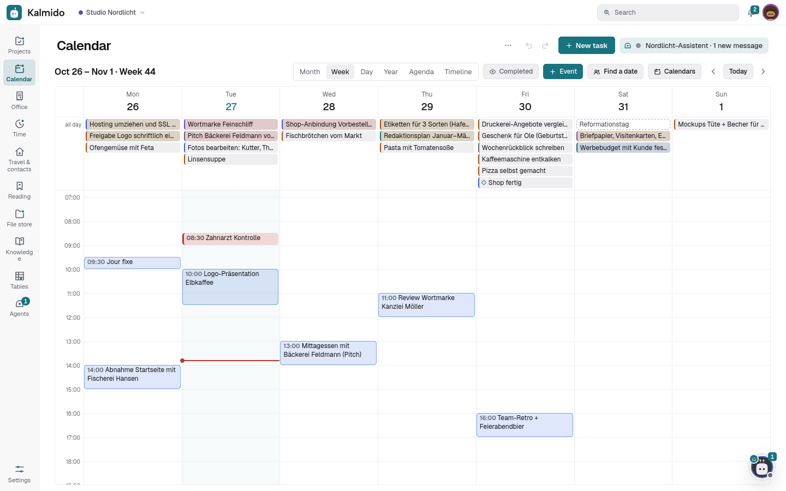

# Calendars and contacts

Events, contacts, calendar subscriptions and CalDAV. The server side of CalDAV and CardDAV is also in [CALDAV.md](CALDAV.md).

## Events

Kalmido keeps your appointments itself (module *Events*, on by default; *Settings > Modules*). They show next to your
tasks in the **year**, month, week and day view, in the **agenda** (the coming two weeks, events and tasks by day) and in *Events
today*. **+ Event** in the calendar bar, the quick sheet of a free slot (*Event*) or a **drag over free time** in the
week create one; a click opens it (details, your answer, *Edit*, *Delete*, *Preparation task*).

- An event: title, from – to (all day or with times, over several days, in any **time zone**), place, notes, a link,
  **repeat** (daily, weekdays, weekly, every two weeks, monthly, yearly, or an own rule such as *every 2nd Tuesday* or
  *Mon, Wed and Fri*; until a date or a number of times),
  **reminders** (a push before the start), status and *busy*. A repeating event changes as a whole or **only this
  date**; a single date can be left out.
- **Calendars**: as many as you like, each with a colour; *Calendars* in the calendar bar shows, hides, renames,
  shares (*can view* / *can edit*, like projects), imports an **ICS file** (an export of Google Calendar or any other app;
  importing it again changes the events instead of doubling them) and exports one.
- **People**: invite people of this server (they see this one event, not your calendar, get News and a push and
  answer *Accept* / *Maybe* / *Decline*), your contacts or any e-mail address.
- **Preparation**: a task linked to the event, due before it (*Preparation task*), or the other way round *Schedule as
  an event* in a task's panel.
- **People's availability** (2.155): while you invite, a free / busy bar shows you and every invited person of your
  organisation for the day - only busy and away times, never titles or places.
- **Holidays and absences** (2.155): the public holidays of your state (Germany by state, Austria) and your absences show
  in the calendar, your team's on request as "away" only; the state can be set per person, also without an
  organisation. Your absences and holidays are also a subscription link for the phone's calendar app.
- **On the phone**: each calendar is a calendar in the phone's own app (CalDAV), changes go both ways; invitations come
  in a calendar *Invitations* and are answered there (*Accept* / *Maybe* / *Decline*) or in the app; a calendar created on
  the phone becomes a Kalmido calendar. See [Calendar and contacts on the phone](CALDAV.md#calendar-and-contacts-on-the-phone).
- The family events of 2.19 (tasks with people who come along) became events once, with those people invited; the
  task stays, marked done and linked to its event.

## Contacts

Your address books live in Kalmido too (module *Contacts*, on by default): **Contacts** in the sidebar lists them with
a search (name, company, e-mail, phone, address, group), a group filter and a card per person (phones and e-mails as
links, addresses, birthday, notes, linked tasks and events). *New contact* / *Edit*: name, company, job title, phones,
e-mails, addresses, web links, birthday and anniversary (also without the year), groups, a photo, notes.

- **Address books**: as many as you like, shared like projects (*can view* / *can edit*); contacts are personal data, so
  they only show to people who see their address book, also in a task.
- **Tasks**: *People and dates* in a task's panel links a contact (*Waiting on*, *Responsible*, *About*).
- **Birthdays** (module Family): an address book's birthdays and anniversaries become yearly tasks of a project you pick.
  An address book connected under *Family > From contacts…* is also copied into an address book of its own.
- **Import / export**: vCard files (3.0 and 4.0); **on the phone** each address book is an address book in the phone's
  contacts app (CardDAV), both ways.

## Calendar subscriptions (other calendars in Kalmido)

*Settings > Integrations > Calendars > Add calendar* shows events from your other calendars in Kalmido's month, week
and day view, in the calendar's timeline and, optionally, as *Events today* at the top of *Today*. Events are
read-only and look different from tasks (tinted and outlined in the calendar's colour; all-day events in the all-day
row). A click shows title, time, place, description (plain text, only http / https links are clickable) and the
calendar, plus **Create task from event** (a task in the basket with the event's title, date, time and duration,
opened for editing). Subscriptions are private: project members never see them. Two ways to add one:

- **Link (ICS / iCal)**, `https://` or `webcal://`:
  **Google Calendar:** on a computer, calendar.google.com > *Settings* > your calendar > *Integrate calendar* >
  *Secret address in iCal format*. **iCloud:** share the calendar as a *Public Calendar* in the Calendar app and copy
  the link. **Outlook / Microsoft 365:** *Settings > Calendar > Shared calendars > Publish a calendar* > ICS link.
  Any other `.ics` URL works too.
- **CalDAV account:** server address, username and password (use an app password where the service offers one:
  iCloud `caldav.icloud.com` with an app-specific password, Nextcloud, Radicale, Baïkal, Fastmail, mailbox.org ...).
  Kalmido finds your calendars (`current-user-principal` > `calendar-home-set`, also via `/.well-known/caldav`) and you
  pick which ones to show.

**What is fetched:** the server fetches every subscription every 15 minutes or every hour (per calendar), and
*Refresh now* on demand (rate-limited). It keeps the events from 60 days back to 365 days ahead and expands
recurring events (RRULE, RDATE, EXDATE, moved or cancelled occurrences, time zones, floating times in the server's
`TZ`). ICS links are fetched with `If-None-Match` / `If-Modified-Since`, CalDAV calendars only when their `getctag` /
`sync-token` changed (plus once a day, as the window moves). A download may be at most 10 MB, a calendar keeps at most
5,000 occurrences (the ones closest to today), rules below daily (hourly, every minute) are not expanded, and nothing
is ever written back to a calendar. Each calendar shows its last sync and error; after five failed syncs in a row the
admins get an *Integration problems* alert (subscription id, user and error class only).

**Security:** the link (for Google a secret address) and the CalDAV password are stored encrypted (AES-GCM with a
key derived from a random server secret in the database) and are never sent back to the browser, nor logged; a
backup of the database contains both, so keep it as private as the data itself. Credentials only go to the host they
were entered for (and, over https, to the same parent domain when a CalDAV server points there, as iCloud does).
Every fetch is protected against server-side request forgery: before connecting, the server resolves the host name
and refuses private, loopback, link-local, CGNAT (100.64.0.0/10), multicast and reserved addresses (IPv4 and IPv6,
including IPv4-mapped and NAT64 / 6to4 forms), then connects to exactly the address it checked (no second DNS
lookup, so DNS rebinding does not help; TLS still verifies the host name). Redirects are followed by hand, at most
five, never from https to http, to another host only for links without a password and only over https, and every hop
runs through the same check. XML from CalDAV servers with a DTD or entities is refused.

**Your own server at home:** a Radicale, Nextcloud or other calendar server in your own network (a LAN or VPN
address) is blocked by that guard until an admin allows its host: *Settings > Administration > Advanced > Allowed
internal hosts* (`host` or `host:port`, comma-separated), or `KALMIDO_CALENDAR_ALLOW_HOSTS` in the environment. Only
list servers you trust: every user can then subscribe to calendars on them. `KALMIDO_CALENDARS=0` turns the whole
feature off.

## Calendar subscription (your tasks in other calendars)

*Settings > Integrations > Calendar subscription > Create subscription link* gives you a private URL
(`https://tasks.example.com/ical/<id>.<secret>.ics`) that any calendar app can subscribe to (read-only):

- **Google Calendar / Android:** calendar.google.com > *Other calendars* > *+* > *From URL*. It then syncs to the phone.
- **iPhone / iPad:** *Settings > Apps > Calendar > Calendar Accounts > Add Account > Other > Add Subscribed Calendar*;
  **Mac:** *Calendar > File > New Calendar Subscription*. **Thunderbird:** *New Calendar > On the Network*. **Outlook:** *Add calendar > Subscribe from web*.

What is in it: open tasks with a due date from all projects you can see (or, per setting, only your own and those
assigned to you). Timed tasks are events with their duration (30 minutes if none is set), all-day tasks are all-day
events (a start date makes it a range), recurring tasks carry their RRULE so every future date shows up (tasks that
repeat from the completion date only show their next date), reminders become alarms (can be switched off), and the
description holds the notes, the project and a link back to the task. Completed tasks disappear on the next refresh;
how often that happens is up to the calendar app (Google: every few hours).

> [!NOTE]
> Google Calendar, iCloud and Outlook.com fetch subscriptions from their own servers, so your Kalmido must be
> reachable from the internet at that address. If it only runs at home or behind a VPN, use a client that fetches
> on the device: [ICSx⁵](https://icsx5.bitfire.at) on Android (the calendar then appears in every calendar app),
> the location *On My Mac* instead of iCloud on a Mac, or Thunderbird.

The secret in the URL is the only credential: anyone with the link can read these tasks. *New link* replaces it
(the old URL stops working at once), *Turn off* removes it. Wrong tokens answer 404 and are rate-limited per
address. With a login proxy, let `/ical/*` bypass it (see *Reverse proxy*); Kalmido never reads the proxy header there.

## Calendar apps (CalDAV)

Kalmido is a CalDAV server for tasks: every project you see (not archived) shows up as a task list in Reminders on iPhone,
iPad and Mac, Thunderbird, Evolution, Tasks.org or DAVx⁵ (with Tasks.org, jtx Board or OpenTasks) on Android, and changes
go both ways. *Settings > Account > App passwords* creates a password per device (shown once, stored as a hash,
revocable, with its last use); *Settings > Integrations > Calendar apps (CalDAV)* shows the server, the address
`https://<host>/dav/`, your user name and step-by-step guides for each app. iPhone and Mac only need the host name
(discovery via `/.well-known/caldav`).

What syncs: title, notes, due date (all-day or with a time, any time zone is converted to the server's), start,
priority, done / won't do, your tags (`CATEGORIES`), subtasks (`RELATED-TO`), repeat rules (daily to yearly; completing
moves the task on as in the app), reminders (`VALARM`) and the link. Everything else a client writes comes back to it
unchanged. Viewers get read-only projects, participants only their tasks; deleting moves to the trash; changes show "via
CalDAV" in the history. Behind a login proxy, `/dav` and `/.well-known/caldav` must bypass the login (see *Reverse
proxy*). Details, the mapping table and proxy examples (Caddy, Authelia, nginx, Traefik): [docs/CALDAV.md](CALDAV.md).
