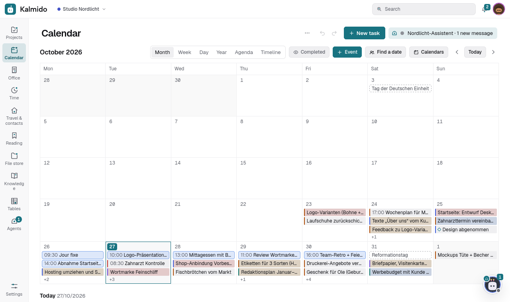
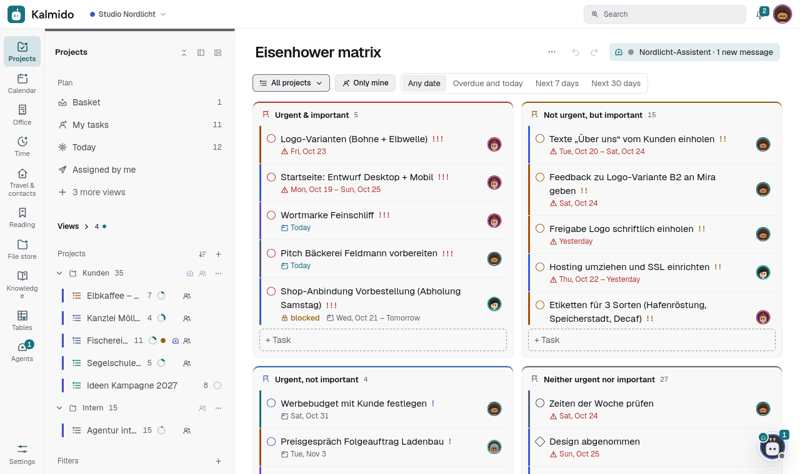
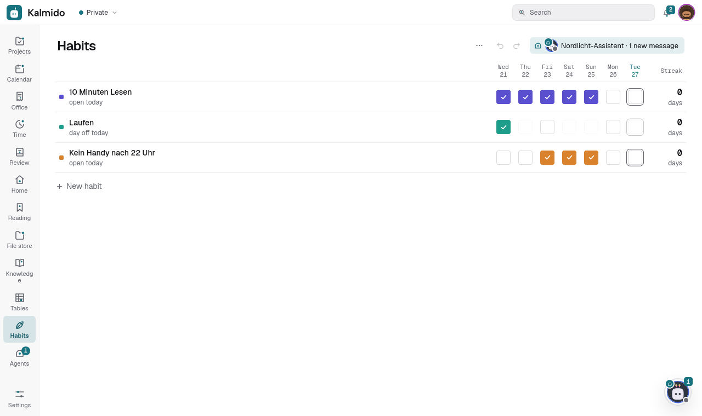
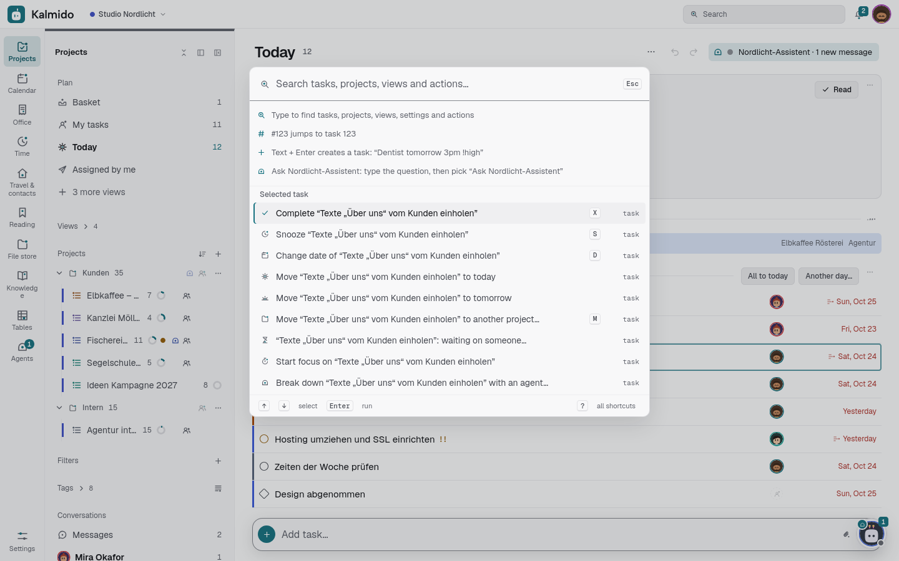
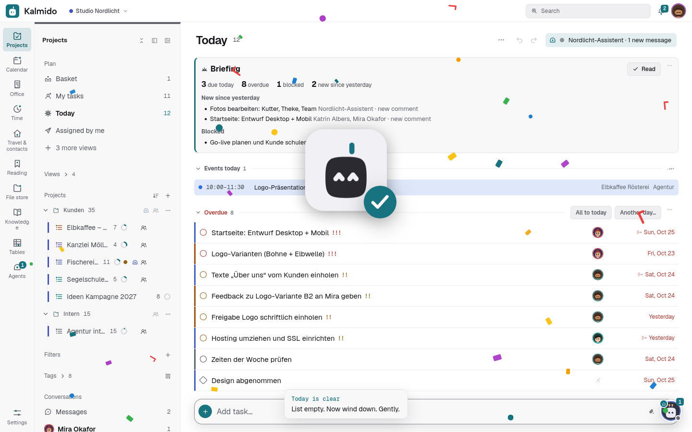
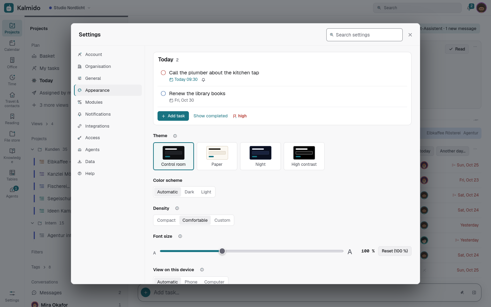
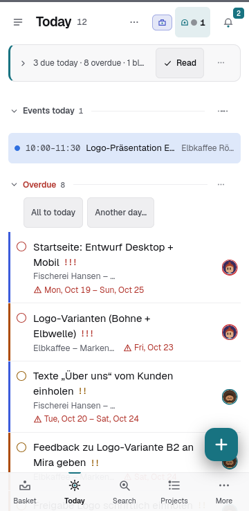

# Full feature list

Every single feature of Kalmido, area by area. The [README](../README.md) has the short overview.

## Full feature list

**Projects**
- Projects with emoji, own picture or colour, project folders with subfolders (up to 30 levels), sections (Kanban columns) with a "+" each, collapse / expand all, archive
- **Folders and subfolders**: *Clients › Company X*. The sidebar is a tree (a folder's projects, then its subfolders),
  folded folders stay folded on all your devices. Drag projects into a subfolder, a subfolder into another folder or onto
  *Projects* (top level); the folder menu (…) has *New subfolder…*, *Rename*, *Move into a folder…* / *Move to the top
  level* and *Dissolve* (projects and subfolders move up one level). Opening a folder shows the tasks of all its projects,
  subfolders included, with a small header per subfolder. In the project dialog type `Clients / Company X`. A project in
  its owner's folder sits for everyone in that folder and place, and the owner's folders keep their order among each
  other in every member's sidebar (2.27.0); a shared project without a folder can be filed where each member likes. The
  sort of a shared project is set by its owner or a project admin for everyone; a member may sort it otherwise on one device
  and the project says so. The API takes and returns the path (`"folder": "Clients/Company X"`, at most 30 levels)
- **Quick capture** from anywhere: `q` (or Ctrl+Space, also while typing somewhere else) opens a small box, the quick
  add syntax works and it lands in the basket whatever view is open (unless you name a project). The installed app's icon
  menu has *Quick add*. The page `/capture` holds a **bookmarklet**: drag it to the bookmarks bar, click it on any
  page and a small window opens with the page's title and address, Enter saves it to your basket (your normal
  sign-in, no code of Kalmido runs on that page). A system-wide key for it: Windows: Start menu > right-click Kalmido >
  More > Open file location > Properties > *Shortcut key*; macOS: Shortcuts app > *Open URL* `https://your-host/capture` >
  *Add keyboard shortcut*; GNOME / KDE: a custom shortcut that opens that address
- Drag and drop everywhere, also on touch: tasks onto a section header or into an empty section, sections by their
  handle (list and kanban), projects and folders in the sidebar (long-press on a phone); on a phone a long press
  selects a task (a bar with *Move*, *Date*, *Complete*, *More*; tap more tasks to add them, drag by the grip), and in
  the open task a swipe left or right goes to the next or previous task
- Drop files from the desktop on a project: one new task per file, with the file attached
- Subtasks up to five levels, drag and drop between projects and levels
- Priorities, tags, pinned tasks (the smart list *Pinned* collects them from every project, 2.16), Markdown notes, attachments (images, PDFs, documents)
- Long descriptions fold to a few lines; *Show more* keeps the following tasks unfolded too until *Show less* (per device, 2.101).
- A website link per task, shown as a small domain chip (paste a URL in quick add or share a page from Android)
- Quick add with two extra buttons (2.14): *Add and open details* creates the task and opens it at once, the paper clip creates it with files attached (the file name is the title when none is typed)
- Natural-language quick add in English and German, whatever the interface language, plus French, Spanish, Italian or Dutch when the app runs in that language: `Dentist tomorrow 3pm !high #private ~Work`, `Zahnarzt morgen 15 Uhr !hoch #privat ~Arbeit`, `Dentiste demain 15h !!! #privé`
- Recurring tasks (daily, weekdays, weekly, monthly, yearly, every n days / weeks / months with weekdays, or any RRULE for experts) with end date, count and skip
- **Dates save as you pick them** (2.6.1): in the date popover every tap (day, time, start, duration, reminders,
  repeat) is saved at once and the popover stays open for more; *Done* (or a click outside, Esc) closes it and leaves
  one undo step with *Date: … · Undo*, *Undo* in its foot puts everything back. *Settings > General > Confirm changes
  with OK* brings back Cancel / OK
- **Reminders well ahead and deadlines** (2.7.0): reminders from *On time* to *1 month* before as chips, or any number
  of minutes, hours, days or weeks up to a year with *Other…* (also as the default reminder). Tick *Deadline* and the
  task counts down on its row and in the task panel (*12 days left*), highlighted from its first reminder on;
  *On Today from the first reminder* also puts it on Today from then on
- **Repeat reminder until done** (2.7.0): a task's reminder can repeat every 5, 10, 15, 30 or 60 minutes or daily
  until it is completed, starting with its first reminder (e.g. *2 weeks before the deadline, then daily*). Set it per
  task in the date popover, or as the default of a project (project dialog). The push offers *Done*, *Stop reminding* and
  *Snooze*. Nothing repeats during your quiet hours (*Settings > Notifications*, 22:00 to 07:00 by default), for a
  project whose bell is muted, or with *Repeated reminders* switched off in the notification matrix; completed, deleted
  and archived tasks stop at once, and every interval sends one push at most
- Smart lists (basket, the start view; today, tomorrow, next 7 days, now doable, all), combinable filters (project, date, priority, tag)
- **Plan my day** (2.10.0): in Today, *Plan my day* puts your open tasks into the free time between the day's calendar
  events and timed tasks within your working hours (*Settings > General > Day planning*): overdue and due first, then
  deadlines and priority, 30 minutes for a task without a duration; what does not fit is listed as *does not fit
  today*. *Fill free time* only fills the gaps with tasks not planned yet. A timeline preview, leave out what you like,
  one undo step. Planning sets only a task's planned start and duration (2.11.0): **due dates, times and deadlines never
  change**; planned tasks show in Today with their time and can be unplanned in the task panel. With an agent online, *Let an agent plan* asks it for the same plan as a proposal that you approve
- **Daily review** (2.10.0): after your working hours Today shows what you finished, what is still open and what you
  moved, with a suggestion for the next working day; optionally as a push at a time you choose
- **Now doable** (`g d`): what you can start right now: open, not waiting on another task, due today, overdue or
  undated, and yours (assigned to you, or unassigned in your own projects; everything with collaboration off). In the
  order the dependencies allow, with a count in the sidebar; pin it as a tab like the other smart lists
- **Overdue in one click**: on top of Today, *3 overdue → Today / Tomorrow / Next week (Mon) / Pick a date…* moves
  every overdue task you may change at once (time and repeat stay, view-only ones are skipped and counted), one undo
  step; the × hides it until tomorrow on that device
- Multi-select (Shift-click a range, Ctrl/Cmd-click single tasks) and multi-edit in the task panel (2.26.0: the shared fields of all selected tasks, *Mixed* where they differ, one undo step), snooze, trash with restore, search in titles, notes and links
- **Undo and redo history**: ← / → in the top bar step back and forward through your last 30 changes (edits,
  completing, deleting, moves, sections, project settings, batch actions, moving projects); right-click or long-press ←
  to jump back several steps. Ctrl/Cmd+Z, Ctrl/Cmd+Shift+Z, Ctrl+Y; on phones *Undo* / *Redo* sit at the top of the header's “…” menu (touch tablets and an unfolded foldable keep the arrows in the header while there is room).
  Settings changes are steps too. Never overwrites what others changed meanwhile, works offline
- **Settings save themselves**: every switch, field and choice applies at once with a small *Saved · Undo*; one
  *Modules* page with a sentence per module; developer things (API tokens, webhooks, rule texts) folded under
  *Advanced*; the upload token for sharing from a phone lives in one place, *Integrations > Share from your phone*
- **Archive instead of delete** for projects (undoable); deleting for good only from the archive, with a dialog that names
  what is lost. All questions use the app's own dialog, and whatever can be undone asks nothing. Tasks of an archived
  project stay out of Today, filters, the calendar, reminders and the digest until you restore it. *Archived* in the
  sidebar opens all archived projects (tasks, folder, archived date, owner) with Open, Restore and Delete permanently
- **Folder view**: click a folder name in the sidebar for all its projects' tasks in one view, grouped by project
- **One tap "Today" / "Tomorrow"** in the task menu, the task panel and the selection bar (keys `t` / `Shift+T`);
  time, reminders and repeat stay. **Completed tasks are shown** everywhere; hide them per project, filter and smart list
  (its “…” menu) or in the calendar (its bar)
- **Own date and time pickers** in the app language: a small month grid (the week starts on your locale's first day)
  and hours / minutes you can also type (`930`, `9:30 pm`, `21 Uhr`); keyboard and touch friendly
- **Templates**: save a task with its subtasks, or a whole project with sections, and reuse it with dates relative to today;
  **Duplicate project…** (2.78.0) copies a project at once with its dates as they are (completed tasks optional, no members)
- **Every list is a project** (2.152.2): the switch *Progress and status* in the project dialog turns on the progress ring,
  the status, the project page and the row in *All projects* (dependencies with the Gantt timeline and custom fields have
  their own switches). Every project can **show completed at the bottom** (what you tick off stays there and comes
  back with one tap: shopping and packing lists). Set it in the project dialog or the project's menu; with the switch off
  a project stays free of project controls (the repository section shows only with the switch on or for a project that already has one)
- **Running indicator** in the top bar: time tracking, a focus session or the stopwatch, each with its own icon, the
  time and the task; a click shows the task with Pause / Stop. The *Time tracking* page shows a running timer as a
  large card (live time, task, project, start, Stop)

**Views**
- Calendar (month, week, day) and a timeline, drag tasks onto days; swipe to turn the page, pinch to zoom the hours (2.164.0)
- **Gantt timeline**: dependency arrows between the bars, a red mark when a task starts before the one it waits on is
  due, link two tasks by dragging from one bar onto another (long-press on a phone, keyboard too), and optionally
  *Move dependent tasks along* when a date slips, with one undo for the whole chain
- **Roadmap**: *All* as a timeline: every project on one chart, grouped by folder, collapsible to one summary bar per
  project with its progress; drag a summary bar (or long-press it on a phone) to move the whole project, one undo
- **Calendar subscriptions**: events from Google Calendar, iCloud, Outlook or any CalDAV server (Nextcloud, Radicale,
  Fastmail, ...) right next to your tasks, read-only, with "Create task from event"
- Eisenhower matrix (priority x due date)
- Kanban per project, with WIP limits per column, story points and sprints with burndown and velocity (2.60.0)
- Review step per project: reviewer, done only after approval; environments (Staging, Live) per project (2.60.0)
- **Statistics**: completions per week / day and per project, on-time rate, overdue trend, focus time, habit streaks

**Habits, focus and time**
- Habits per day or *n* times per week, counters (e.g. 8 glasses of water), notes per day, streaks
- Pomodoro timer and stopwatch, focus minutes per task
- **Time tracking** (2.41.0: its own switch per project, any project type): a timer on any task that follows you across devices, manual entries, hours per project and task
  for any period, rounding, hourly rates, CSV export and a printable timesheet
- **Time sum in the project header** (2.7.0): a project with time tracking (and a folder of them) shows its tracked time in hours and in
  working days, e.g. *12.5 h · 1.6 days*. The length of a day / shift is one value for the whole server
  (*Settings > Server > Server > Time sums*, 8 h by default) that a project can override in its dialog, the same for everyone in it. A
  number field *Budget h* (the agency project type has one) adds a budget bar: tracked against the sum of the budgets

**Together**
- Several users, each with their own basket, habits, filters, tags, settings and notifications
- **Groups** (2.10.0): an admin creates groups (*Office*, *Field team*; optionally synced from a sign-in group of the
  OIDC provider). Share a project or a whole folder with a group and a role: whoever joins gets access, whoever leaves loses
  it, and a person's role is the higher of their own and the group's. Assign a task to a group, "whoever has time": it is
  in *Assigned to me* for every member until one of them takes it. Groups appear under *People* in the sidebar
- **Shared project tags** besides your personal tags: tags that belong to a project, with a colour per project, visible to
  everyone in it (`1.9.0`, `bug`, `Client X`). In shared projects the tag input suggests project tags first; your personal
  tags keep a small person icon, and one click turns a personal tag into a project tag. Filters, the sidebar and the API
  know both
- **Reactions** 👍 👎 ❤️ or any emoji (+) on comments, with the names on hover or tap
- Share a project with others as admin, member, participant (sees only the tasks assigned to them) or viewer; shared projects show up in their smart lists, calendar and search
- Assign tasks and subtasks in shared projects, with an assignee column (pictures, one click to assign): reminders go to the assignee, plus an *Assigned to me* list
- Comments on every task with @mentions and files, at the end of the task panel with the comment box always at the bottom edge (2.0.6: also as personal notes in private projects, own *Comments* module), an activity history (who changed what, when) and unread markers
- A *News* inbox (bell icon with an unread badge): mentions, comments on your tasks, assignments, completions, unblocked tasks, status updates and projects shared with you, newest first; filter *Mentions & assigned to me* and *Unread only*
- **Dependencies:** a task can be *blocked by* other tasks (also in other projects); it shows *blocked* until they are done, and its assignee gets a message when the last one is finished
- **Waiting on someone** (2.1.0): mark a task as waiting for someone outside (a client, an office, a delivery) with a note and a follow-up day (task menu > *Waiting on someone…*, or *Waiting on…* in the task panel, which also offers *Another task*). It shows an hourglass chip, sits in the smart view *Waiting on someone*, and on the follow-up day you get a reminder and a News item, while agents that follow the task get the event `followup_due`. One click (the × on the bar in the task panel) ends it. API: `PUT` / `DELETE /api/v1/tasks/{id}/waiting`, `GET /api/v1/tasks?waiting=true`; MCP `set_waiting`, `clear_waiting`, `list_waiting`
- **Project status and progress:** a progress bar per project, a status (*On track*, *At risk*, *Off track*, *On hold*, *Complete*) with a short note, and the **project status** (*Where is it stuck?*) with the overdue, blocked and unassigned tasks across all projects
- **Project page:** every project has a tab next to List / Kanban / Timeline with its description (Markdown), key links, milestones (also in the timeline), project files plus the files of its tasks, members, status updates and the tracked time
- **Custom fields** per project: text, number (with unit), currency, selection with colours, multiple choice, rating, date, checkbox, person, link or a link to another task; formulas with IF, SUM, ROUND, MIN, MAX; shown as chips or columns, usable in filters, sorting and search
- **Shown fields per project** (2.14): project *…* > *Shown fields…* (or the button in the project header) picks which columns the
  rows show and in which order: task number, date, priority, assignee, tags, tracked time, subtasks, dependencies,
  created and the project's custom fields. The setting belongs to the project, so every member sees the same; the owner and
  project admins change it, *Default* goes back to the standard layout. Desktops show a title row above the columns; where
  the list column gets narrower (a Fold, the task panel open) and on phones the first two columns stay in the row and the
  rest moves into its second line. API v1 (`columns` on projects) and the MCP tool `set_list_columns` read and set it
- Push notifications for new comments, mentions, assignments and completions, bundled so a busy task does not spam you
- **Public links**: share one project with people who have no account through a secret link, view only or *view and tick off*, with an optional password and expiry
- One switch (*Collaboration*) turns all of this off for a simple personal task list, per person or (admins) for the whole server;
  *Dependencies* and *Custom fields* are modules of their own, so a household project stays simple while a small team
  (an agency, a club) gets the project tools
- Built-in login or single sign-on through your reverse proxy (Authelia, Authentik, oauth2-proxy)
- **Two-factor authentication** for the built-in login: authenticator app (TOTP) with recovery codes, or **passkeys**
  (also for logging in without a password); admins can require it for everyone
- **Log in with an OpenID Connect provider** (Authentik, Keycloak, Authelia, Google, ...): code flow with PKCE, only
  accounts an admin created (or automatic accounts, if you want), optional group check and admin group
- **Encryption** (2.42.0): an end-to-end encrypted note and files per task and encrypted direct messages (WebCrypto in
  the browser, the server only stores ciphertext), plus encryption at rest with a key per organisation for bank and tax
  data, purchase and contract rates and stored files (needs `KALMIDO_SECRET_KEY`; see SELF-HOSTING.md)
- **Lock per project** (2.64.1): a project can be *encrypted in the browser* (project dialog): titles, descriptions, subtasks,
  comments, project notes, section names, text fields, links and code snippets are encrypted with a key per project that each
  member gets wrapped with their own key; dates, status, assignees and the project name stay readable. Members without a key
  wait until the owner releases it; agents, the mail address, public links and templates are not available there.
  Since 2.64.2 attachments and the project's team chat are encrypted too, and the key changes when a member leaves;
  since 2.64.3 a whole knowledge space can be encrypted the same way (see docs/ARCHITECTURE.md, *Lock per list*, and
  docs/SELF-HOSTING.md, *Exporting encrypted content*)
  data, purchase and contract rates and stored files (needs `KALMIDO_SECRET_KEY`; see SELF-HOSTING.md). 2.64.0: the files
  of the private space are stored encrypted on the server as well, with a key per person (server-side, not end-to-end)
- **Automatic backups** of the database and all attachments, daily with retention, optionally encrypted, downloadable,
  and a **restore** right in the app (checked, with a safety backup of the current state first); encrypted backups can also go to an
  **off-site target** (S3-compatible, WebDAV over https or SFTP) after each run (2.143.0)
- **Admin alerts** over each admin's own channel (Web Push or ntfy): a new version, devices that stopped taking pushes, watchdog errors, failing integrations, repeated failed logins, low disk space or a failed database check reach the admins, never with task contents

**AI agents**
- **Agents as team members**: an admin adds an agent (Claude Code, Codex, n8n, a local model, your own script) as a
  user of type *Agent*: never an admin, sees only the projects shared with it, with its own API token, an
  optional webhook and an on/off switch that stops everything at once
- **Settings > Agents** (called *AI colleague* before 2.6.0; 2.7.0: shown while the *Agents* module is on, and to
  admins while agents exist): one tab in four sub-tabs (2.5.1). *Status* (2.7.0, was *Overview*): a card per agent with its state, projects and
  usage; admins add, edit, test and pause them there (username, display name and profile picture: a preset, an own
  photo or the initials). *Projects*: which projects each agent sees, *Share all* / *New projects automatically*, and a table
  of the projects you manage (shared ones first, *Show all*, search): which agent sees it (one click shares or unshares),
  its tidy mode and which agent tidies it up. *Usage* and *Log* (admins) below
- Agents get **events** as signed webhooks or by **long-polling** (no public endpoint needed): @mentions, assignments,
  comments on their tasks, chat messages and reactions. A task event
  brings the task's newest comments and the project's sections along, so the agent can act at once; project pages can be
  fetched compact
- **Approvals**: 👍 / 👎 on an agent's comment from the project owner, a project admin or the assignee counts as approval or
  rejection; nothing needs to happen without it. 2.15.0: deleting projects or fields, emptying the trash, changing 10+
  tasks at once, moving projects and sharing by an agent always wait for *Approve* (then run as the agent) or *Reject*
- **Permissions** (2.15.0): each agent and each API token gets only what it needs: *Read*, *Tasks*, *Comments*,
  *Structure*, *Delete & trash*, *Read / Upload files*, *Time tracking*, *Export* (new agents: read, tasks, comments).
  Admins set them for team agents, owners for their personal agents (lock button); a server-wide limit and an optional
  address restriction per token; the MCP server shows only the allowed tools
- **Status and jobs**: a dot on the agent's avatar (idle, working, waiting for you, error), a chip in the top bar
  (*Claude · 2 running · 1 waiting*) and an *Agents* tab with its jobs, a short log and *Approve* / *Reject* / *Stop*
- **Chat** with an agent in a side panel (a tab on the phone); the agent can create tasks and comments within its rights.
  The header shows typing dots while it writes to you and what it is doing: *working on #51*, *waiting for you*,
  *ready*, *paused*, *limit reached* or *offline* (2.4.1). 2.13.1: send screenshots and files in the chat (paperclip,
  paste, drag and drop, or *Send to agent* from the phone's share sheet); thumbnails open in a lightbox, the sender can
  remove a file, and agents can read chat, task and comment files through the API / MCP (`get_attachment`)
- **Agent reads every comment** (2.13.1): per project, the checked agents hear about every comment people write there, not
  only on tasks they follow (on by default for the project's tidy agent)
- **Tidy up** per project (off, suggest, automatic) by exactly one agent of the project (*Tidy up by*, 2.4.1): it turns
  quickly typed entries into a short title, section and tags; the original text stays at the top of the notes, a
  suggestion is applied with 👍
- **Runtime settings** per agent (2.4.1): model, auto-compact threshold, a nightly fresh restart and *Reset now*.
  Kalmido only stores them; the agent's host applies them ([mcp/agent_launcher.sh](../mcp/agent_launcher.sh) for Claude Code)
- **MCP server** ([mcp/](../mcp/)) so agents can use Kalmido as a tool, and a protocol description in
  [docs/AGENTS.md](AGENTS.md). 2.15.0: everything the app does is in the API and the MCP server (a test checks it)
- **Setup guide** ([docs/AGENT-SETUP.md](AGENT-SETUP.md), in the app under *Settings > Agents > Set up*): an agent step by step, either by pasting one prompt into Claude Code or by hand (sandbox user,
  firewall, MCP wrapper, rules, event loop, autostart, test checklist)
- **Usage and limits** (2.1.1): agents report their model usage (tokens, optionally the cost; numbers only, never
  prompts); *Settings > Agents > Usage* shows today / 7 / 30 days per agent, behind *Details* a chart per day, top tasks, projects and
  models (admins: every agent; others: the agents and projects they share), the Agents view a compact card, the task panel
  *AI usage*. Per agent a soft limit (News + push to the admins at 80 % / 100 %) and a hard limit (its API calls get
  `429` until the next day / month or a higher limit). A Claude Code Stop hook ([mcp/claude_usage_hook.py](../mcp/claude_usage_hook.py))
  reports a session's usage by itself, and as SubagentStop hook (2.11.0) the usage of its subagents too
- **Activity log** (2.2.1): every API request an agent makes (route, status, task / project, duration; never content) in
  *Settings > Organisation > Agents* for admins (2.46.6; before *Settings > Agents > Log*), filtered by agent, status and day, event polling hidden by default, denied calls marked, CSV export;
  kept `KALMIDO_AUDIT_DAYS` days (default 90)
- **Git integration** (2.2.0, 2.18.0): connect a project to GitHub, GitLab, Gitea / Forgejo or Bitbucket Cloud; pull requests (state, CI), commits
  and branches show up at their tasks (`#123`, `kalmido-123`), `fixes #123` in a merged pull request completes the
  task. Works by polling, so the server needs no public address. **Hand a ticket to a coding agent**: it gets the
  repository and a branch name with the assignment and merges only after your 👍 on its *Ready to merge* comment
  ([Git integration](GIT.md#git-integration))

**Fast and friendly**
- **Resize the panels** (2.16; the sidebar too since 2.26.0): drag the edge between the list and the task, or between the task and the chat, to
  make them wider or narrower (desktops, an unfolded Fold; each device remembers it, a double-click goes back to the
  standard width; with the keyboard: focus the grip, ← →, Enter). **Column widths** work the same way: the grip at the
  right of a column title (per device and project)
- Command palette (Ctrl/Cmd+K, the *Search* button in the bar at the top) for tasks, projects, views and actions, the recently
  viewed ones on top; type text and pick *Ask <agent>: …* (sends it to the agent's chat) or *Create as task: …* (quick
  add syntax; Enter when nothing else matches); `#123` jumps to task 123; keyboard shortcuts (`?` shows them all: arrows, Space to complete, E to rename in the project; calendar 1-4 / ← → / `.`; multi-select Ctrl/Cmd+A, Shift+↓ ↑, Shift+X, then Space, M or D for the selection; D / M open the date / project field of the multi-edit panel), compact, comfortable or custom density (the sidebar and the task rows each on their own); your account sits as your picture at the right end of the bar at the top (Account, Settings, Log out)
- New accounts start with a "Getting started" project and a short welcome tour
- **Practice project** (*Settings > Help > Create the practice project*): the "Getting started" project again, for example for a member who was invited and started without it
- **Favourites** (star next to a title, or *Add to favourites* in the menu of a row): projects, filters, documents, folders, knowledge pages, tables, contacts and more stand as a row of symbols in the bar at the top (on a phone under the header); the order is yours and the same on every device, other members do not see your stars
- **Saved sidebar views** (*Save as view…* in the menu of the tool button in the sidebar's head, up to 20): a view remembers which groups of the sidebar are open, which folders are closed, which entries it hides and, optionally, a start page, for example "On the road" or "Planning". Its tile sits beside the favourites; the tile *Everything* is the sidebar as it was. What a view hides waits under *Others* at the end of the sidebar, nothing is lost
- A **sample project** to try things out: an image film for a client with phases, dates, dependencies, custom fields and a packing checklist, offered in the setup and the tour, removed again in one click (Settings > Data)
- When Today is clear or a project is done, the Kalmido bot celebrates (with one of 50 dry one-liners). Can be switched off.

**Everywhere**
- Installable web app (PWA) for phone and desktop, works offline: changes queue up and sync later, with conflict detection
- Sorting per view: priority, manual, date, title, *Created* (newest or oldest first, with the creation day on the rows), Flow and custom fields
- On phones every choice list (project, section, assignee, settings) opens as a bottom sheet like the app's menus: icons, a check on the current value, a search field for long lists
- Mobile layout with swipe gestures, long-press drag, configurable tab bar per device (on the desktop one sidebar with grouped navigation: Focus, Views, Projects, Filters, Tags and Team); tablets in portrait keep the composer at the bottom
- Push notifications without an extra app (Web Push: Chrome, Edge, Firefox, Safari, iPhone and iPad from the Home Screen) or via [ntfy](https://ntfy.sh): reminders with *Done* / *Snooze*, focus end, habit reminders, daily digest, comments and assignments; a notification you handled on one device (task completed or opened, News read) closes on your other devices
- **Slack, Matrix, Telegram or Signal** as extra channels (2.142.0): each person picks which kinds go there (reminders, assignments, mentions, digest, changes in own projects), organisation admins add a team channel for projects everyone in the organisation sees; the address stays encrypted on the server. People without a push device get assignments and mentions by **e-mail**, collected into at most one mail every 10 minutes (off / only without push / always, *Settings > Notifications*)
- Share from your phone into the basket: a ready-made import for the Android app HTTP Shortcuts, a guide for the iPhone Shortcuts app (see below); app shortcuts (long-press the icon: new task, today, news, search)
- Profile pictures: ten drawn people presets (2.19.0; agents get the matching robots) or your own photo (cropped square, resized, metadata removed), shown wherever the initials were
- **Events and contacts** (2.21.0): your own calendars and address books in Kalmido, synced with the phone's calendar and contacts apps ([Events](CALENDAR.md#events), [Contacts](CALENDAR.md#contacts))
- **Calendar apps (CalDAV), both ways**: every project as a task list in Reminders (iPhone, iPad, Mac), Thunderbird, Evolution, Tasks.org or DAVx⁵ on Android, with an app password per device ([Calendar apps](CALENDAR.md#calendar-apps-caldav))
- **Calendar subscription**: your open tasks with a date as an ICS feed for Google Calendar, Apple Calendar, Outlook or Thunderbird
- **Import from Todoist, Trello, Asana, Microsoft To Do, TickTick, Notion, Google Tasks, ClickUp, Jira, any CSV, Markdown checklists and any ICS / VTODO file** (Apple Reminders exports, Nextcloud Tasks, Thunderbird) with a preview, re-import without duplicates and undo ([Moving from other apps](IMPORT.md#moving-from-other-apps)); export everything as JSON (incl. your time entries), or your projects as Todoist CSV files or Markdown checklists (2.142.0) - no lock-in
- **REST API** with personal access tokens (`/api/v1`, OpenAPI 3.1) and signed **webhooks** for Home Assistant, n8n or your own scripts ([docs/API.md](API.md))
- **Appearance per device**: dark or light theme, compact or comfortable rows, font size from 75 to 150 % in 5 % steps, also with Ctrl + / − / 0 (the whole interface scales, not just the text), Geist, your system font or the low-vision friendly [Atkinson Hyperlegible](https://www.brailleinstitute.org/freefont/), and eight accent colors (petrol by default) that all meet WCAG AA in both themes; the switch **View on this device** (Automatic / Phone / Computer) is kept per device, and an unfolded foldable or small tablet in landscape gets the narrow desktop view
- English and German interface, French, Spanish, Italian and Dutch in beta (translations are plain JSON files, [fix or add yours](../CONTRIBUTING.md#translations))

| | | |
|---|---|---|
|  |  |  |
| Calendar | Eisenhower matrix | Habits |

| | |
|---|---|
|  |  |
| Command palette | The Kalmido figure celebrates |

