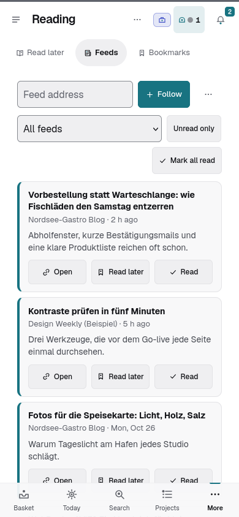

# Feeds

*Since 2.85.0.* A simple feed reader, part of the area **Reading** (since 2.172.0; before: Home): follow blogs and news
sites and read their new articles in one list. Switch it on under *Settings > Modules > Reading > Feeds* (off by default).

## Following a feed

- Open **Feeds** (a part of the area Reading) and paste the address of a feed (RSS 2.0, Atom or RSS 1.0), e.g.
  `https://example.com/feed`, then tap **Follow**. The server fetches the feed once right away; if that does not work,
  it says why (no feed at this address, not reachable, too large, a private address). A website that answers *403* refuses
  fetches by servers (many sites behind a firewall service block data-centre addresses); Kalmido says so instead of asking
  for a password (2.172.0). Feeds are fetched with the sender `Kalmido/<version> (feed reader; +https://kalmido.com)`.
- Menu **…** > *Import OPML file* takes over the feeds of another reader (at most 100 feeds per person); *Export OPML
  file* downloads yours.
- *Manage feeds* (below the articles) lists your feeds with the last fetch or the last error; the bin unfollows a feed
  (undo brings it back with its articles).

## Reading

- The newest articles come first: title, feed, date and a short summary as plain text. Unread articles have a coloured
  bar. Choose one feed or *Unread only* at the top.
- **Open** opens the article on its website in a new tab and marks it read; **Read** / **Unread** marks it by hand;
  *Mark all read* marks every unread article (of the chosen feed), one undo step brings them back.
- **Read later** saves the article to *Read later* of the same workspace (private feed: your own, an organisation's feed:
  the organisation's, see [Bookmarks and Read later](BOOKMARKS.md)). A second tap does not add it again.
- *Home & life* shows a card **Feeds** with the number of unread articles of your private feeds.

## Private and organisation (2.172.0)

- The view shows the feeds of the workspace you are looking at: in *Private* your own, in an organisation its feeds (under
  *All workspaces* your private ones; a picker above the list switches). There is no mixed view.
- An organisation's feeds are read by all its members (not by guests); each person has their own read marks. Only the
  organisation's admins follow, unfollow and import its feeds. Read-only members read and mark read, but save nothing.
- Without an organisation everything works in your private space. Feeds you followed before 2.172.0 stay private.

## How it works

- Your server fetches each feed about once an hour (a feed that fails ten times in a row only once a day) and keeps the
  articles for 30 days; tasks you saved stay.
- Feeds are never visible to agents, neither private nor an organisation's (no REST API, no MCP tool). There are no
  notifications for new articles.
- Privacy and safety: Kalmido loads no pictures and no scripts of the feeds (no tracking); only the text is kept. The
  server only fetches public addresses (an admin can allow internal hosts under *Settings > Administration > Advanced*,
  like for calendar subscriptions), at most 2 MB per feed, and refuses feeds with a DTD.
