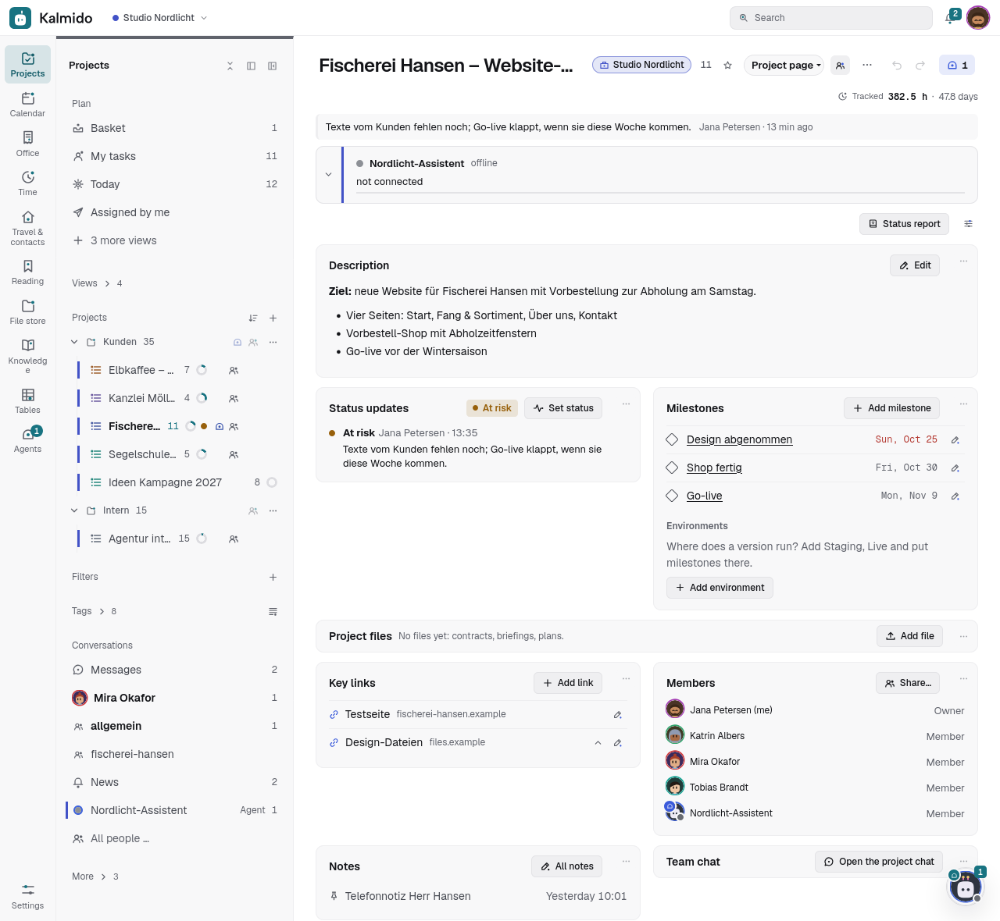
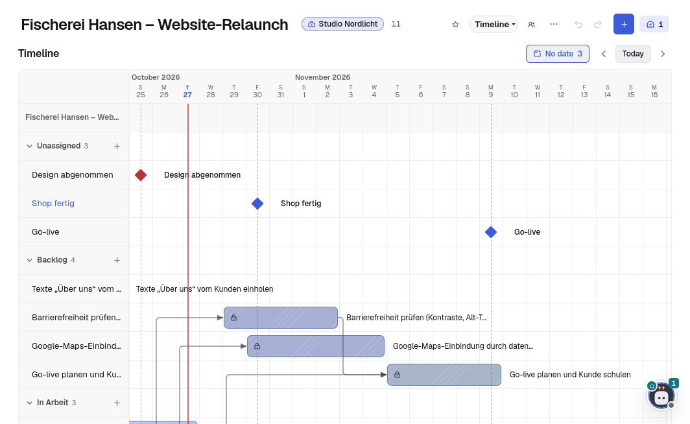
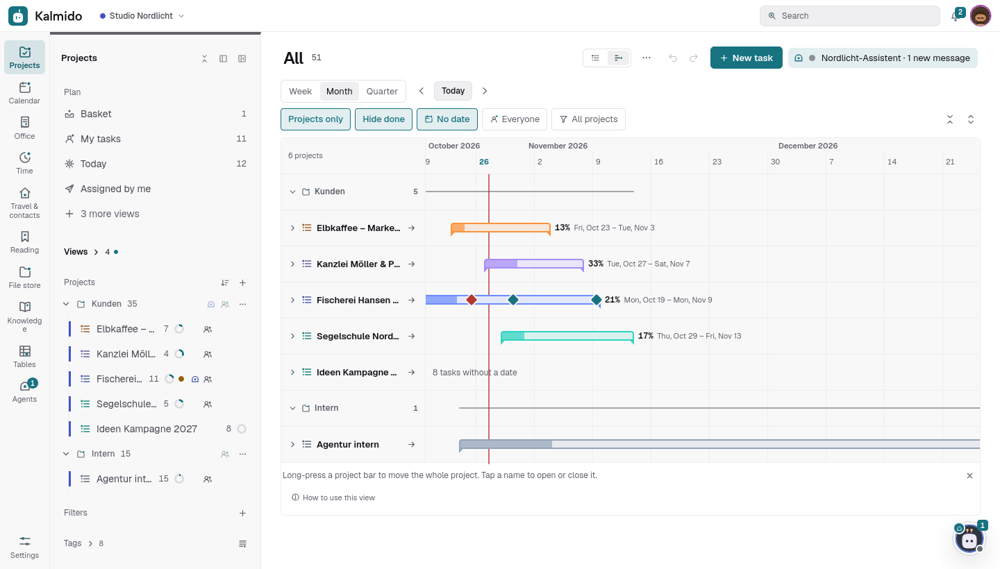
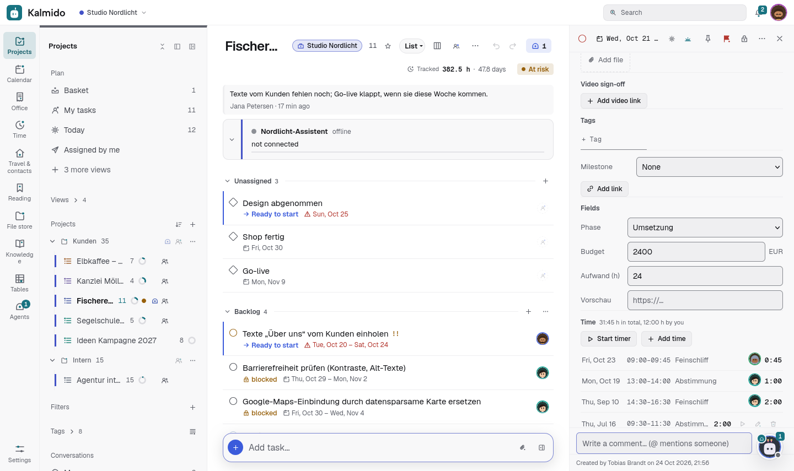
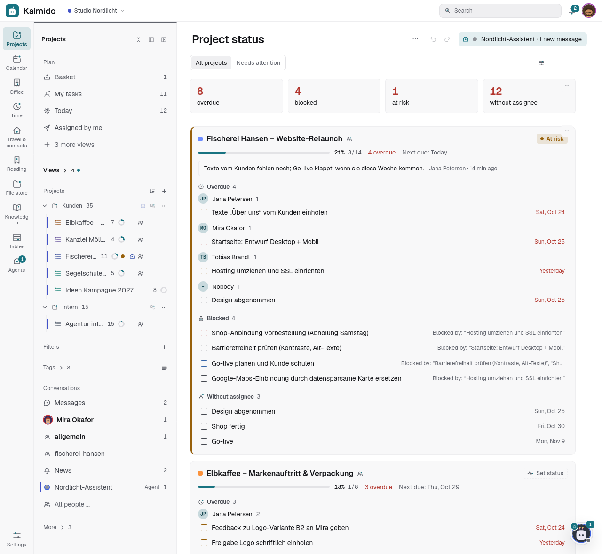
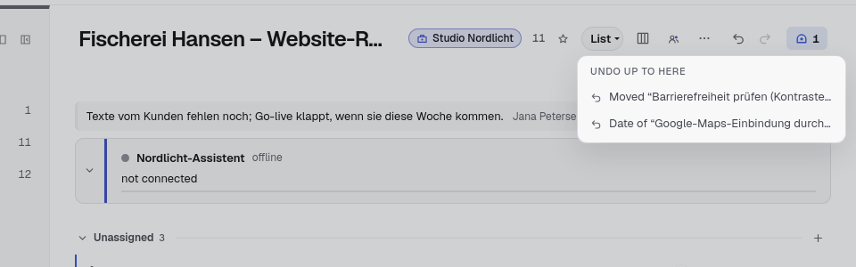
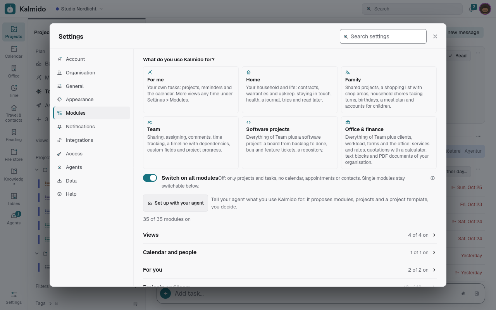
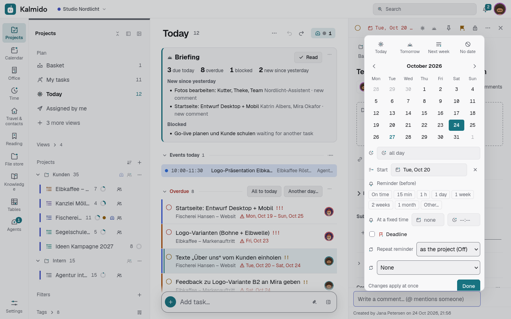
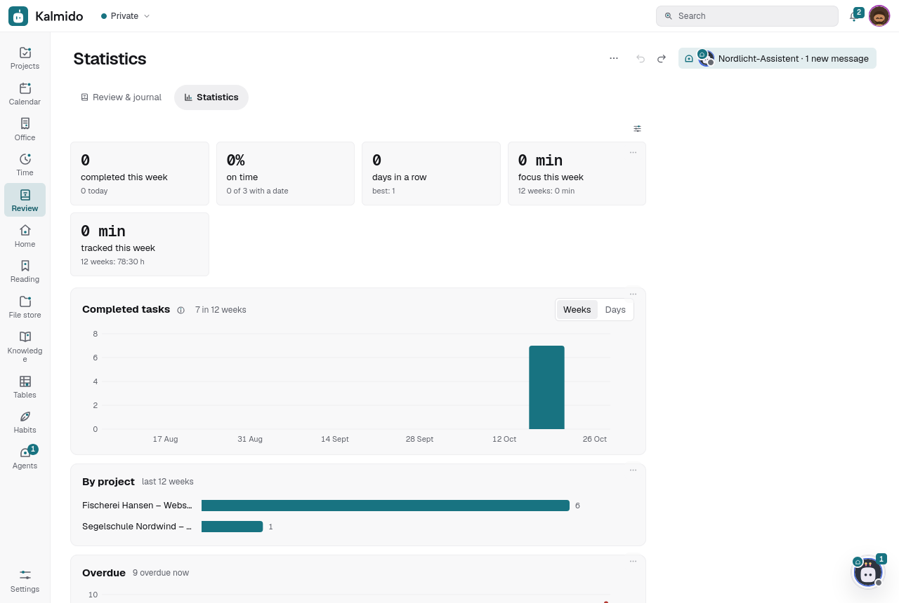
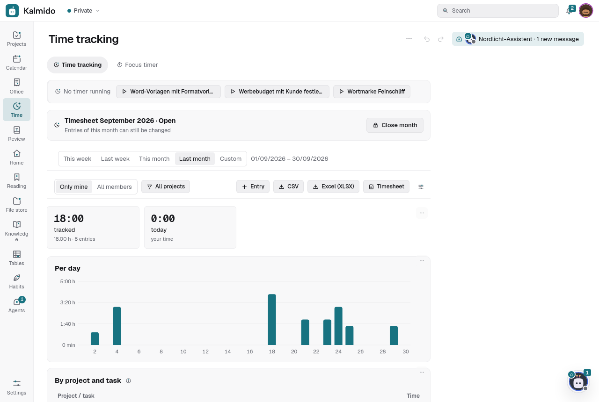

# Tasks, projects and planning

Start page, projects with dependencies and custom fields, templates, undo, statistics, time tracking and notes.

## Start page

The **Start** icon (the first one in the bar of the areas on a computer, and in the phone's drawer) opens the **start page** (the dashboard): what waits for you (approvals,
mentions, assignments), today's tasks (complete them right there), News bundled, the team chat, your projects with
their progress, pinned tasks, recent notes, the agents, a few numbers and a search field. *Customize* orders the cards
(↑ ↓, also with the keyboard) and hides the ones you do not need; the choice follows you to every device. The same
*Customize* (2.32) arranges Today, Time tracking, the agents and projects overviews and the project page: show, hide,
reorder, half or full width, optionally different on the phone; on the project page the owner sets the standard for
everyone and each person may override it. The start page can also be a tab (Settings > Appearance > Tab bar).

## Projects: dependencies, status, custom fields

**Project types.** *Projects > + > New project…* (also from the command palette, the setup and the first welcome card)
can start from a type:

| Type | Standard sections (2.27.0: only when ticked) | Also |
|---|---|---|
| Agency | Request · Concept · Production · Approval · Billing | no fields of its own (the client is the project's; a task has its own budget), time tracking |
| Software / AI dev | Backlog · Next · In progress · Review · Done | Kanban view, ticket types, dependencies, *Move dependent tasks along*; a next-steps dialog to connect a repository and, optionally, share the project with a coding agent |
| Personal | Ideas · Planning · To do | no fields |

A new project starts without sections; tick *With the standard sections* to get the type's (2.27.0). The names come
in your language (German: Anfrage / Konzept / Umsetzung …). A type switches the modules it needs on for you and says
so. Types are templates: change anything afterwards. API: `POST /api/v1/lists {"project_type": "agency" | "software" |
"private", "sections": true}`.

**Software type with a bug inbox** (2.473.0). For the type *Software* the dialog offers **With a bug inbox**. Kalmido then
makes a second project, *<name> – Bugs*, next to the build project. New tasks in it are bugs, and the project has a custom
field *Release* and a rule: as soon as *Release* is filled, the task moves to the build project (into its first section, if
it has sections). The rule runs with your rights, so only a person can switch this on, not an agent. API: `bug_inbox: true`
in `POST /lists` with `project_type` `software` (the answer has `bug_list_id`).

**Ticket types.** A project setting (*Ticket types*, in the project dialog of a project; on for Software / AI dev): tasks
get a type, *Bug*, *Feature* or *Task*, shown as a small chip with an icon, set in the task panel or in quick add
with `!bug`, `!feature`, `!task` (German `!fehler`, `!funktion`, `!aufgabe`), and filterable in saved filters. A new
bug starts with the notes *Steps to reproduce / Expected / Actual / Environment*, a feature with *Goal / Acceptance
criteria* (in your language; *Templates…* next to the switch sets the project's own). In the API, MCP and agent events
the task has `"type": "bug" | "feature" | "task" | null`; `GET /api/v1/tasks?type=bug` filters.

Every list is a project. For projects that need more than a to-do pile, switch on *Progress and status* (project dialog, the project's
… menu or right-click in the sidebar): the progress ring, the status, the project page and the row in *All projects* appear.
Dependencies (and the Gantt arrows; 2.41.0: time tracking is a switch of its own per project, `time_tracking`; a new project has it on when the module Time is on for its creator)
and custom fields follow the modules below, so a shopping list or a household project never shows fields unless you want them. The
modules below stay the outer switch: a feature shows when its module is on **and** the project has the matching switch. Switching
*Progress and status* off again only hides these things (nothing is deleted). The server refuses a custom field value
or a status on a project without the switch with a clear message. Time tracking (2.41.0) has its own switch in the project settings
(*Track time in this project*; on in a new project when the module Time is on for its creator, off otherwise; projects with time entries got it on with the update):
without it the server refuses a timer or a new time entry, tracked time stays in the review and reports. Projects that already had dependencies, custom fields, a status or at least five
minutes of tracked time got *Progress and status* on with the update; checklists stayed checklists. Each person can hide a project's progress bar with the
small **×** next to it (*Show progress* in the project's … menu or the project dialog brings it back).

- **Gantt timeline** (list view *Timeline*, or *Calendar > Timeline* for all projects): every open task with a date is a
  bar from its start to its due date, and each dependency is an arrow from the end of a task to the start of the
  task waiting on it. A task that starts before a task it waits on is due gets a red arrow and a red edge (*Starts
  before "Design" is due*); waiting tasks are hatched with a lock; arrows from completed tasks are dashed; a task
  outside the visible range or in another project gets a short arrow stub with a tooltip.
  - **Link:** drag the dot at the end of a bar onto another bar: the second task then waits on the first (valid
    targets light up, a loop or a task you may only view is refused). A click on the dot, a long-press on a phone
    (*Connect to…*), or the keyboard (focus a bar with Tab, press **C**, then Enter on the target) do the same;
    *Select from a list…* opens the searchable picker. Shift+F10 or right-click opens a bar's menu.
  - **Remove:** click an arrow for *Remove dependency* and links to both tasks, or use the bar's menu.
  - **Move dependent tasks along** (project dialog, on by default in a new project): when a task is postponed, the tasks that wait on it
    (also in other projects) move by the same number of days, keeping their length, and
    so on down the chain (at most 500 tasks; the setting of the project of the postponed task counts for the whole chain; completed tasks, milestones, tasks without a due date and tasks you may not change stay and end that branch). The toast says *3 dependent
    tasks moved*, and one *Undo* takes the whole chain back.
- **Sort: Flow** (sort menu, only with the dependencies module; the default of projects): tasks in the order
  the dependencies allow, so a task always comes after the ones it waits on; ties by start date, due date and time,
  priority and manual order. When a task in the view waits on something, the first task of each section that waits
  on nothing is marked *Ready to start* (tap it for a short explanation); without dependencies there is no marker.
  Waiting tasks keep their lock. Works in projects (per section), folders, filters and smart lists; dependencies on tasks outside the
  view only keep the lock. Tasks that wait on each other in a circle (old or imported data) fall back to date order
  with a short hint. A manual drag switches the view back to *Priority, then manual*.

### Roadmap: all projects on one timeline

- **Where:** *All* > the *Timeline* button next to the title (needs the *Timeline* module; nothing else). Your choice,
  the zoom, the filters and which projects are collapsed are saved for you on the server.
- **Groups:** projects without a folder first, then folder by folder in your sidebar order. Each project has a header row
  with a **summary bar** from the earliest start (or due date) to the latest due date of its open tasks, in the project's
  colour with its emoji, filled by the project progress when the *Project progress* module is on. Click a name (or
  Enter on it) to collapse the project to that one row; *Collapse all* / *Expand all* sit next to the filters. With
  fewer than five projects they start expanded, otherwise collapsed.
- **Filters:** *Projects only* (on by default as soon as one project is a project; otherwise the chart shows every project
  with dates and a hint *Make a project a project to plan it here*), *Hide done*, an assignee (with collaboration) and a
  project / folder picker.
- **Zoom:** *Week* (day columns), *Month* (week columns with the Monday's date) and *Quarter* (week columns, month and
  quarter labels), plus *Today* and back / forward.
- **Move a whole project:** drag its summary bar (the task bars move along while you drag), or long-press it on a
  phone and pick *Move project by…* in days or weeks (also in the bar's menu, or **M** on a focused bar). Every open
  task with a date in that project, subtasks included, moves by the same number of days in one step on the server and
  keeps its length; tasks without a date stay. Tasks in other projects waiting on it follow when their project has *Move
  dependent tasks along* on. The toast says *12 tasks moved*, one *Undo* takes all of it back. You need edit rights
  on the project (view-only members get a notice), and a project with more than 500 dated tasks is refused.
- **Arrows** work across projects as in the Gantt timeline. When a project is collapsed, its arrows start or end at its
  summary bar, several between the same two rows merged into one with a count; click it to see and open them.
- **Phone:** the project names stay put while you scroll sideways, rows are taller, the filters scroll in one line.
- Only the rows in view are drawn, so 50 projects with 1000 tasks stay smooth.

- **Dependencies ("blocked by"):** in a task's panel, *Waiting on…* > *Another task* picks the tasks that have to be done
  first (search over all your open tasks, also in other projects and shared projects), *Blocking…* the other way round.
  Cycles and self-dependencies are refused. The task row shows *blocked* with the names of the open blockers;
  completing a blocked task asks first. When the last blocker is done (or marked *won't do*), the waiting task
  gets an activity line and its assignee (or creator) a News item and a push: *Unblocked: Send invoice*. A blocker
  in the trash is ignored until it is restored; a recurring blocker stays open until its repetition ends.
  *Settings > General > Today* can hide blocked tasks. If you lose access to a blocker, you see
  *a task you cannot see* (never its title) and can remove it.
- **Progress:** the project header shows done vs. all main tasks (optionally subtasks too), overdue tasks and the next
  due date. It counts all time, leaves out *won't do* and the trash, and counts a recurring task once.
- **Status** (with *Collaboration* on): the owner and editors set *On track*, *At risk*, *Off track*, *On hold* or
  *Complete* with a short note. It shows as a coloured pill in the project header, a dot in the sidebar and in the
  overview; everyone else in the project gets it in their News. Each project keeps a status history.
- **Project status** (*Where is it stuck?*; sidebar, command bar or a pinned tab; shown once you have two projects or a shared
  one): per list the status, the progress, overdue tasks grouped by assignee, blocked tasks and, in shared projects, tasks without an
  assignee, with *Needs attention* to hide the calm ones. Everything is clickable.
- **Project page** (2.7.1, projects only; a tab next to List / Kanban / Timeline, on phones in "…"): the place
  for what belongs to the project as a whole. *Description* in Markdown; *Key links* (title + address, in your order,
  an icon from the address such as a repository or a design file, nothing is fetched from the linked site);
  *Milestones* (milestone tasks of the project, see below); *Project files* uploaded on the
  project itself (same size limit and download rules as task files: images and PDFs open, everything else downloads)
  and, read-only, *Attachments from tasks* with
  a link to each task; *Members* with their roles (with collaboration); *Status updates* with *Set status*; the
  tracked time with the budget. Owner, project admins and members change it, viewers and participants read it
  (participants only see the files of their own tasks). The choice of the tab is remembered per device; the project's own
  view stays. Token API: `/api/v1/lists/{id}/overview`, `/links`, `/milestones`, `/files`; MCP tool
  `get_project_overview`.
- **Milestones** (2.18.0): a task can be a milestone (quick add `!milestone`, *This task is a milestone* in the task
  panel, or the task menu): a diamond instead of the round glyph, a date, checked off like a task, no assignee needed;
  in the list, Kanban, calendar and timeline. Tasks belong to a milestone (the release or version they ship in) via
  the *Milestone* field or *Set milestone* in the multi-select; the milestone's panel shows the progress, its tasks, a
  burndown (also as a table) and **release notes** from its completed tasks (Features / Fixes / Other) to copy.
  Token API: `milestone`, `milestone_id` on tasks, `GET /api/v1/tasks/{id}/milestone`; MCP `get_milestone`. The
  older overview milestones were migrated into milestone tasks; `/lists/{id}/milestones` stays as a compatibility
  route (ids are task ids).
- **Project type of an existing project** (2.18.0): *Edit project > Project type* (None, Agency, Software / AI dev,
  Personal), for the owner and project admins. Switching turns on what the type needs (Software: ticket types and the
  *Repository* area) and offers the type's missing sections, with Undo; nothing is deleted.
- **Custom fields:** the project owner adds fields in the project dialog: text, number (optional unit such as € or h),
  selection (options with colours), date, checkbox, person (owner or member of the project) or link. Values are the
  same for everyone in the project; view-only members see them but cannot change them. Up to two fields show as chips
  on the task rows; on a computer the columns button shows up to six fields as a table. Filters (selection,
  checkbox, date, number greater / less / equal / empty) and sorting work on fields, search finds text and option
  names. A task moved to another project keeps its values, hidden until it comes back. Deleting a field deletes its
  values. Project templates keep the fields and their values; the JSON export includes fields, values, dependencies
  and status updates.
- Modules (*Settings > Modules*, per person): *Project progress* (progress, status, the
  overview), *Dependencies* (waiting on, the arrows and linking in the timeline, the waiting part of the overview,
  *Unblocked* notices) and *Custom fields*. Switched off, they are only hidden: nothing is deleted, the API keeps
  working, and switching back on shows everything again. Existing accounts keep both after the update if they
  already use dependencies or custom fields, or the timeline or project progress.

| | |
|---|---|
|  |  |
| Custom fields, dependencies, progress and status | *Where is it stuck?* |

## Recurring tasks

*This page since 2.1067.0 (#5819).*

A task repeats from its date. Open the task, select its date (the date chip, *Change date*) and in the date popover the
repeat row (the arrows icon, *Repeat*): *Daily*, *Weekdays*, *Weekly*, *Every 2 weeks*, *Monthly*, *Yearly* or *Custom…*
(every n days / weeks / months, the weekdays, several times a day; *Advanced · rule text (RRULE)* for any rule). *Ends*
sets an end date or a count. A task without a date has no repeat row: pick a day first. Every change saves at once.
Quick add understands it too: `Water plants every monday`, `Report every 2 weeks`, `Miete monatlich`.
Checking a recurring task off moves it to its next date (one step per check-off, also when two devices check it at the
same time); *Skip this occurrence* in its menu moves on without checking it off. Anyone who may edit the task may change its repeat;
templates keep it. Through the API it is the task field `repeat` (an RRULE, e.g. `FREQ=WEEKLY;BYDAY=MO`).

## Templates, undo, statistics

- **Templates:** *Save as template* in a task's menu (the task with its subtasks, priority, tags, notes, repeat and
  dates as "days after use") or in the project dialog (sections and open tasks). The template button in the add bar
  creates the task in the current project, *Projects > + > New project from template* a new project. Templates are private and
  can be renamed, edited as a plain outline (one task per line, two spaces per level, `# Name` = section) or deleted
  under *Settings > Data*.
- **Project templates with relative dates:** saving a project keeps every date as *Start + n days*, counted
  from the project's earliest start or due date, together with sections, custom fields, dependencies, ticket types
  and *Move dependent tasks along*. Using it asks for the project start and, optionally, an end date: the dates are
  then stretched or squeezed so the last one falls on the end. Your templates also show up as cards next to the
  project types (Agency, Software / AI dev, Personal, Social media plan) in *New project*.
- **Social media plan** (2.387.0): a project type for an editorial calendar. A post is a task: its text is the
  description, the picture an attachment, the publishing day the due date, the networks the selection field *Channel*
  (Instagram, LinkedIn, Facebook, TikTok, YouTube, Newsletter, Other). It opens in the calendar view (the board is one
  tap away); with the standard sections (*Idea, Draft, For approval, Approved, Scheduled, Published*) the review step is
  on: moving a post into *For approval* asks its reviewer - for example the client, added to the project with the role
  *View* - and a post is completed only after the approval. Kalmido publishes nothing: you post it yourself and move it
  to *Published*.
- **Undo and redo:** the ← / → buttons in the top bar (on phones and touch tablets: *Undo: …* / *Redo: …* at the top of the header's “…” menu) step back and forward through the
  history of this device: up to 30 steps, kept until you reload the page. Their tooltip names the step (*Undo:
  Completed “Pay invoice”*, *Redo: Moved 3 tasks to Work*); right-click or long-press ← (or →) lists the last ten
  steps, and picking one undoes everything up to it, one step after the other. Covered: completing, reopening and
  *Won't do*, creating and deleting tasks (undo moves a new task to the trash, a deleted one comes back), title,
  description, tags, priority, date, repeat, reminder, assignee, link and custom field values, moves between projects,
  sections and levels, subtasks, *Skip this occurrence*, sections (add, rename, delete with their tasks, reorder),
  projects (type, name, colour, view, *Move dependent tasks along*, hourly rate, archive, folder, order), batch actions,
  moving a whole project in the roadmap, dependent tasks moved along, deleted time entries. Typing counts as one step
  per field until you leave it. A new change clears the steps forward. The toast after an action still offers *Undo*
  for six seconds.
  Undo and redo never overwrite a change made in the meantime, by you on another device or by someone else: such a
  field stays as it is and a notice lists it (*Changed elsewhere, not undone: “Invoice”: Priority*). Steps with
  several tasks go to the server in one request (all or nothing per task). A task that someone else changed after it
  came back from the trash is not deleted again. Steps in a project that became view-only for you are refused. Offline,
  a change that has not been sent yet is simply taken out of the queue; otherwise undo and redo are queued like any
  change (a dot on the button shows it is waiting). Sections and project settings need a connection.
  Since 2.270.0 edits from several devices, people and agents never silently overwrite each other: conflict hints, a history of
  descriptions, `Idempotency-Key` on writes, and recurring tasks advance once per check-off.

  | Keys | |
  |---|---|
  | Ctrl+Z / Cmd+Z | Undo (outside text fields; while typing, the browser's own text undo applies) |
  | Ctrl+Shift+Z / Cmd+Shift+Z, Ctrl+Y | Redo |
  | Right-click or long-press on ← / → | The last ten steps, jump to one |

- **Settings save themselves:** every switch, choice and field in *Settings* applies at once and shows *Saved · Undo*;
  each change is a step in the history above, so a wrong click is one *Undo* away. *Settings > Modules* lists every
  module with one sentence; switched off, a module disappears from the menus and nothing is deleted.
- **Date and time pickers** follow the app language, not the browser: the week starts on your locale's first day,
  times show 12 or 24 hours as your locale does, and you can type a time (`930`, `9:30 pm`, `21 Uhr`). Arrow keys,
  PageUp / PageDown and Enter work in the month grid; on a phone it opens as a sheet.

| Settings > Modules | Date picker |
|---|---|
|  |  |
- **Statistics** (module, on by default; sidebar, command bar or a pinned tab) for the last 12 weeks: completed tasks per
  week or per day and per project, on-time rate (completed on or before the due day), the overdue trend (your open
  tasks past their due date at the end of each week), focus minutes per week and per project, habit rates and streaks.
  A completion counts for the person who ticked the task off, also in shared projects.

## Time tracking

A module (on by default, *Settings > Modules*) for tracking the time you spend on tasks, for yourself or to bill a client.
Since 2.41.0 each project switches it on in its settings (*Track time in this project*, any project type; a new project starts with it on when the module is on for its creator).
Admins can turn it off for everyone (*Settings > Modules*, *for everyone* next to *Time tracking*): the module
disappears for all users, the time endpoints answer 403, timers running at that moment are stopped (the entries
are kept), focus sessions no longer become time entries and no timer reminders go out. Switched back on, all
entries are there again.

- **Maybe forgotten** (2.34.0, #269): working days of the last two weeks with work on tasks but no tracked time;
  *Copy as text* on the timesheet gives date, task, duration and note with totals for an invoice.
- **Timer:** *Start timer* in a task's detail panel or menu. The running timer shows in the top bar (with the task
  and the elapsed time) on every device you are logged in on; click it to stop, open the task or change the start
  time. One timer per person: starting another one stops the first. Start and stop also work offline: they carry
  the device's time and are sent later with the right times.
- **Manual entries:** *Add time* with a date and a from-to time (an end before the start means the next day) or
  just a duration (`1:30`, `45m`, `1.5`). The *Time* section of a task lists its entries with totals; your own
  entries can be edited, continued (a new timer with the same note) or deleted (with undo). A task row shows a small
  total-time chip.
- **Focus sessions** (Pomodoro or stopwatch) on a task count as time entries when they end, unless a timer ran at
  the same time: the timer wins, nothing is counted twice. Can be turned off in *Settings > Modules > Time tracking settings*.
- **Reports** (sidebar *Time tracking*, the command bar or a pinned tab): this week, last week, this month, last month or a
  custom range; totals per project and task, per day and per person, filtered by projects and, with shared projects, *only
  mine* or *all members*. **CSV export** (one row per entry: project, task, user, start, end, duration in hours and
  h:mm, rounded hours, amount, note; UTF-8 with BOM, in German with `;` and decimal commas for Excel) and a
  printable **timesheet** (summary per project and task, hours per day, individual entries; *Print / save as PDF*).
- **Rounding and rates:** every entry can be rounded up to 5, 6, 10, 15 or 30 minutes in reports, CSV and the
  timesheet; the tracked times stay exact. The project owner can set an hourly rate in the project dialog, the report
  then shows amounts. A daily target shows today's progress.
- **Forgotten timers:** a push notification after a few hours (default 4) and an automatic stop after 12 hours
  (end = start + 12 h), both adjustable per user.
- **Rules:** an entry that runs over midnight counts on each day with its share in the reports, the CSV and the timesheet (*Settings > Modules > Time tracking settings > Entries over midnight*, on by default; switched off, it counts on the day it starts); durations are
  real elapsed time, so daylight-saving changes are exact; weeks start on Monday. In a shared project every member
  sees everyone's time on its tasks, but only the person who tracked an entry can change it; time on private
  tasks stays private. View-only members can track their own time.

## Notes

Every project has **notes**: Markdown documents next to the tasks for meeting notes, briefings and decisions
(project menu > *Notes*, the project page). Title, tags, pinned notes first, a search field; typing saves by itself,
*Read* shows the rendered text where `#123` links that task. Each note has its own address (`#note/<id>`, *Copy link*),
moves to another project, and is found by the command field. Everyone who sees the whole project reads its notes (participants
do not), owner, project admins and members write them; when someone else changed a note while you were typing, Kalmido shows
both versions. API: `/lists/{id}/notes`, `/notes` (docs/API.md), MCP tools `list_notes`, `search` (`kind: notes`), `create_note` ….

**Quick notes** (2.477.0): *New note* in the command palette (Ctrl/Cmd+K) or the key `M` opens an empty note at once. In the
notes of one project it lands in that project; otherwise (the **Notes** area in the bar of the areas, or any other page) it
lands in your private list *Notes*, which only you see. Sharing such a note means moving it into a project; Kalmido first
says who will see it there. The Notes area shows the notes of all projects of the shown workspace plus your private ones,
pinned first, with a filter by project and a search in title and text.

## How to: Add a task with a date
<!-- user-help: tasks -->
<!-- show: tasks.add -->

1. Click into **Add task…** at the bottom of a project (on the phone: the + button).
2. Type the task the way you think, for example "Call the dentist tomorrow 3pm". Words like today and tomorrow become the
   date; or pick it with the date chip.
3. Press Enter.

What happens then: the task lands in the open project (or in the **Basket**) with its date and shows up in **Today** on that
day. To change the date later, open the task and click its date: **Today**, **Tomorrow**, **Next week** or a day in the
calendar.

## How to: Make a task repeat
<!-- user-help: tasks -->
<!-- show: tasks.repeat -->

A recurring task comes back by itself - every day, every week or by your own rule.

1. Open the task and click its date.
2. Choose under **Repeat**, for example **Daily**, weekly or monthly - or **Custom…** for your own rule.
3. Select **Done**.

What happens then: when you complete the task, the next one appears with the next date. You can also type it right away,
for example "Water the plants every monday".

## How to: Assign a task or share a project
<!-- user-help: tasks -->
<!-- show: tasks.share -->

1. To share the project: open its menu (⋯) > **Share…**, pick the person under **Share with …**, a role (for example
   **Member**) and select **Add**.
2. To assign a task: open the task, click **Assign** and pick the person.

What happens then: the person sees the project and gets the task in their own list. Only people who are in the project can
be assigned.
