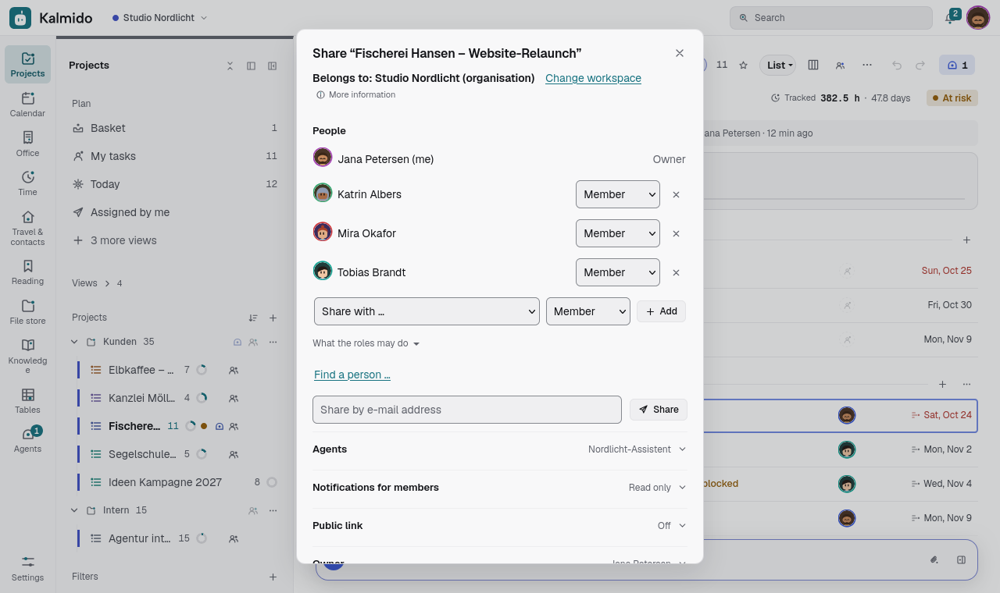
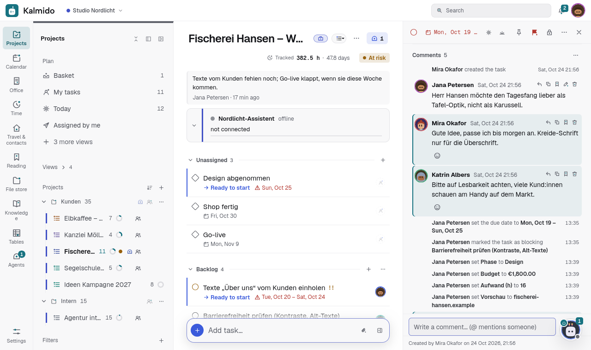
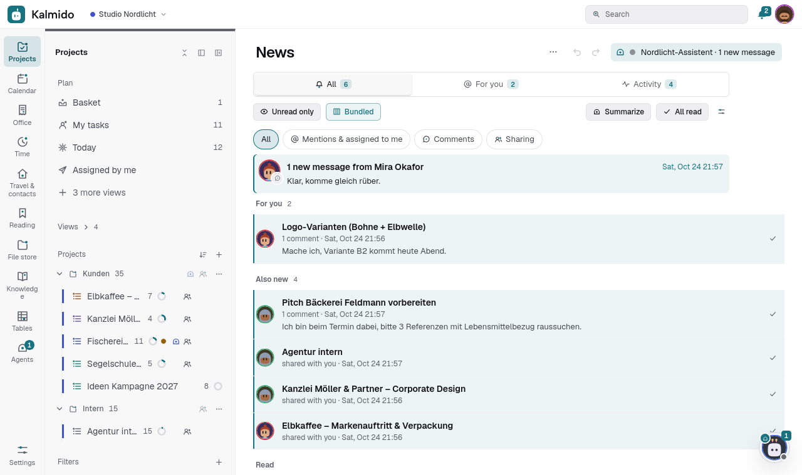

# Team: workload, absences, disposition

Kalmido's team views live in **Workload** (sidebar, module "Workload"). Since 2.50.0 the view has three tabs:
**Workload**, **Absences** and - with the module "Disposition" switched on - **Disposition**.

## Absences

*Since 2.50.0.*

- Everybody enters their own absences: **Absences > Enter an absence** - vacation, sick leave, day off or other,
  one day or a period, optionally half a day (morning / afternoon) and a note. There is no approval: entering is enough
  (unless the organisation's admins switch on vacation requests, see below).
- The admins of an organisation can also enter absences for its members.
- **Which area:** the workspace switch decides (2.96): on an organisation its absences, on **Private** your own
  personal area (also as a member of organisations), on **All** the first organisation. The picker at the top switches
  between them.
- **Who sees what:** the team sees *that* somebody is away and when. The kind (above all sick leave) and the note
  only the person and the organisation's admins see. Kind and note are stored encrypted when the server's
  encryption at rest is on.
- **Public holidays:** an organisation's admins pick first the country, then the region where it has any (Settings >
  Organisation); Germany by state, or only the nationwide holidays; Austria, Switzerland, France, Spain, Italy and the
  Netherlands with their nationwide holidays. Kalmido computes them itself (no external service), one data file per country
  under `kalmido/office/packs/holidays/`, the names follow your language. People without an organisation set their own.
- **Effect:** in the workload a week's capacity shrinks by the absent workdays and holidays (a week away = no
  capacity). *Plan my day* shows a hint instead of a proposal on a day away. Assigning a task to somebody who is
  away on its day shows a warning - the assignment still happens.
- Deleting an absence can be undone.
- Agents read only "away" and the period of their own organisation (`GET /api/v1/absences`, MCP `get_absences`),
  never the kind.

## Working days and weekly hours

*Since 2.125.0.*

- **Settings > General > Working week**: the days you work (Monday to Friday by default) and your hours per week
  (empty = 5 x the server's hours per day).
- The workload spreads the hours per week over your working days: an absence or a public holiday on a working day lowers
  the week by that day's share, a day off on a day you do not work costs nothing. The hint *Maybe forgotten* in the time
  view and the vacation account count only working days.
- An organisation's admins set the working days and hours of their members in **Absences > Vacation accounts**
  (they are the person's own settings, so they apply in every organisation of that person).
- Without a setting everything stays as before (Monday to Friday).

## Vacation account and vacation requests

*Since 2.125.0.*

- **Vacation account:** per person and year an entitlement in days (half days allowed) and an optional carry-over from
  the year before. The admins of an organisation set it for its members in **Absences > Vacation accounts**; people
  without an organisation set their own there. The tab shows *entitlement*, *taken* (approved vacation working days of
  the year; half days count 0.5, public holidays of the chosen region and days you do not work do not count), *requested* (open
  requests) and *left*. No entitlement = no account, nothing changes.
- **Vacation requests:** off by default. An organisation's admins switch on **Vacation of members needs an approval** in
  **Absences > Vacation accounts**. Then vacation a member enters for themselves is a request: the person and the admins
  see it marked *requested* (striped in the grid); the team, the workload, *Plan my day*, the booking page and agents
  treat the person as present until it is approved. Sick leave, days off and other absences never need an approval;
  vacation an admin enters (for themselves or a member) is approved at once. People without an organisation never ask.
- **Deciding:** the admins see **Open vacation requests** with *Approve* and *Reject* (an optional note for the person).
  Undo opens the request again. A member who changes the period of a request or an approved vacation, or changes a
  rejected request, asks again.
- **Notifications:** the admins get a News item and a push about a new request, the person about the decision; the row
  *Vacation requests* of the notification settings switches both off. The notes stay in the app.

## Disposition

*Since 2.50.0.*

Book crew and equipment for shoot days and see who and what is free.

- Switch it on in **Settings > Modules > Disposition** (off by default; for organisations and for freelancers in their
  own area).
- **Book:** a title, the day(s), optional times, *Option* (pencilled in) or *Firm*, optionally a project, and the
  resources: members of the organisation, contacts from the organisation's address books (crew without an account),
  devices and device sets from *Office & finance* (a set books its devices along).
- **Warnings, never blocks:** a person or device booked twice at the same time, or a person who is away
  (vacation, sick leave, day off), is marked; the booking stays.
- **Week grid** with one row per resource (phones: a project per day), **Who is free on ...?** for a single day.
- **My bookings** lists your own bookings; a firm booking also shows up in your News (event "assigned to me", with
  its usual switch in the notification settings).
- Changing or deleting a booking applies to the whole job (one shoot day); deleting can be undone. A member changes only their own bookings of a job (the others stay as they are); deleting a job that holds other people's bookings needs an admin.
- **Export (2.141.0):** the buttons *CSV* and *ICS* next to *Book* download the bookings the view shows (same period, filter and
  organisation). CSV: resource, kind, booking, project, status, start, end, hours (timed bookings only), note. ICS: one event per
  booking, whole days as all-day events, an option as tentative. Your own bookings also appear in your calendar.

## Agents plan with you

*Since 2.51.0.*

- **Weekly status on the project page**: plan a job for an agent with the template *Status on the pin board*. The agent writes
  one block "Status" on the project page (done, stuck, overdue, who waits on whom) and overwrites only that block each week. It
  is marked "From <agent>, updated ..."; you can edit or delete it as usual. The agent needs the permission *Pin board*.
- **Time tracking**: with the template *Check time tracking and propose entries* the agent points out implausible entries and
  sends one proposal with entries for past events without time. You change times and note and apply it (one undo step). Share
  your calendar with the agent so that it sees your events.
- **Shoot planning**: an agent proposes shoot days and crew / equipment for a project. Warnings show double bookings, absences
  and other projects that day. Applying creates per day a task in the project with a draft in your calendar and pencils in
  crew and equipment as options, never firm.
- **Drafts in the calendar** (tentative events) look pale and dashed and say *Draft*. Tap one: *Confirm* makes it a normal
  event, *Discard* deletes it (undo brings it back).

## References in comments and descriptions

*Since 2.53.0.*

- **Drag to reference:** drag a project or folder from the sidebar, a task from a project or the calendar, a file from the
  Ablage, a contact or a calendar entry onto the comment field or the description. Kalmido puts a reference in at the
  drop point: a task as `#123`, everything else as a Markdown link to this instance (`[Name](https://…/#l/80)`). Other
  drops (moving tasks, attaching files) work as before; only the text fields take references.
- **Phone / tablet:** the link button next to the comment box (and *Insert reference* under the description) opens the
  search; the pick goes in at the cursor. It finds projects, folders, open tasks, contacts, appointments of the coming
  months and the files of the Ablage folder that is open.
- **Into a chat (2.147.1):** the same works for the message boxes of the team chat, a thread and the agent chat (also a
  window of the split chat panel): drop a task and it goes in as `#123` at the drop point, the sent message shows it as a
  reference. Several selected tasks dragged at once go in as one reference each. A dropped file still becomes an
  attachment. On a phone / tablet the link button sits in the chat's input row.
- **Cards:** a link to this instance shows as a small card with an icon (project, folder, task, contact, appointment,
  document) and the name *the reader* sees now - never the label the author typed. A target the reader cannot see (or one
  that was deleted) is a grey *No access* card without a name and without a link.
- **Preview:** with a mouse, resting 0.4 s on a task number or a card shows a preview next to the pointer - for a task its
  status, project, priority, due date, assignee, tags, subtask progress, the start of the description and the number of
  comments and attachments; for a contact company and phone, for an appointment time and place, for a project its open
  tasks, for a document size and date. Clicking opens the target as before. On touch screens a tap opens it directly.
- Names and previews come from what is already loaded or from the normal read routes, which check access; agents see
  references in comments as plain Markdown text.

## Urgent tasks

*Since 2.53.0.*

The bell in the header of a task decides how that one task notifies you: **As the project** (default), **Muted** (no pushes
for it, News stay) or **Urgent** - until it is completed or until a date. Urgent sends every change and every comment of the
task as a push at the highest priority, even if the project is quiet.

- **For others**: the owner and the admins of a project can mark a task urgent for some or all people of the project (*Urgent for
  others…* in the bell's menu). The people get a News item and see "Urgent, set by ..." on the task. Everyone can switch it
  off for themselves; the task history notes it.
- **Refuse it**: *Settings > Notifications > Accept urgent markings from others* off - such a marking then counts as
  "As the project" for you.
- **Honest limit**: on Android (ntfy) an urgent push comes through. On an iPhone the web app cannot break through Focus or
  silent mode; there it is a prominent push, not an alarm.
## From agents: only what needs me

*Since 2.62.0 (comments), since 2.1043.0 also new tasks, completions and status.*

*Settings > Notifications > From agents* decides what connected agents bring into your bell (News and push):
**All** (default, as before) or **Only what needs me**. With "only what needs me" an agent's comment reaches you only when it
answers one of your comments (reply), comes right after your comment on that task, or @mentions you.

- A task marked **Urgent** for you still brings every comment of that task; a project bell **All** does not override "only replies" for agents.
- Approval cards, questions with buttons and suggestions of an agent always arrive: they wait for your answer.
- A project bell **All** and a task marked **Urgent** for you still bring every comment of that project / task.
- **Since 2.1043.0** an agent's new tasks, completions (also closing / reopening) and project status changes stay quiet with
  "only what needs me": no News entry, no push, also not through a project bell **All** / **Custom**. They still arrive when
  the task is assigned to you or marked **Urgent** for you; what the agent assigns to you arrives as an assignment.
- With **All**, pushes about other things agents do (new tasks, completions) keep their own switch.
- **The bell (2.66.1)**: the agent comments that reach you count in the bell's number and under *For you* - with "only
  replies" its replies and mentions plus what reaches you anyway (approval cards and questions waiting for you, comments on
  a task marked **Urgent** for you), with **All** every agent comment. Other things agents do (completions, status,
  new tasks, assignments) stay under *Activity* without a number.

## Address books of the organisation

*Since 2.52.0.*

- An address book in an organisation's workspace can belong to the organisation instead of a person: **Contacts > Address
  books > More > Hand over to the organisation…** (the owner, if they are an admin of that organisation). Nothing is handed
  over automatically.
- Admins of the organisation manage it (rename, colour, shares, birthdays, delete). **Members of the organisation** sets what
  the other members may: *They can view* (the default), *They can edit*, or *Only admins and people it is shared with*.
  Sharing it with single people of the organisation keeps working; kid accounts and agents get it only through a share.
- It stays when people leave: if the person who handed it over (or the admin who chose its birthday project) leaves the
  organisation or their account is deleted, another admin (else another member) takes over. Its contacts, its birthday project
  and the links to tasks stay. Only when nobody else is left in the organisation does it go with that person as before.
- It always stays in its organisation's workspace and is seen only by its members. Phones get it over CardDAV like any other
  address book (read-only when members may only view).
- **Move to Private…** only undoes one's own hand-over (2.148.1): the admin who handed it over gets it back as their
  own; other admins keep it with the organisation and can export or copy the contacts.

## Report forms

*Since 2.63.0.*

A project's form (project menu, Forms) can work as a report form for customers: **Type of report** gives every sent task a
type (bug, feature, task), **Allow one file** adds a file field (at most 10 MB, stored like other attachments and counted
against the project owner's storage; an executable ending gets `.txt`), and **The sender gets a link to the status** asks for
the e-mail address (required then). After sending, a person without an account sees a status link on the thank-you page
and gets it once by mail; the link shows only that report (see the customer portal). People of the organisation who
send a form signed in get no status link: they see the task in the app.

Against spam, without any outside service: the hidden honeypot field, limits per address and per form, a signed time
stamp in the page (sent sooner than 3 seconds after loading or more than 24 hours later = "please send it once more"),
at most 5 reports per e-mail address, form and hour, at most 3 confirmation mails per address and hour (plus the server's
mails per address and day) and at most 5 links in the text.

## Questionnaires: own questions in forms

*Since 2.98.0.*

A form can ask its own questions instead of subject and description (form dialog, **Questions**): short text, long
text, a choice (one or several options), date, number, a file upload and yes / no; each with a help text and the switch
**Required**. Drag a question by its grip to reorder it (touch too), or use the up / down buttons. A form without own
questions stays the classic form.

- **One question per step**: the page shows one question at a time with Back / Next and the progress; else all questions
  on one page. Both work without scripts. Required answers, numbers, dates and choices are checked on the server; a send
  with a problem shows the page again with the typed answers and opens the step of the first problem (files have to be
  chosen again).
- **Files**: at most three file questions per form, one file each, at most 10 MB; pictures, PDF, office formats and text
  only. They become attachments of the new task (sealed, scanned and counted like every attachment).
- **The task**: in the form's list (and section) as before, titled with the form and the sender; the answers stand in
  its description as Markdown, a heading per question.
- **Client**: with **Match the e-mail to a client** the sender's address is looked up among the clients of the project's
  space only (the project's own client first, else the one client of the project's organisation, or of the owner's private
  space, with that address or a contact person with it). Found: the task names the client; unknown: the task says
  "Client unknown". **Unknown address: create a new client** (off by default) creates one there instead (at most 20 per
  form and day).
- **Submissions**: the form dialog lists the tasks the form made with their answers (only those still in its project and
  not deleted) and downloads them as CSV, a column per question. This list and the CSV are for the people who manage the
  form. The answers and the sender's address also stand in the task: everyone who sees the task reads them, and the project's
  agents get the task.
- Moving the project into the other workspace takes its forms and their questions along; a client of the old workspace is
  then no longer named in the submissions.

## Tracked time of a project and templates

*Since 2.63.0.*

- **Who sees whose time.** In the window "Tracked time" of a project, the time reports and the CSV, the owner of the project,
  its admins and the admins of its organisation see everyone's entries. Everyone else sees their own there, and the window
  says "Your time only". The time list in a task's detail still shows everyone's entries of that task. 2.144.5: the time
  sum in the project header follows the same rule (members see their own hours there); the project page's "Tracked", the status
  report and the office figures stay sums of everyone.
- **Excel export (2.125.0).** Next to *CSV* the time view and the client page have *Excel (XLSX)*: the same filters,
  columns, rounding and visibility as the CSV, but hours and amounts as numbers, start and end as date-time cells and a
  sum row at the end. The workload view has the same button: people x weeks with the planned and the capacity hours per
  week (only the people and tasks you may see). Without an organisation it works the same on your own data.
- **Timer shortcut (2.125.0).** The installed app (Android, desktop) offers *Start / stop timer* in its long-press menu
  when the module "Time tracking" is on: it opens the time view and starts a timer on the basket, or stops the running one.
- **Templates keep the project page.** "Save as template" on a project also saves its notepads, the standard arrangement of
  the project page and the block colours. A project made from the template gets its own copies of the notepads, placed and
  coloured as in the original. Notepads written by agents stay with their project.
- **Undo after "Delete all times of this project"** brings the entries back exactly as they were, including the link to a
  timer started on a phone, so a stop that arrives later from that phone still finds its entry. Entries already billed stay:
  2.144.5 recognises them by the invoice position made from the project's times (also after the project was renamed, and in
  the private office of a person without an organisation); older invoices still by the project's name.

## Monthly timesheets: close, approve, send back

*Since 2.125.0.*

- **Close a month.** On the time page choose *This month* or *Last month*: a card shows the month's timesheet. *Close month*
  locks your entries that start in that month: no new entry, no change, no delete, no timer start or stop into it, focus
  sessions and agents' proposals no longer add time there, and *Delete all times of this project* leaves them. The entries
  show a lock instead of the edit buttons. An entry from the 31st 23:00 to the 1st 01:00 belongs to the month it starts in.
  A running timer of that month has to be stopped first. *Reopen* unlocks it again as long as nobody approved it.
- **Approval in an organisation.** The admins of your organisation get a News item (and a push) and see your closed month
  under *Timesheets of your team*, with the hours on the organisation's projects (never your private time). They *Approve* it
  or *Send back* with a note: then the month is open again and you get the note. An approved month only an admin reopens (after leaving the organisation the person reopens their own sheet; an admin's own sheet needs a second admin to approve it when there is one).
  Members cannot decide, admins of another organisation never see it. Every step is one Undo step.
- **Without an organisation** you are your own admin: closing locks the month, there is no approval step, you reopen it
  yourself.
- **Notifications:** the event *Timesheets* in Settings > Notifications (News and push, both can be switched off).
- **Agents and the API** get `409` with the error code `month_closed` when they write into a closed month.

## Time zone and entries over midnight

*Since 2.125.0.*

- **Your own time zone** (Settings > Modules > Time tracking > *Time zone*; empty = the server's, the device's zone is offered
  as a suggestion) decides on which day an entry counts, the periods of the report, the CSV and the timesheet, "today" and
  the month of the lock above. Reminders, the digest, the briefing and the review follow it too (Settings > General > Region and formats, set from the browser at the first login); the calendar, workload and absences keep the server's time zone. With *All members*
  the report uses your time zone for everyone's entries.
- **Entries over midnight** (on by default): an entry from 23:30 to 00:30 counts with 30 minutes on each day in the days of
  the report and the timesheet, and the CSV has one row per day. The entry itself stays one entry, the totals stay the same.
  Rounding stays per entry: the rounded time is split by the share of each day, never rounded twice. Switched off, an entry
  counts on the day it starts, as before.

## Saved arrangements and templates

*Since 2.55.0.*

- **Several arrangements per view.** The start page, Today, Time tracking, the overviews, the review and every project page
  can keep named arrangements of their blocks, e.g. "Focus" and "Overview". *Save as arrangement…* sits in a block's "…"
  menu and in *Customize*; once a view has one, its header shows a switch (Today: in the view's "…" menu) with *Standard*,
  the saved ones and *Manage arrangements…* (rename, order, delete). They are the same on every device.
- **Switching** shows the saved arrangement as your own arrangement of the view; changes you make while one is active go
  into it. *Reset to the standard* or choosing *Standard* ends that, the saved one stays. Saving, renaming, deleting and
  switching are each one undo step. At most 12 per view.
- **Send as template…** sends the current arrangement to people you see (your organisations and connections; never to
  agents, at most 20 at once; a project page only to people with access to it). Only the arrangement travels (blocks,
  order, widths, heights, a block's switches), never content: a block the recipient cannot see simply stays empty. They get a
  News item ("For you", switched off together with the sharing News) with a preview and *Apply* / *Reject*; applied,
  it is their own saved arrangement, named after the sender, with no link back.
- Agents cannot use any of this (403); they propose arrangements their own way (2.55.0, #1066).
- **A standard per organisation** (2.627.0). The admins of an organisation set the standard of the start page, Today, Time
  tracking, the overviews and the review for its members: in the organisation's workspace, *Make this the default for
  (name of the organisation)* shows next to an own arrangement that differs. What a person sees: their own arrangement, else the
  standard of the organisation of the active workspace, else the server's standard (set by the instance admins); a view the
  organisation has no standard for uses the server's. *Reset to the standard* leads back to the organisation's standard. In
  *Private* (or with several organisations under *All*) and without an organisation only the server's standard counts.

## Sprints

*Since 2.60.0.*

For teams that work through a shared backlog (software, agencies): a project can plan in **sprints**, time boxes of one
or two weeks with a goal. Off by default; switch it on in the project dialog (*Sprints > Plan in sprints*, people who may edit
the project). *Settings…* sets the length (1 week, 2 weeks or free), the start weekday and whether open tasks move to the next
sprint automatically.

- **The sprint header** above the project and the Kanban: name, dates, goal, progress (tasks, or story points when the project
  uses them) and a small burndown with an ideal line. On the phone it folds away with a tap on the name.
- **Filter**: *All*, *Current sprint* or *Backlog* (tasks without a sprint), right in the header.
- **Plan**: *Sprint…* in a task's menu, the *Sprint* field of the multi-selection, or drag tasks onto the sprint header. Each
  step can be undone. *Sprint options > Show the sprint in the task row* shows the sprint in each task row.
- **Close**: *Close sprint* shows the review (done, still open, added after the start) and asks where open tasks go: into the
  next sprint or back to the backlog. The next sprint starts right away; a sprint whose last day is over closes by itself.
  *Sprint options > All sprints* lists every sprint with its review; there you can also plan the next ones.
- Agents of the project read sprints, put tasks into them and hear when a sprint starts or closes (see [AGENTS.md](AGENTS.md#sprints)).

## Review step

*Since 2.60.0.*

For software teams and anything that needs a second look. Off until a project switches it on: project settings > *Review
step*, with an optional default reviewer, the review section (default: the section named *Review*) and *Done only after
approval*.

- A task shows its reviewer and the review state in the task panel (*Select reviewer*, *Send for review*). The reviewer
  is a person or an agent of the project.
- Moving a task into the review section (dragging on the board or changing the section) asks its reviewer; they get a
  News item and a push (Settings > Notifications, row *Reviews*).
- The reviewer (or an owner / admin of the project) presses 👍 *Approve* or 👎 *Back* (with an optional note). *Back*
  returns the task to the section it came from and tells the assignee. Nobody approves their own task unless they are a
  project admin.
- With *Done only after approval*, ticking off waits for the approval: the tick explains it and offers *Send for
  review*. Without a reviewer ticking off stays free.
- A linked pull request that is merged, or approved with 👍 in Kalmido, counts as the approval.
- Every step can be undone.

## Video sign-off with comments at a timecode

*Since 2.99.1.*

For film and video work: the customer or a colleague watches a cut and comments at the second it is about. **Kalmido
stores no videos**: a video sign-off holds **links only** -- Vimeo (also unlisted with its hash), YouTube (also unlisted,
youtu.be, Shorts) or a direct video file over https (MP4, WebM, MOV, e.g. a file link from Nextcloud, a NAS or Dropbox; the
link has to end with the file name). Any other link (a Google Drive page, a Nextcloud share page) is a *link without time
control*: it opens in a new tab and its comments carry no timecode.

*Since 2.633.0:* **audio** works the same way: a direct audio file over https (MP3, M4A / AAC, WAV, OGG / Opus or FLAC; the
link has to end with the file name). It plays in the browser's own audio player (no script of another service, no
SoundCloud / Spotify, no waveform); comments sit at a second, the time line under the player shows their marks, versions,
states and the customer link work as for a video. Kalmido stores nothing of the file and fetches nothing from the link
itself: the browser of the person who listens loads it (after *Load audio* when the file lies on another host).

- Where: a task's panel (*More details* > *Approval*), a project's overview and a client's card: *Add video link* (2.633.0: *Add video or audio link*).
  2.623.0: it is called *Approval* in the app and belongs to agency projects and projects without a type (not software or
  private ones; switch it on there under the project's options > Properties). Settings > Modules > *Approval* switches it
  off for you completely (also for a person without an organisation): no new ones, the existing ones stay visible and
  readable, in the trash too; nothing is deleted.
- Comments: typing pauses the player and keeps its time (*at 01:23*; a tap on it comments without a time). A tap on a
  timecode or on a mark of the time line under the player jumps there. Answers (one level), *done* and back, delete.
- Versions: *New version…* in the menu adds the next cut (v1, v2 …); the version switch shows the older ones with their
  comments.
- Export: *Copy comments as text* (timecode, name, text, done -- for the edit) and *Download comments (CSV)*.
- Customer link: *Create customer link* gives a page without an account (the approval link of the office, see
  [OFFICE.md](OFFICE.md) *Approval by the customer*): the newest version, the customer's comments with a timecode (name
  needed) and *Approve* / *Request changes* (with a reason). The decision sets the state of the sign-off and stands in its
  comments; the creator of the link gets a push (notification switch *Client decisions*; if the creator has left: the office's admins; also for the customer's first
  comment within ten minutes). Comments of the team stay internal; only answers to the customer's comments are shown to
  them. Deleting the sign-off stops its links at once.
  2.642.0: several customer links per sign-off, each with its own expiry date (*Valid until*) and its own *Switch off*;
  the list shows every running link and the last decisions. *The client may also see the older versions* (ticked when the
  link is made) lets the customer open the older versions too, read-only - comments and the decision stay on the newest.
  The customer types the name once (it stays for this link in the browser). A new version keeps every link working: the
  customer sees the new version at the same address and decides again; the earlier decision stays in the list and as a
  comment at its version. In the app the customer's comments show as *Name (Guest)*. The page shows nothing but this one
  sign-off: no task, project, other sign-offs or contacts.
  2.764.0: the customer link works for **images and PDFs** too: the page shows the image or the PDF page by page (the
  bundled PDF viewer, nothing in the PDF runs) with the numbered points of the customer's comments; a tap sets the point
  of the next comment (on a PDF: on the page shown), the same numbers as in the app. The page hands out only the file of
  the version it shows and only while the link is open.
- Rights: who sees the task / project / client sees the sign-off and may comment (like task comments); changing it, new
  versions, the customer link, moving and deleting need the right to edit there. A locked project (end-to-end) has none.
  At a client (2.122.4) that is an office role in the client's organisation (or, for a private client, its creator).
- *Move to another workspace…* takes it with its versions and comments into a project of the private space or an
  organisation (out of an organisation: its admin, or its creator into the private space after an admin released the request, see *The way back for members*); the customer links and their record stay in the old
  workspace. Undo brings it back to its old place. Since 2.122.4 the records stay bound to the sign-off and show again
  when it comes back; in the new workspace they never show.
- Deleting for good: a sign-off in the trash is deleted for good after 30 days (only with the deletion runs on, `KALMIDO_RETENTION_PURGE=1`: [Deletion periods](SELF-HOSTING.md#deletion-periods)) with its versions and comments. A task,
  project or client that is deleted for good takes its video sign-offs with it. The customer's approval records **stay**: name,
  e-mail, reason, address, device and the decision, without the link to the video. The admins of the organisation and the
  creator see and delete them; a decided record of an organisation or a private office only after its legal period (6 years,
  to the end of the year).
- Every step can be undone. The players are embedded without loading any script of Vimeo or YouTube (YouTube through
  youtube-nocookie.com); only the two player addresses may be framed (Content-Security-Policy).

## Story points, WIP limits and velocity

*Since 2.60.0.*

For software teams working on a board. Everything is off until you switch it on.

- **WIP limit per column**: in a kanban column's menu choose *WIP limit…* and enter how many open tasks the column should
  hold (empty = no limit). The column head then shows "2/3"; above the limit the number and the head are marked in the
  warning colour and a move into the column says so. Moving stays allowed. New projects of the type *Software / AI dev*
  with the standard sections start with a limit of 3 for *In progress* and *Review* (change or remove it any time).
- **Story points**: in the project dialog (projects with ticket types or sprints) turn on *Story points*. A task then gets the
  field *Story points* (1, 2, 3, 5, 8, 13) in its panel; the number shows in the task row and on the card, the kanban
  column heads add up their points, and the multi panel sets them for many tasks at once. Each change is one undo step.
- **Velocity**: with sprints and story points on, the project page offers the block *Velocity*: the completed points of
  the last (up to six) closed sprints as bars and their average as a planning aid for the next sprint.
- Agents read and set the same through the API and MCP (`points`, `set_wip_limit`, `get_velocity`, see AGENTS.md).
- **Meaning of a column** (2.577.0): in the column menu *Meaning…*: open, in progress, review, done or rejected, the name stays
  free. Dragging a task into a done column completes it, into a rejected column marks it won't do, dragging it out opens it again.
  Ticking moves it into the first done column while completed tasks stay in their columns; reopening goes to the first open column.

## Swimlanes on the board

*Since 2.138.0.*

The button *Swimlanes* above a kanban board groups the cards into horizontal lanes: by **person** (the people with tasks
on the board, then *Nobody assigned*), by **priority** (High, Medium, Low, No priority) or by a **custom field** of the
project (a select field: its options, then *No value*; a checkbox: yes / no). *None* shows the board as before.

- The column heads (count, WIP limit, points, the column menu, dragging a column) stay in one row on top; each lane has
  its own head with name and count and folds with a tap (it stays folded).
- Dragging a card into another lane sets that lane's value (priority, field or person; a person replaces the previous
  one); a move into another column at the same time is one undo step. Only people who may edit the project can drag.
- *+ Task* in a lane creates the task with the lane's value.
- On a phone the lanes stand below each other and the board swipes sideways as a whole; a long press drags a card into
  another lane.
- The choice is remembered per project on your account in this browser; other members choose their own.
## Photo metadata on upload

*Since 2.61.0.*

Photos keep a lot about where and how they were taken: the place (GPS), the camera and its serial number, the capture
time. Uploaded photos lose these metadata before they are stored, on every way in (file store, task and comment files,
project files, chat, documents, mail and sharing into Kalmido); profile pictures and project icons were already stored without them.

- JPEG, PNG, WebP and HEIC / HEIF, recognised from the content, not the file name. The picture itself stays as it was:
  only the metadata blocks are cut out (JPEG keeps its colour profile; HEIC keeps its structure, its metadata blocks are
  emptied). A photo stored turned (the camera's orientation mark) is turned upright first and saved again, so it shows the
  right way round without the mark. Anything Kalmido cannot read is stored unchanged; the upload never fails because of it.
- Videos (MP4, MOV, also from phones, 2.360.0): the recorded place is overwritten with zeros in the file itself; the video,
  its size and everything else stay as they were.
- The switch *Remove location data from photos* (on by default) also removes camera details and capture time. For your
  private files it sits in *Settings > Data > Photos*; files of an organisation follow the organisation's switch in
  *Settings > Organisation > People*, which only its admins change. Off: photos are stored exactly as uploaded.
- Documents: the capture date is read before the metadata go (also with the switch off) and shown in the document's
  detail (*Taken on …*). When the recognised text has no date, the document gets the day the photo was taken, marked
  *automatic* like other recognised values. The place is never stored.
- Browser-encrypted files (end-to-end) are not touched: the server cannot read them.
- Agents cannot change either switch.
## Files and documents into the other workspace

*Since 2.96.0.*

Files, folders (with everything in them) and documents move between the private space and an organisation, both ways:
**Move to another workspace…** in a row's menu of the file store, or **Select** (check boxes, also on the phone) and the bar
*n selected · Move to… · Move to another workspace…*. In *Documents*, **Select** chooses cards (or *Select all* of what the
search and the filters find) and moves them into the documents folder of the other workspace; a single document has the
button in its sheet. The dialog names source and target and says beforehand what happens: how many files, duplicates
already there, shares and openings to the whole organisation that end, what stays (links to task files, agent folders,
the trash). Sender, type, tags, the custom fields with their values (2.153.0: found or made by name and type in the
target), the archive number (when it is free there), the recognised text and a Paperless origin go along; the files are sealed again with the target's key. One undo step moves everything back.

Out of an organisation only an organisation admin moves something (2.148.1; before, the owner or who uploaded it could);
a person without an organisation has no other workspace and does not see the action. Agents never move data between
workspaces. Receipts the cash book or the equipment list points to stay in their workspace.

**A task into a project of another workspace** (2.455.0). The project picker for moving a task (also for a selection, and in the command palette) lists the projects of the workspace the task is in. At the top, *Move to another workspace…* lets you pick the workspace first and then the project there; moving
across always asks once (*Move to another workspace*), and Undo stays. A task in the Basket belongs to the workspace shown now. Without an organisation there is only one workspace and no such entry.

**A project into the other workspace (2.401).** Changing *Workspace* in the project dialog checks first: when the move ends
something, takes something along or leaves something behind, the same move dialog lists it before anything moves -- the
client of the old workspace and "also in" links across the boundary end (Undo brings both back), the customer reports of
its tasks go along (a report's client of the old workspace comes back with Undo), attached tables, video reviews, office
documents, deals, approval links and receipts stay in the old workspace (each has its own *Move to another workspace…*).
A member who does not fit the target, or a family / Home & life project, blocks the move there. Nothing to say: it moves at
once, as before. Route: `POST /api/lists/{id}/move-space {to, dry: 1}` (only the check; the move is `PATCH /api/lists/{id}
{org_id}`; agents 403).

**Leaving an organisation is the admins' call (2.148.1).** Projects (also through a folder's workspace), copies of a project,
files and folders, tables, contacts (single or several at once) and *Save as task* from a channel of the organisation
leave it -- into the private space or another organisation -- only through an admin of that organisation; everybody else
gets "Only organisation admins can move data out of the organisation." Each such move is written to the organisation's
project history (*Settings > Organisation > People > Projects of the organisation*) and the other admins find it in their News. Moving something from the
private space into an organisation and moving inside one organisation work as before; a person without an organisation
moves freely in the own private space.

**The way back for members (2.361.2).** Whoever brought something into an organisation or made it there (a project they own,
a table, file / folder, knowledge page, office client or draft, video sign-off they made, a poll or bookmark of theirs) and is no admin gets *Ask an admin* instead of a plain refusal -- in the move dialog
and in the message. The organisation's admins get a News item and find the request at the top of *Settings > Organisation > People > Projects of the organisation*: *Release* or *Reject* is one click. After a release the member moves that one thing into
their private space with the usual dialog (which still lists what the move ends) within 14 days; the release is used up
by that move. Knowledge pages, office clients and drafts, video sign-offs, polls and bookmarks no longer let their
maker take them out without an admin (before 2.361.2 they did, unlogged). Releases, declines and the move itself are in the project history; nothing goes back silently. The dry run
of a move into an organisation tells a member up front that the way back needs an admin.

## File requests: clients upload into a folder

*Since 2.122.0.*

A client sends logos, contracts or receipts without an account: **Request files…** in the menu of a folder of the file
store (everyone who may add files there) opens the folder's requests and **New file request**. A request has a title
and a note for the client, an end date (required, suggested in 14 days, at most 90), the size per file, how many files
in all and the allowed kinds (documents and pictures ticked; design files, archives, audio and video on request).
Programs, web pages and SVG files are never accepted, also not under another ending: the content must fit the name.
Optionally every request gets its own subfolder. **Create link** copies the link; the row also has a QR code.

The page of the link (`/u/<token>`) shows only the title, the note and a file field (drag and drop, a progress bar per
file; without JavaScript the plain form works). It never shows the folder, its files or other uploads. The files land in
the folder as files of whoever asked (counted on their storage, scanned and sealed like every upload, a free name instead
of overwriting); the history of each file says *received through a file request*. A request in the documents inbox
folder is recognised like any other document there.

The folder's project shows each request as open, expired, stopped or not working, with the number of files that arrived.
In its menu: **Extend by 14 days**, **Stop the link** (it stops at once; *Open again* brings it back) and **Remove**;
each is one undo step. A link also stops when its folder goes into the trash or into another workspace, or when whoever
asked can no longer add files there. Unknown, expired and stopped links get the same answer. Limits per address and
link (sends per minute and hour, a daily volume per link: `KALMIDO_FILE_REQUEST_MB_DAY`, default 1000 MB) keep a
link in the open from filling the disk. Public links have to be on (Settings > Server > Server > Whole server); a person without an
organisation uses requests in the own folders the same way.

Whoever asked gets one News item (and a push) per request when files arrive; more files within ten minutes raise its
count instead of sending again. *Files from file requests* in the notification settings switches News and push off.

## Several files at once, ZIP download, scanning with the phone

*Since 2.138.1.*

In the file store, **Select** (check boxes, also on the phone) and the bar now also offer **Download** and **Move to the
trash**. Download of one file gives the file itself; several items or a folder become one ZIP that keeps the folder
structure (a doubled name gets " (2)"). A folder's menu (its row or the open folder's "…") has **Download as ZIP**. The ZIP
holds only what you may see: nothing from the trash, no links to task or project files, no file the virus scanner locked
or has not checked yet. Moving several items into the trash is one undo step that brings all of them back. On a phone the
moves of the bar sit in its "…" menu.

**Scan** next to *Upload* (and in *Documents*) opens the scan dialog: take a photo per page with the camera (on a computer:
choose pictures), turn a page by 90 degrees, change the order, remove a page, then **Save as PDF**. *Black and white
(document)* (on by default) gives a clean grey page. Kalmido builds one PDF on your own server -- at most 30 pages, every page
scaled to about 2000 pixels, without the photo's metadata or location -- and stores it like an upload: the storage limit,
the virus scan and the text recognition apply. From *Documents* the PDF becomes a document of the workspace there.

## Links for external people

*Since 2.138.1.*

A file or a folder of the file store can go to people without an account through a secret link: **Link for external
people…** in a row's menu, or **Create link** in its details. Choose how long it is valid (1 day, 7 days, 30 days, until a
date, no end), optionally a password and a label only the owners see (one link per customer, for example). The page shows
a file with its size and a download button (pictures with a preview), a folder with its folders and files, each to
download, and the whole folder as a ZIP. Nothing else: no upload, no versions, no comments, no names of people. A row with
a live link carries a link badge; the details list every link with views and the last time it was opened, **Copy**,
**New link** (the old address stops at once) and **Revoke** (one undo step brings the same address back).

Only who may share the item (its owner, an organisation's admins) makes a link; agents never do, and folders of agents,
linked task files, locked folders, folders of the knowledge areas and items in the trash cannot be shared outside. A link stops working at once when it expires, is
revoked, the item or a folder above it goes into the trash or into another workspace, the person who made it can no
longer share it (left the organisation, no longer admin), the organisation's admin turns off **Allow external share
links** (Settings > Organisation > People; nothing is deleted, turning it on brings the links back) or the server's admin turns off
public links. Every view and download through a link shows up in the item's history, without the visitor's address;
the page is never indexed or cached, and guessing addresses or passwords is limited per address. A person without an
organisation shares from the private space the same way (only the server's switch applies).

## Pinned chat messages

*Since 2.62.0.*

Important messages stay in view: in the team chat and in the chat with an agent, *Pin* in the menu of a message (on a
phone: press and hold the message) puts it into a bar at the top of the conversation. With several pins the bar shows
the newest; a tap on the arrow goes through the others, a tap on the text jumps to the message, also when it is further
up than the loaded part. *Unpin* in the same menu (or the x in the bar) takes it out again; Undo brings it back. At most
five messages per conversation are pinned; a deleted message leaves the bar. Everyone in a team chat conversation can
pin, in an agent chat the person and the agent. Others see the change right away.

A message is sent once: it shows at once as *Sending…*, and Send / Enter wait until the server took it, so pressing
Enter again (for example right after waking the laptop) does not send it twice.
## Channels, groups and files in the team chat

*Since 2.138.1.*

Besides the chat of every shared project there are **channels** anyone opens: *Team chat > New message > New channel*. A
channel of an organisation is either *open to the whole organisation* (everyone in it finds it under *Browse channels*
and joins; writing in it joins too) or for invited people only. Without an organisation (your own space) a channel is
always for invited people, chosen from the people you work with. Its creator and the admins of the organisation rename
it, open or close it, add and remove members and archive it (the gear in the head of the channel); an archived channel
stays readable for its members and comes back with *Restore*. Each change is one step of *Undo*. Since 2.148.1 only the
channel's members (and its creator) open a closed channel or add an agent to it; an admin who is not a member can still
archive it.

**Groups** are conversations of three or more people (*New group*): everyone in a group must work with everyone else
(the same people you could write a direct message to). The name is optional; without one the group is named after its
members. Every member adds people and leaves; nobody removes someone else. A group notifies like a direct message.

**Files**: the paperclip next to the message box, pasting an image or dropping files on the conversation adds up to ten
files to a message (50 MB each). Images show as thumbnails (a tap opens them large), other files as tiles. Everyone in
the conversation opens them; deleting the message deletes its files for good. End-to-end encrypted conversations
(encrypted direct messages, the chat of a project with the lock) take no files.

Agents take part in a channel only when a person adds them: your own agents, and as an admin of the organisation its
shared agents. They never join groups.

## Threads and "Read by" in the team chat

*Since 2.139.0.*

**Threads** keep a side topic out of the main conversation: *Reply in thread* in the menu of a message (the three dots)
opens the thread next to the conversation (on a phone full screen, *Back* returns). Answers there stay out of the main
conversation; under the first message a slim line shows how many answers there are, when the last came and who wrote
them, with a dot while some are unread. Editing, deleting, reactions, pinning, quoting a message and *Save as task* work in
a thread as everywhere; a search hit or a pin of a thread answer opens its thread. A deleted first message keeps its
thread ("Message deleted" stays above the line).

The unread count of a conversation counts the main conversation and the threads you take part in: you wrote the first
message, answered or were @mentioned. Only those people are notified of a new answer (the conversation's *Mute* and the
notification settings still apply); everyone else sees the thread line without a push.

**Read by**: under your own latest message that someone has read a small grey line says *Read* (a direct message) or
*Read by 3* with small pictures (groups, channels, the chat of a project); a tap lists who read it and who did not yet. There
are no ticks at every message. *Settings > Notifications > Team chat > Send read receipts* switches it off: then nobody sees when you read,
and you see nobody's read state either.

## The customer portal

*Since 2.63.0.*

A form with **status link** turns every report sent without an account into a customer report: the reporter gets a link to
its status page (on the thank-you page and by mail). There they see the title, the state (received, in progress, done), the
text they sent, the team's public answers and their own comments, and they can answer. **All my reports** sends a sign-in
link (valid 30 minutes, once) to their address; it opens a page with all their reports in the same organisation (or the same
private project owner) - never reports of another organisation, even with the same address. A report counts there once
its address is confirmed: the link in a mail to that address was opened (someone typing another person's address into the
form does not put reports into that person's list; 2.360). Nobody needs an account.

- **Internal stays internal.** In the task panel, a customer report shows the box *Customer report* (who sent it; the
  address, *Copy the status link* and *Mails to the customer* only for people who may change the task). The comment box
  gets a switch *Internal* / *To the customer*: it starts on *Internal* every time. Only comments sent with *To the
  customer* reach the customer; they are marked "to the customer", the customer's own ones "Customer". A public answer
  cannot be made internal later (the customer may have it by mail already); delete it if needed.
- **Mails.** The customer gets a mail for a public answer and when the report is done - at most one mail per report every
  10 minutes, every mail with a link that turns them off. *Mails to the customer* in the box does the same for the team.
- **Clients.** A report belongs to the project's client, else to the client of the organisation whose e-mail (or a contact
  person's) is the reporter's address. The client's card lists its reports (block *Customer reports*).
- **What the customer never sees:** internal comments, the notes once the team changed them, assignees, files, other tasks,
  names of team members other than the name of an answer's author.
- Agents answer customers the same way (`add_comment` with `portal: true`, see AGENTS.md).

### Quotations and invoices in the portal

*Since 2.120.0.*

With *Settings > Company & office > Data > Show documents in the client portal* (off by default; the office's admin, or the
person in their own private office) the portal also lists the client's **documents**: sent quotations (with the button
*Review and approve* while an approval link is open), invoices with their payment state (open, partly paid with the open
amount, overdue, paid; the due date; with online payment on, the button *Pay now* while something is open) and credit notes. Each opens as the PDF that was sent. The customer is every client
of the same organisation (or the same private office) whose e-mail or e-mail for invoices is the signed-in address.

- **Getting in.** In the client's menu (*More*) **Send portal link** mails the client the same one-time sign-in link
  (30 minutes, once; then signed in for 7 days) to the e-mail for invoices, else the e-mail. No account, no password;
  at most three links per address and hour.
- **What the customer never sees:** drafts, invoices that were finalised but not sent yet (a paid invoice shows even if it was never sent), reminders, internal notes,
  purchase prices, documents of other clients - and nothing of another organisation, even with the same address.
- Switched off with the document switch, the portal is exactly as before. With public links off on the server (or the portal's own switch off there, see SELF-HOSTING.md) the status links and the sign-in are gone altogether.

## A task in several projects

*Since 2.71.0.*

- **Show also in project…** in a task's menu (and in the task panel's project path) puts the task into a further list of the same
  workspace without copying it: it is one task, every change shows everywhere. *Remove from <project>* takes it out of that
  project again; the task stays. Both are one undo step, and the task's history notes them.
- *Since 2.320:* the task panel shows the field **Projects**: the task's own project (fixed) and every further one; **+** adds
  one, **x** removes it (phone and computer alike). On a computer, hold **Alt** (Option on a Mac) while dropping a task onto a
  project in the sidebar: it is then shown there too instead of moved (the project says so while you drag). For several
  selected tasks, **Show also in project…** sits in the selection panel (on a phone under More); subtasks and tasks that
  cannot go there are skipped and counted. At most 10 further projects per task, main tasks only.
- In the further list the row says **From <its project>**, in its own project **Also in <project>**. The further project has its own
  place and column for it: dragging it there (also on the board) moves only that place, never the task into another project.
- **Who sees it** is decided by the task's own project only. Someone who sees only the further project does not see the task
  there (nor in search, the calendar feed, a public link or an export). Projects of another organisation, private projects of
  an organisation's task (and the other way round), health, budget and locked projects cannot be used.
- It counts once: in statistics, Today, the calendar, search and exports. The sidebar counts it in each project it is in.

## Rules in projects

*Since 2.71.0.*

In the project settings the owner and the project admins find *Rules*: "When a task comes into the column Review, assign it to
the reviewer" in one sentence per rule, a switch, edit and delete (undo brings it back). *Add rule* asks for a name, *When* (a
task comes into a column, is completed, is opened again, gets a project tag, its due date is reached) and *Then* (assign to
a person of the project, set or remove the due date, write a comment, move to a column or another list of the same
workspace).

- A rule runs with the rights of the person who set it up. Loses that person the access or the admin role, or the target
  project becomes unreachable, the rule pauses and the settings say why; switching it on again makes the person who does it
  its owner.
- A change made by a rule never starts another rule, so two rules cannot play ping-pong.
- The history of the task and the comment show "Rule <name>".
- Health and budget projects, the basket and locked projects have no rules. Copying a project or making a template does not copy its rules.
- Agents read rules and can only propose one; the owner or an admin accepts it with 👍.

2.138.0 adds three triggers and three actions:

- *A task is created* (also by an agent, the API or an import step), *A task is assigned* (to a chosen person or to anyone;
  only when the person is new on the task) and *A custom field changes* (any change, or for selection and checkbox fields
  only a chosen value: an option, checked, unchecked; every field but a checkbox also *Filled*: it has a value, clearing it
  starts nothing). Formula fields are calculated and never start a rule. A rule that moves a task to another project keeps the
  values of text, number, amount, rating, date and checkbox fields where the target has a field of the same name and type.
- *Set the priority* (none, low, medium, high), *Add a project tag* (only tags of this project: the rule belongs to everyone in
  the project, personal tags stay personal) and *Set a custom field* (a fixed value, checked like a value you type; empty
  clears the field).
- A deleted custom field or project tag pauses the rules that use it. A value set by a rule never starts a "field changes"
  rule (the same loop protection as above).

## An own picture as the organisation's symbol

*Since 2.87.9.*

An organisation's symbol was an emoji only. Its admins can now use an own picture instead, like a profile picture:
*Settings > Organisation > People*, the organisation, *Symbol > Upload a picture…*; the picture is cropped square in the app and
stored re-encoded without metadata. It shows wherever the emoji showed (the workspace switch, *Settings > Organisation > People*,
the server's organisation project for its members).

- Only admins of the organisation set or remove it (*Remove the picture*); setting an emoji later replaces the picture.
- Only members of the organisation get the picture; with organisation encryption it is stored sealed with the
  organisation's key, and it is part of backups like the project icons.
- People without an organisation have nothing to set here: their private space shows its own symbol.

## Managing many accounts

*Since 2.88.0.*

*Settings > Organisation > People* is built for hundreds of accounts:

- **Search and filter:** the field above the project finds people by name, user name or e-mail address; the filter next to
  it shows *People*, *Active*, *Disabled*, *Admins*, *Invited*, *Waiting for approval* or *Agents*. The project shows 50
  accounts at a time with *Previous page* / *Next page*.
- **Several at once:** tick the boxes in front of the people and use the bar that appears: *Disable*, *Enable* (one undo
  step brings them back) or *Add to an organisation*. Every account is checked on its own; the ones that cannot be
  changed (your own account, a person of an organisation you do not belong to) are named.
- **Deleting someone who still owns projects:** the delete dialog lists them (the names of projects you may see, with whom
  they are shared, the lock) and asks what happens to them: **hand them over** to one person (the default; only people
  every one of the projects may go to are offered, an organisation's project stays in its organisation) or **delete them
  along** (type the user name to confirm; projects shared with others are pointed out). Either way it happens completely or
  not at all. Invoices and filed documents do not hang on projects and stay; a project with receipts in its budget can only be
  handed over, never deleted along (receipts are kept). A project with the lock whose key nobody else holds is pointed out:
  after a handover its content can no longer be read. Projects of an organisation you do not belong to show neither their
  name nor the organisation's and can only be handed over. The security log notes the deletion.
- **Organisation admins** (*Settings > Organisation > People*) can delete the account of a member who belongs to their organisation
  alone, is no server admin and whose private space is empty (no private projects, nothing in the basket, no private
  calendars, address books, files, pages, mails, habits or time entries, and since 2.148.1 no private office, private
  clients, bookmarks, news feeds, journal, booking page, polls, videos, agent chats or direct messages -- deleting the
  account would delete them too; the answer names these areas, never their content), handing the projects over the same
  way. For anyone else they remove the person from the organisation and choose which member gets the person's projects of
  the organisation.
- **Retention (2.148.1):** no account is deleted while its private office holds finalised documents or cash book entries,
  also not by a server admin. Export the office first and disable the account instead.

API for scripts of the web app (session, not the REST API): `GET /api/users?all=1&limit=50&offset=0&q=&filter=people`
answers `{users, total, offset, limit, agents}` (without `limit` the whole project as before), `GET /api/users/{id}/delete-info`,
`DELETE /api/users/{id}?lists=transfer&to={id}` or `?lists=delete&confirm={user name}` (without `lists` an account that
owns projects still gets 409), `POST /api/users/bulk {ids, action: disable | enable | org_add, org_id}` and
`DELETE /api/orgs/{org}/members/{id}?to={id}`. Agents do not manage accounts: no REST API or MCP change.

## Members of an organisation as a list

*Since 2.138.3.*

*Settings > Organisation > People > Organisations*, the pencil of an organisation: its members are a project like *Settings > Organisation > People*, with a
search (name, user name, e-mail), the filter *Members* / *All* and a counter. Each person has a *Member* and an *Admin*
box; *Admin* only works for members, and taking someone out of the organisation also ends their admin role. The project
scrolls inside the dialog, *Save* stays in view. The symbol field shows the organisation's picture or an app icon.

## Roles in an organisation: guest, read-only, accounting

*Since 2.143.*

Besides *Member* and *Admin* an organisation admin can give a person one of three limited roles (*Settings > Organisation > People*,
the role next to each member, and in *Invite by e-mail*; *What the roles mean* explains them in the app):

- **Read-only**: sees everything a member sees and changes nothing in the organisation: projects and tasks (also projects shared
  with them as *Member*), the office, pages, tables, address books, calendars, files. The team chat stays open (reading and
  writing). The office shows its data without the buttons to add or delete.
- **Guest**: sees in the organisation only what is shared with them personally (a project, a calendar, an address book, a
  table, a file); there it works with the role of that share. No organisation-wide projects, no office, no pages, no open
  channels, no agents of the organisation, no invitations. In the member list a guest only sees the admins and the people
  they share something with.
- **Accounting**: like a guest, plus the office of the organisation to read and export (also the bookkeeping, the income
  statement and the DATEV export) and receipts to upload into the organisation's documents (a wrongly uploaded receipt
  of their own they can rename or remove again). Nothing else is sent, deleted or changed, no master data or settings.
  The typical case: the tax advisor.

The three limited roles add nothing at the top level of the organisation's files, own no list of the organisation (a project
handed over goes only to a member or admin), copy no project into the organisation, use no internal form of the organisation
and move nothing out of its office. Their closed months of working time stay their own (no approval by the organisation).

The person's private space stays as it is (there they are their own admin); a person without any organisation notices no
change. Every check sits on the server: the app, the REST API, MCP and CalDAV / CardDAV answer 403 (read-only) or 404 (guest,
accounting: as if the content did not exist). The last admin of an organisation cannot step down. The instance admin's
organisation dialog only switches *Admin* on and off; the limited roles stay as they are there.

API for scripts of the web app: `PUT /api/orgs/{org}/members {user_id | email, role}`, `POST /api/orgs/{org}/invites
{email, role}` and `POST /api/users {orgs: [{id, role}]}` take `member`, `admin`, `guest`, `readonly` or `accounting`;
`GET /api/orgs` carries each member's role, `roles` (the roles with their explanation) and `limited` (my own role is one of
the three). Before version 2.143 a server read an unknown role as *Member*: going back to an older version is only safe
while nobody holds one of the new roles. From 2.143 on a stored role the server does not know reads as *Guest* (and is
noted in the server log).

## Joining an organisation needs your yes

*Since 2.148.1, for new addresses too since 2.453.*

An organisation admin who adds an existing account (by e-mail address under *Settings > Organisation > People*, or with *Invite by
e-mail*) no longer makes the person a member at once: the person gets an invitation in their News (*X invites you to join
the organisation Y*), by mail and as a push (at most one a day; the push follows *Tasks assigned to me*) and chooses *Join*, *Later* or *Reject the invitation*. Only after *Join* are they a member
in the chosen role. An open invitation ends after two weeks; inviting again renews it. The answer to the admin is the same
for every address (with or without an account), so nobody learns through it who has an account. The instance admin still
adds people directly (on a hosted instance the operator invites, too). A new address (without an account) gets a new account
and the invitation mail; the link to choose a password goes only by e-mail, an organisation admin never sees it (also not when
the mail failed); *Resend* works three times a day per invitation. Since 2.453 such a person also joins only with *Join*
(the invitation is in their News after they chose a password), so the member list looks the same for both. The link lasts
as long as the invitation, two weeks, and *Resend* renews both; whoever sets the password late still has two weeks to answer.
Accounts invited before stay members.

Since 2.593 the list of open invitations shows both kinds alike as well (the same fields, *Invited*, no account number;
*Resend* and *Withdraw* use a neutral reference), and the daily limit counts before the address is looked up. In a company
somebody created themselves, an invitation of an existing account goes out only to a person its admin may see anyway; for
anybody else, and for a disabled account, it stays silent: it stands in the list like any other, but the person gets no
News item, mail or push and cannot answer it. *Add by e-mail address* in such a company adds nobody its admin may not see,
with the same answer.

Related changes in the same release:

- A new project without a chosen workspace (from an import, the REST API, a template or a proposal) goes to the organisation
  the workspace switch in the sidebar shows, else to your only organisation; with several organisations and the switch on
  *All* or *Private* it is private (it no longer lands in the first organisation by itself).
- The organisation admins' *Projects of the organisation* acts only on the projects it shows (shared with at least one more
  person): a member's unshared project stays theirs, also in the project trash. When a person leaves or is removed, their projects
  made in the organisation go to an admin (when removing someone, to another active person you choose instead); what they brought in from their private space goes back there with them; that now shows in the dialog's history, and the person is told in their News.
- A project that changes its owner gets a new public link (the old one stops working; the new owner shares the new one) and
  its deploy webhooks switch off; the new owner is told in their News.

API for scripts of the web app: `GET /api/orgs` carries `joins` (my open invitations: `org_id`, `name`, `role`, `by`),
`POST /api/orgs/{org}/join` accepts, `DELETE /api/orgs/{org}/join` declines (404 without an open invitation).

## The group "People" in the sidebar

*Since 2.99.0; 2.489.0: called "People", before "Conversations" (the team chat is an area of its own, #2814).*

The group no longer grows with every person you share a project with:

- **Team chat** and at most five last conversations stay, unread ones first. This holds for the single sidebar only: with the bar of the areas (the normal layout on a computer and in the phone's drawer) the conversations are in the **Chat** area and the group has no such rows.
- People only show while you **pin** them (at most five): right-click a person or a direct conversation in the sidebar and
  choose "Pin to the sidebar" / "Unpin from the sidebar", or use the pin in **All people …**. A person who already stands
  there as a conversation is not shown a second time. Pin and unpin are one undo step each.
- **All people …** at the end of the group lists everyone you share a project with: a name opens their tasks, the bubble writes
  them a message, the pin puts them into the sidebar. Without an organisation it works the same way.
- Groups: only the ones you are a member of.
- Agents: only pinned ones and those with something unread, waiting or running; all others are under **Agents**.
- The pins are personal settings (`side_people`, `side_agents`) and hold on every device. A pinned person you no longer
  share a project with drops out quietly.

## Deleting accounts and organisations: what the law keeps

*Since 2.152.0.*

- **Deleting an account** removes it completely, files on the disk included: the private office (its documents, the
  logo, the stored PDFs and XML) and the own files go, the inbox goes with its attachments, the person's own agents go
  with their access keys. What belongs to others stays: time entries in projects of an organisation (without the
  person's name), calendars of an organisation (to an admin of the organisation, as when leaving it), direct
  conversations (for the other person). Mentions of the person read "@Deleted person"; the histories keep no id of it.
- **What the account shares privately stays (2.508):** before an account is deleted, its private calendars, address books, tables
  and the knowledge pages somebody else may write go to the person who has had the right to write them longest (a share of a
  folder they lie in counts; never an agent, a child account or a disabled account). Others keep their shares; read-only shares
  and public links of a moved knowledge page end. Without such a person the object goes with the account, and the delete dialog
  counts both beforehand. Shared folders and files of the file store still go with the account.
- **Kept by law**, each counted from the end of its calendar year (the delete dialog names the exact items): books, cash book, bank and card statements, payments, procedure documentation, asset register and finalised invoices: 10 years; receipts (also those not booked yet), entertainment receipts, receipts of trips taken into DATEV and the logbook: 8 years; sent letters and confirmed sign-offs: 6 years. A private office or an
  organisation with such data is **retired** instead of deleted: its members leave it, nobody sees it in the app any
  more, the server admins see it in *Settings > Organisation > People > Organisations* as "kept until ..." (its delete
  button shows the period), nobody can change it. Since 2.186.0 only the people who were its admins when it was retired
  export it (*Settings > Organisation* lists it with the export), other server admins do not, with one exception: when no
  former admin is left (or it was retired before 2.186.0), the server admins may download the retention export (the records
  kept by law), never the full export; the retired private office of a deleted account nobody. Retiring needs no retention export and notes no waiver. The account itself is deleted all the same, unless no other server admin could hold what has to be kept or nobody could take over the organisation's calendars and agent projects: then the dialog says "Disable the account instead". After the date the retention run deletes it
  for good (only when the server's retention switch is on; until then it is counted, see SELF-HOSTING.md).
- **Deleting an organisation** asks first when it would take knowledge pages, tables or office data along: the dialog
  names them ("1 knowledge page, 2 tables") and offers the export of the organisation (its admins; for a retired one its former
  admins). Projects and files in the file store still block the deletion as before (files in a folder in the trash count
  as trash, 2.186.0).
- The delete dialog of an account names the same: what is kept by law and until when, what goes with the private office,
  the agents, calendars, time entries and conversations.

API for scripts of the web app (session): `GET /api/admin/orgs/{id}/delete-info` answers `{content, kept, retain_until,
kept_until, retired, lists, members, notice, more, files, can_export, can_retention}`; `DELETE /api/admin/orgs/{id}` answers 409 with these numbers while
content would go along or the organisation must be retired, `?confirm=1` deletes or retires it (`{retired: true,
retain_until}`); `GET /api/admin/orgs` adds `retired_at`, `retain_until`, `retired_personal`; `GET /api/orgs` adds `retired` (2.186.0:
`[{id, name, retain_until}]`, the retired organisations the caller was an admin of); `GET /api/users/{id}/delete-info`
adds `purge {office: delete | keep, office_counts, kept, kept_until, agents, calendars, time_kept, dms}`.

## Deleted projects in the trash

*Since 2.102.0.*

Deleting an archived project no longer scatters it: the project goes into the trash with everything in it (tasks, custom fields
and their values, sections, tags, the project's chat) and nothing moves anywhere else.

- **Where it goes:** a private project into the trash of its owner, a list of an organisation into the organisation's trash.
  Its tasks never land in someone's private basket, and a single task comes back only together with its project.
- **Who sees it:** for a private project its owner and its project admins; for an organisation's list the organisation's admins,
  its owner and its project admins, as long as they belong to the organisation. Agents never.
- **Trash > Deleted projects:** name, who deleted it and when, the number of tasks; *Restore* brings the project back into its
  archive in the same place (the same organisation or the private space), *Delete permanently…* removes it for good.
  Right after deleting, *Undo* in the notice does the same as *Restore*.
- **After 30 days** (only with the deletion runs on, `KALMIDO_RETENTION_PURGE=1`: [Deletion periods](SELF-HOSTING.md#deletion-periods)) the project is deleted for good with its tasks, comments, attachments (also the files on disk), fields and
  chat. Tracked time stays (without the project) for the bookkeeping.
- Projects with end-to-end encryption are still deleted for good at once (nobody could read them in the trash).

## Voice messages in the team chat

*Since 2.139.0.*

When the text box of a team chat conversation is empty, a **microphone** sits next to the paper clip. Tap it and the
recording starts at once (the browser asks for the microphone the first time): a bar shows the running time, the
**bin** discards the recording, **Send** sends it, and the **stop** button ends the recording so you can listen first.
A recording stops by itself after 5 minutes and waits for Send or the bin; Escape discards it.

- Voice messages are files of the message: the same storage quota, virus check and encryption at rest as other files.
  They are not possible in end-to-end encrypted or archived conversations (no microphone there).
- The player in the message: play / pause, the bar to jump, the remaining time, the speed (1×, 1.5×, 2×) and a download
  button. Only one message plays at a time. Other audio files you attach stay a normal file (download).
- The recording format is the one the device records: phones and Safari record MP4 (AAC), which plays everywhere; some
  desktop browsers record WebM (Opus). A device that cannot play a recording shows a note and offers the download.
- The microphone blocked? Allow it in the browser's site settings (or in the phone's settings for the app) and try again.
- Kalmido never transcribes voice messages and sends them to no service. Agents in a channel see them as audio files
  (`voice: true`) and can download them like any other file.

## Notification channels: Slack, Matrix, Telegram, Signal

*Since 2.142.0.*

Notifications can also go to a chat service, as a short text with the link to the task.

- **Your own channels:** *Settings > Notifications > Channels > Add channel*. Choose the service and paste what it needs:
  Slack an *Incoming Webhook* URL, Matrix the URL of a webhook bridge of your Matrix server (for example hookshot's generic
  webhooks, Kalmido posts `{"text": …}`), Telegram a bot token from @BotFather and the chat ID, Signal the address of your own
  signal-cli-rest-api server with the registered sender number and the recipient (a number or `group.…`). Then pick what goes
  there: reminders, assignments, mentions and comments, the daily digest and briefing, other notifications, and *changes in my
  own projects* (new, completed, assigned, commented in your private projects - the channel of your private area, also without an
  organisation). *Send test* posts a test message at once.
- **What stays in the app** (since 2.240.0): nothing of a health, budget or read-later project, nor of an organisation's trip,
  reaches your own channels. From an organisation's projects only a short note with the link arrives ("New notification in
  …", no title, no comment), unless an admin of the organisation switches on *Send the content of our projects to personal
  forwardings* (*Settings > Organisation > People > the organisation*, off by default). Private projects, your own office without an
  organisation, habits and family: the full text as before. A notification that belongs to nothing known (and a direct message
  between members of an organisation) arrives as the short note too; the daily summary only with its numbers, no titles. The
  channels of a disabled account stay quiet; an organisation's forwarding set up by a disabled account shows it as the reason it is off.
- **The organisation's channels:** *Settings > Organisation > People > the organisation > Channels* (its admins). They get what happens in
  the organisation's projects that **every member sees** (*Everyone in the organisation*): new task, completed, assigned, comment.
  Never a project shared only with some people, never a private area, never another organisation; a project with end-to-end
  encryption shows only the neutral word. When the admin who set a channel up is no admin any more, it turns itself off; an
  admin who switches it on again owns it.
- **The address is a secret:** stored encrypted, never shown again (only the service, the name and the last characters; with Slack, Matrix and Signal also the host name).
  Editing leaves it unchanged unless you type a new one.
- **Your own changes:** *Changes in my own projects* leaves out what you did yourself; tick *Including my own changes* to get
  those too. An inbound webhook and a rule count as news, even though they act in your name. An organisation's channel is a
  team feed and always reports everybody.
- **Delivery:** in the background with a short time limit; a failed message gets one more try after a minute. After 5 failed
  messages in a row the channel turns itself off: the settings say why, and you (for an organisation's channel: its admins)
  get a News item and a push (event *Integrations* in the notification settings). Switching it on again starts the count anew. During quiet hours notifications do not
  reach your own channels and are not sent later (urgent ones excepted); afterwards one push counts them, which reaches a
  channel only with *other notifications* ticked. *Changes in my own projects* are not affected by quiet hours.
- **Addresses:** `https://` only. Addresses in your own network and plain `http://` only for hosts an admin allowed
  (*Settings > Server > Server > Advanced* or `KALMIDO_WEBHOOK_ALLOW_HOSTS`), the same guard as for webhooks.
- Server settings: `KALMIDO_CHANNELS=0` turns channels off; `KALMIDO_CHANNEL_FAILS` (default 5) failures in a row before a
  channel turns off; `KALMIDO_TELEGRAM_API` another Telegram Bot API server (default `https://api.telegram.org`).

## E-mail for assignments and mentions

*Since 2.142.0.*

Someone who gets no pushes still learns when a task is assigned to them or they are mentioned in a comment.

- *Settings > Notifications > E-mail for single events*, per kind (*Assigned to me*, *Mentioned*): **Only without a push
  device** (the default), **Always** or **Off**. "Push device" means a device with Web Push, or ntfy when it is your channel
  (*Delivery > Channel* ntfy or both); the chat channels above do not count.
- Needs e-mail sending on the server (`KALMIDO_SMTP_*`) and an e-mail address of the account.
- **Bundled:** the first event waits 10 minutes for more, then one e-mail lists them all with links; at most one e-mail every
  10 minutes and 20 a day per person. The text names who did what and the project - never the words of the comment; a task you
  no longer see by then is left out, a project with end-to-end encryption shows only the neutral word.
- Agents never get these e-mails (they have their events). Server settings: `KALMIDO_EVENT_MAIL_DELAY` and
  `KALMIDO_EVENT_MAIL_GAP` (seconds, default 600 each).

## A project as CSV and on paper

*Since 2.145.0.*

- **More columns in the CSV.** *Export as CSV* in a project's menu adds, after the columns it always had (their order stays, so
  your sheets and importers keep working): start date, deadline, duration (h), tracked time (h, the total you also see in the
  task), created by, completed by, milestone, sprint and the checklist. The checklist is one cell, one point per line:
  `[x] Text` done, `[ ] Text` open, from the checkboxes in the notes and then the subtasks. Comments, attachments and the project
  description stay out. Participants get their own tasks as before; names show only for people they see in the project.
- **Project head in the printable view.** *Print* on a project starts with a compact head: the description, the status with
  its note (who, when), the period of the tasks and the progress, the members with their role and the milestones with date
  and state. It uses what the project page shows you; parts without content are left out. A plain project prints its name only.

## Users and sharing

- **Accounts:** admins manage users under *Settings > Organisation > People* (username, display name, optional password,
  optional SSO login, admin flag, ntfy topic, disable / delete). Everyone can change their own display name and
  password under *Settings > Account*, and a profile picture there (one of ten drawn presets, an own photo or just the initials;
  admins can set a preset for someone else, e.g. the bot user of an API integration). The *Users* block comes first
  under *Settings > Organisation > People*; agents are listed there too (with the *Agent* badge) and open their own dialog
  (*Managed under Agents*). A user who still owns projects cannot be deleted (delete the projects or
  disable the user instead); deleting removes their inbox, habits, filters and focus history.
- **Private per user:** inbox, habits, focus sessions, filters, folders and sidebar order, tags (two people can tag
  the same shared task differently; right-click or long-press a tag in the sidebar, or "…" in the tag view, >
  *Delete tag…* removes it from all your tasks after showing how many, the tasks stay, undo brings it back), settings (language, notifications, digest, ...), ntfy topic, upload token.
- **The Share dialog** (2.6.0): *Share…* in a project's "…" menu, the *Share* button next to the project title (desktop), or
  *Sharing > Share…* in the project dialog. One place for everything about who sees a project: **People** (members with their
  role, *Share with …* + role + *Add* to invite, remove), **Agents** (the project's agent: one select *Agent: No agent / …*
  -- **one agent per project** (2.26.0), switching swaps it in one step with Undo; *Members may see and use the agent*
  (default off: only the owner and project admins can chat with it, @mention it or assign it tasks here), *Agents may
  address each other* (default off), which agent may tidy up entries), the **Public link** (owner) and the **Owner** (*Transfer
  ownership…* / *Take over…* with the history). Members see who is in the project, read-only. The project dialog keeps the
  project's own settings and shows a one-line summary ("Shared with 2 people · 1 agent").
- **Sharing and roles:** in the Share dialog add people with a role (*What the roles may do* explains each one):

  | Role | Sees | Changes |
  |---|---|---|
  | **Owner** | everything | everything; the only one who creates and manages the public link and hands the project to someone else |
  | **Admin** | everything | every task, sections, project status; also renames, recolours, archives, restores and deletes the project (after archiving it), changes its type and manages its custom fields; adds and removes members and sets their roles (never the owner's); moderates comments |
  | **Member** | everything | every task, sections, project status |
  | **Participant** | only the tasks assigned to them, with their subtasks, comments, files and time; the main task of an assigned subtask as read-only context (title, dates, status) | their own tasks; may add tasks (always assigned to themselves) and subtasks; never deletes, moves out or reassigns |
  | **Viewer** | everything | nothing (may comment) |

  A participant's view is filtered on the server everywhere (search, calendar feed, statistics, time reports, News,
  pushes, reminders, the REST API, webhooks), not only hidden in the app; sections show only when they hold one of
  their tasks. Changing a role takes effect at once. Projects shared before 1.10.0 keep their meaning: *Can edit* is now
  *Member*, *Read-only* is *Viewer*. Members can leave a project; the basket cannot be shared.
- **Delegate to an agent and watch a task** (2.473.0): in a task's detail, under the assignee, *Delegate to an agent* picks one
  agent of the project (only agents that are open to you in this project). The person stays the assignee; the agent gets the
  task like an assignment and it counts in the agent's queue. A delegation needs the right to assign the task. *Watch* (the
  eye) makes you a watcher: comments and status changes of the task reach you, like for someone who commented (the same
  notification rows as before, nothing new to switch). Everyone who may see the task with its comments can watch it;
  the link *N watchers* lists them, and only the project's owner and admins add or remove other people. A watcher who loses
  access to the project or the task hears nothing more.
- **Transfer ownership:** the owner hands a project to another person in the Share dialog (*Owner > Transfer ownership…*)
  (a member or anyone they could share with; confirmed twice). The new owner gets it in the same folder and place
  where they had it as a member (otherwise at the end of their sidebar) and a News item; the old owner stays in the
  project as a **project admin**, where it was in their sidebar. Every transfer is noted under *Owner* in the Share dialog ("Ownership
  transferred from X to Y"). Agents never become owners and never transfer; baskets cannot be transferred.
  **Admins take over** projects whose owner is an agent or a disabled user, which nobody could manage otherwise (agents
  cannot share, disabled users cannot log in): *Settings > Organisation > People > Projects owned by agents or disabled users >
  Take over* (for themselves or another person), or *Take over…* in the Share dialog when they are in the project. An
  agent that owned the project stays in it as a *Member* (agents are never project admins). API:
  `POST /api/v1/lists/{id}/owner` with `{"user_id": …}` (scope structure; agent tokens get 403).
  Moving a task into a project needs edit rights there, moving it out needs edit rights on its current project. Members
  with edit rights can only move a task out of a shared project into a project that all its current people can see (e.g. between
  two projects shared with the same people); moving it anywhere else is up to the project owner, so a member can never take a
  shared task (with its subtasks and comments) away from the owner. Subtasks follow their parent; a subtask that lives
  in someone else's project stays there (at the top level) when a member moves the parent elsewhere.
- **Trash:** deletion after the trash period needs `KALMIDO_RETENTION_PURGE=1` (new installations get it from the installer). Everyone with edit rights can move tasks to the trash and restore them. Only the project owner deletes
  tasks of a shared project permanently (*Empty trash* of a member leaves shared projects of other owners alone, marks those
  items *stays* and says how many stayed). Instance admins also empty the trash of shared projects where they may edit.
- **Assignment:** in shared projects a task or subtask can be assigned to the owner or any member (task panel >
  *Assignee*, or the **assignee column**: every row of a shared project shows the assignee's picture or a dashed circle
  for nobody; a click opens the assign menu; on phones a small cell at the end of the row; 2.14: project *…* > *Columns…*
  shows or hides it, and orders it among the other columns, for everyone in the project). A subtask's assignee is independent of its main task.
  Reminders go to the assignee, otherwise to whoever created the task (if they still see it, else to the project owner). The daily digest contains your own
  projects' tasks plus everything assigned to you.
- **Export** (*Settings > Data > Export*) contains your data and the projects you own (tasks with links, comments and history) and your templates.
  Note: the export of a project owner includes the comments that other members wrote in the owner's shared projects.

### Public links

A project owner can share one project with people who have **no account**: *Share… > Public link > Create public link* (the Share dialog, 2.6.0).
The link (`/s/<token>`, 192 random bits) opens a plain page with only that project: its sections, open tasks with their
subtasks and due dates, and the tasks completed in the last 7 days (in a checklist: all done items). Never comments,
assignees, tags, files, custom fields or anything from other projects; task notes only if you tick *Show task notes*
(then as plain text).

- **Access:** *Read-only* or *View and tick off*. Ticking goes through the normal completion: the history says
  *Someone via the public link*, and the task's creator gets a News item and a push like after any completion in a
  shared project (if collaboration is on). Put back on the project works too; nothing else can be changed.
- **Password** (optional, stored hashed): visitors enter it once per browser (a cookie for that link only). Changing
  or removing the password, *New link* and *Switch off* take effect at once.
- **Expiry** (optional): the link works through the end of that day.
- Only the owner creates and manages the link; the basket cannot be shared. The page loads no scripts and nothing
  external, is marked `noindex`, is never cached, and has a strict Content-Security-Policy. Views, ticks, unknown links
  and wrong passwords are rate-limited per address; an unusual number of views of one link sends the admins an alert.
- Admins can turn public links off for everyone (*Settings > Server > Server > Whole server*; existing links then stop working
  but are kept); `KALMIDO_PUBLIC_LINKS=0` turns them off for good.

### Show completed at the bottom

For projects you work through again and again (groceries, packing, a cleaning routine): *Show completed at the bottom* in
the project's *…* menu, its *Sort* menu or the project dialog (2.7.2; before, this was the project type *Shopping & packing list*
/ *Checklist*: such projects became plain projects with the option on, nothing changed for their items).
Ticked-off items move to a **Done** section at the bottom (open, collapsible) instead of disappearing, sorted by name,
and go back on the project with one tap (↺). *Uncheck all* puts everything back, *Clear done* moves the done items to the
trash. Quick add works as usual, and it works with sharing and public links (*View and tick off* makes a shared shopping
project for the whole household, no accounts needed). API: the project field `done_at_bottom`; `kind: "checklist"` and the
boolean `checklist` are still accepted as deprecated aliases.

### Comments and activity

- **Comments** (module *Comments*, on by default): everyone who can see a task can comment on it, including *Read-only*
  members (they still cannot change the task). In private projects and without collaboration, comments are personal
  notes with a timestamp: no @mentions, no News, no pushes, no history of your own changes. Checklists have none.
  On a desktop (2.31.0, #344) the comments and the history have their own area below the properties: drag the line
  between them (or use the arrow keys) to resize it, fold it with a double-click or the arrow in its head; position and
  fold are saved per user. On phones and tablets the comments and the history sit at the end of the task panel (a small
  *To the comments* link jumps there; order and history are in the "…" of the comment head). The comment box stays at
  the bottom edge of the panel while you scroll, a single line until you use it. Opened from a comment (News, a
  push), the panel shows the newest one. Comments support a little Markdown,
  links, files (images show as thumbnails inside the comment, not in the task's attachment list) and
  **@mentions**: type `@` for a list of the people who can see the task. Mentions are stored by user, so a
  renamed user stays linked. *Ctrl+Enter* sends.
- **Edit and delete:** you can edit and delete your own comments (edited ones show *edited*, deleted ones and
  their files disappear). The owner and the admins of a project may delete any comment in it (moderation); server
  admins have no extra rights on other people's comments. Participants comment on their own tasks only.
- **Activity:** the task panel shows the history between the comments: created, renamed, dates, priority,
  assignment, moves, completion, repetition, links, attachments, subtasks, trash. Sort order, pins, reminders
  and your private tags are not logged. *Show activity* hides it (remembered per device).
- **Unread:** tasks with comments show a count; a dot marks comments by others you have not seen yet. Opening the
  task marks them as read.
- **Notifications** (over each person's own channel, Web Push and / or ntfy, in their language; tapping opens the task; never for your
  own actions and only to people who can still see the task):
  - new comment: to the assignee, the creator and everyone who commented before; *@mentioned* people always,
    with "mentioned you"
  - *Sam assigned you: task* to the new assignee (with project and due date), *Sam unassigned you from: task*
    to the previous one
  - *Robin completed: task* to the creator and whoever assigned it, for tasks in shared projects
  - bundling: after a push about a task, anything else on that task within a minute is collected into one
    summary push ("2 more comments · 1 more change").
- **Offline:** comments need a connection. Offline, the text stays in the box with a notice (task edits still
  queue up and sync later as before).
- **Comments off:** *Settings > Modules > Comments* hides every comment (they stay stored), the API refuses new ones
  (409) and you get no comment News or pushes. Collaboration keeps working without them (sharing, assigning, history,
  News about assignments and status).
- **Simple mode:** *Settings > Modules > Collaboration* (per user) hides activity, mentions, assignee chips, the sharing section, the assignee field, *Assigned to me* and the News inbox, and stops these
  notifications and News entries. Shared projects you are in stay visible as normal projects, nothing is deleted.
  The website link field is always available.
- **For the whole server:** admins can switch collaboration off for everyone (*Settings > Modules*, the
  *for everyone* switch next to *Collaboration*). Then nobody can share, assign, mention or get News and collaboration pushes
  (comments stay as personal notes), the related API endpoints answer 403, and shared projects are only visible to their owner. Personal switches are shown
  disabled. Nothing is deleted: switched back on, memberships, comments, assignments and status history are all
  there again. When an admin creates the second user while it is off, Kalmido offers to turn it on.

### News and notifications

2.28.0 (#987): News come in two parts. **For you** holds what *people* send you -- @mentions, assignments, replies to
your comments, approval decisions -- and the unread direct messages of the team chat; **Activity** holds every change
and everything agents do. The bell counts only *For you*, its dropdown shows *For you* first, the News view has the
tabs *For you | Activity | All*, and the start page shows *N messages for you* while something is unread. Pushes for
what agents do (their comments, completions, new tasks, status) are off by default (*Settings > Notifications > Pushes
for what agents do*); an agent's @mention of you and its approval requests push as before.

**Notification templates** (2.33.0, #927): the owner of a shared project or folder chooses in the share dialog how much
the other people are notified at most -- *Read-only* (mentions, assignments, direct replies), *Collaborate* (+ comments
on their tasks and due reminders), *Everything* or *Custom*, also per person. Members can set themselves quieter, never
louder, and see who limited the project; the News list stays complete, only pushes are held back. New shares start with
*Read-only*; projects and folders shared before 2.33.0 keep *Everything* until the owner chooses (asked once).

**Bundled (2.17.0):** News are grouped per task (or project) with one line of what happened ("2 comments · completed"),
three sections (2.138.2): *For you* (unread approvals, proposals, mentions, assignments, follow-ups; the number is the
bell's), *Also new* (other unread activity) and *Read* (muted, below), *Mark read* per group;
*Bundled* in the bar switches to the plain list (per device). *Summarize* sends your unread News to an agent's chat,
which answers with a short summary.

- **News** (bell icon in the top bar, also as a sidebar entry and a pinnable tab) lists what concerns you,
  newest first: *@mentions*, new comments on tasks you take part in (creator, assignee, earlier commenter),
  *assigned you* / *unassigned you*, completions by others (same rule as the push; off by default, see below), and projects someone shared
  with you, your role changes and *removed you from a project*. Never your own actions.
- Same recipients as the push notifications, but nothing is bundled: every event is kept (people without an
  ntfy topic get them too). Consecutive comments on the same task are shown as one row with a count.
- Only items you may still see: if you lose access to a project or a task goes to the trash, its items disappear;
  deleted comments disappear as well. Comment items show a short excerpt with mentions highlighted.
- Works like a mail inbox: unread items are bold, tapping one opens the task and marks it read (opening a task any
  other way also marks its items read), *×* (desktop) or a swipe sideways (touch) removes a single item, *Mark all as
  read* and the filter *All | Mentions & assigned to me* are at the top. The unread badge updates with the normal sync.
- **What notifies you** (2.1.0) is one table under *Settings > Notifications* (or the gear next to the filter): every
  event with a *News* and a *Push* checkbox. Events: comments on your tasks (created by you or assigned to you),
  replies to your comment (the comment right before is yours), comments on tasks you follow (you commented on them),
  mentions, assignments, new tasks in shared projects (someone else created them), completions by others, project status,
  projects shared with you, unblocked tasks, an agent waiting for your approval, the follow-up day of a task *waiting on
  external*, reminders (push only), repeated reminders (2.7.0, push only; a muted project bell stops them) and, for admins, an agent reaching a usage limit (2.1.1). A comment counts once, as the first of: mention, your task, reply, follow.
  Defaults = the behaviour before 2.1.0 (completions only as a push; status and sharing only in News); new tasks in
  shared projects are off, replies and follow-ups on. `GET /api/v1/me` shows the settings, `PATCH /api/v1/me/notifications`
  changes them.
- **The bell of a project** (project menu > *Notifications*, or the project dialog), for you only: *All activity* = every
  comment, new task and change in that project as News and push; *Default* = the table above; *Mute* = nothing from that
  project except mentions of you and tasks assigned to you (those follow the table); *Custom selection…* (2.6.1) = your
  own choice per event for this project, News and Push each: new tasks, comments, mentions, assignments, completions,
  project status, unblocked tasks, agents waiting for approval. A ticked event reaches you from every task of the
  project, an unticked one never; the choice is kept when you switch to another mode and back. Reminders and follow-ups
  are your own and are never muted. A muted project shows a crossed-out bell in the sidebar.
- **The bell in the top bar** (2.6.1) opens the newest News right where you are (a dropdown on the desktop, a sheet
  from the bottom on a phone): open an item, remove it, *Mark all as read*, *Show all* for the full view; a click
  outside or Esc closes it and you stay in your project. **Filter chips** (*Mentions*, *Comments*, *Assignments*, *New
  tasks*, *Completed*, *Status*, *Agents*, …, only the kinds that are there) narrow the dropdown and the News view;
  they only change what you see, per device.
- Items are kept for 90 days, at most 500 per person (`TASKS_NEWS_DAYS`, `TASKS_NEWS_MAX`).

## Workspaces: work and private apart

Since 2.28.0.

Every project belongs to a **workspace**: your private space or one of your organisations (the project dialog, *Workspace*).
The switch at the top of the sidebar (*Private | <organisation> | All*) shows the projects, tasks, News, agents and team
chats of one workspace at a time (the basket is always there); a chip in the header says which one you look at, and the
choice follows you to every device. A new project starts in the shown workspace.

What the server keeps apart:

- An **organisation's project** is shared only with the organisation's members (a share with somebody else is refused with
  a clear message, a share by e-mail address into it does nothing and reveals nothing); its groups must consist of
  members and its ownership stays inside the organisation.
- **Private projects** are shared with anyone you may see (also colleagues) and stay invisible to the organisation.
- **Agents work in one workspace** and join only its projects: an organisation's agent never sees a private project, a private
  agent never an organisation's project. "Used for" (family / household) and Home & life projects are private only.
- Changing a project's workspace is the owner's call and refused while people or agents in it do not fit the new one.
- *Settings > Account > Workspaces* lists your organisations with their members; an organisation's admins manage them
  there (see below).

**Leaving an organisation** (removed by an admin, or on your own): your projects of that workspace stay with the
organisation (they go to the admin who removes you, or to the next admin), you leave every list of the organisation;
your private projects go with you. When the only admin leaves, the operator (an instance admin) takes the organisation over.

**On the update** to 2.28.0 every list of a server with an organisation stays in the organisation (a server from before
was one company), except family / household and Home & life projects, projects in a top folder named like *Private* /
*Family* / *Home* and every basket: those become private. Team agents work in the organisation, a personal agent in the
workspace most of its projects are in; an agent that already sits in a list of another workspace is kept and pointed out --
the owner decides.

**Calendars and address books** (2.30.0, #1036) belong to a workspace too, with the same rules: an organisation's
calendar or address book is shared only with its members and agents, a private one never with an organisation's agent,
and a share always needs a person you may see. *New calendar…* / *New address book…* ask for the workspace, *Workspace…*
in their menu moves one (the owner; refused while a member does not fit). The sidebar switch filters events, calendars,
contacts and address books as well. Groups of another organisation stay unknown. On the update every calendar and
address book of a server with an organisation goes into its owner's organisation, except the ones named like *Private* /
*Family* / *Home*, address books mirrored from an outside account and those with a member who does not fit (they stay
private; nobody loses access). A **nightly boundary check** counts every membership across the workspace boundary
(projects, calendars, address books, groups, agents), raises an admin alert when the count changes and shows it under
*Settings > Organisation > People > Organisations*.

## Organisations and invitations

2.46.0: **one kind of server** - organisations plus a private space for everybody. People see the members of their
organisations and the people they are connected with (a project or group in common, their kids, their agents); on a server
without any organisation everyone sees everyone (a household). People outside your organisations are reached by sharing
a private project by e-mail address (the answer never says whether the address has an account).

- The **instance admin** (the operator) creates organisations with a first admin and deletes empty ones; *Users* lists
  every account. When adding a person the admin picks the organisation (none, or one of them) and the role (member /
  admin); with exactly one organisation it is preselected.
- 2.143.0: besides member and admin an organisation knows **read-only** (sees what members see, changes nothing; team
  chat stays open), **guest** (sees only what is shared with them personally) and **accounting** (reads and exports the
  office, uploads receipts). The server checks the role everywhere (see docs/TEAM.md). Going back to an older version
  treats these roles as "member" - set them back to member first.
- **Organisation admins** manage their members (add by e-mail address, roles, removal - the removed person's projects of the
  organisation go to the admin), name and e-mail domains under *Settings > Account > Workspaces*, without being admins of
  the server.
- New accounts join no organisation by themselves: registrations join the organisation of their e-mail domain, or one
  that invited them. The login page names no organisation.
- The first-run setup asks for an optional organisation name (or takes `KALMIDO_ORG_NAME`): with a name the server starts
  with that organisation and you as its admin, without one only with private spaces.
- **Organisation projects** are shared with invited people only, or (2.46.0) with *everyone in the organisation*: members see
  them read-only until they join (or may edit, when the project allows it); agents only when invited.
- Upgrading from 2.45 or older: memberships, roles and projects stay as they are; nobody is added to an organisation at a
  start any more. `KALMIDO_INSTANCE_MODE=organisation` is ignored (a log line says so); `shared` (no organisations, people
  see only their own contacts) still works when set explicitly.

**Registration** (*Settings > Server > Sign-in*, off by default): *Create account* on the login page for addresses
of certain e-mail domains, for anyone after an admin approves it, or (shared servers) for anyone with a confirmed
address. With e-mail (SMTP) people confirm their address with a link and choose their password; without it only
"after an admin approves" works. New accounts start without access to projects, never as admins or child accounts; the
answer never says whether an address already has an account. Admins approve waiting accounts under *Users*.

**Sign-in link / QR code** (user dialog; parents for their children in the family): for family members without an
e-mail address. Opened on their device it signs them in there, once, within 7 days.

**Invitations**: create a person without a password and Kalmido e-mails them a link (valid 7 days, once) to *Set up
your account*: they choose their own password and are signed in. *Send the invitation again* / *Send a link to set a
new password* in the user dialog; without SMTP you copy the link.

## Clients, workload, approvals, forms

Three modules under *Settings > Modules > Projects and team*, each off until you switch it on, all within your
organisation:

- **Clients**: name, contact, address, an hourly rate for projects without their own, a budget in hours and / or money
  (the bar turns amber at 80 %, red over 100 %). A project belongs to a client (project dialog). The client's page shows the
  hours of the month and in total, the amount, the estimate (the tasks' durations) next to the tracked time per project,
  and the **timesheet** of a month (printable / PDF, CSV). The sidebar lists the clients above the projects.
- **Workload**: open tasks assigned to each person, week by week (by their planned start, else the due date; overdue
  ones count this week), weighed with their duration, against their hours per week (each person sets their own; admins
  for everyone). Only what you can see is counted.
- **Forms**: a project's form is a link with a small page (subject, description, name, e-mail). What someone sends becomes
  a task in the project, the project's agents get it to sort in. For signed-in people of your organisation or, with public
  links on, for anyone with the link (a honeypot and limits against spam).

**Approvals** (with collaboration): *Ask for approval…* in a task's menu assigns it to a person of the project; they
**approve** it (done), **ask for changes** (back to you, with a note) or **reject** it (won't do). Agents can ask, never
decide.

## Team chat

People talk to each other in Kalmido: **direct messages** between two people who work together (they share a project or a
group) and **one channel per shared project** for everyone who sees the whole project. Agents shared with the project are in its
channel: they read along and answer when you @mention them. Messages are Markdown, `@Name` mentions a member, a message
can link a task, shows 👍 👎 ❤️ under every message (one tap adds or removes yours, 2.18.0; "+" for any other emoji,
2.19.0), and you edit or delete your own (project owners and admins delete
any in their channel). The **Chat** area (its own icon in the bar of the areas, with the unread count; 2.479.0) holds all conversations; a direct message and a mention push to your
devices (notification row *Team chat*; muting a conversation leaves only mentions). Find it in the **Chat** area, the tab bar on a phone,
the project menu (*Team chat*) and a project's overview. The REST API and the MCP server have it too (`/team/...`, see
docs/API.md); agents cannot open direct messages.

**Reply to one message** (2.33.0, #1076): swipe a message to the right on a phone (or *Reply* on hover / in its menu
on a computer); the answer shows a small quote that jumps to the original, and its author is notified. The same works
in comments and the agent chat. **Search** (#1080): the magnifier in a chat's header searches that conversation; the
search page and the command field find messages and comments everywhere you may read them.

**Several chats at once** (#1720): Ctrl/Cmd+click a chat (or *Open in split window* in its right-click menu or the person
card) opens it below the chat that is open; agent chats, channels and direct messages share the panel, each window keeps
its draft and unread dot, a header folds, moves or closes it, the divider between two windows moves (double-click: equal
heights). On phones a row of the open chats at the top switches between them. Every agent and person has a **fixed
colour** (#1721) in avatars everywhere; change yours under *Settings > Account*, an agent's in its settings, and switch
people's colours off under *Settings > Appearance*.
